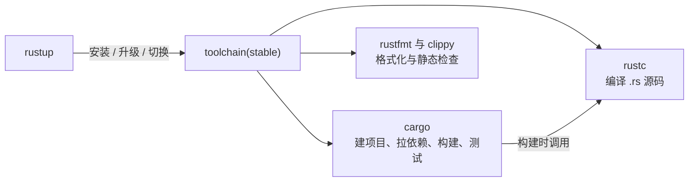

# Setup(环境搭建)

一句话:一条命令装好整套 Rust 环境——rustup 负责装工具链,cargo 负责建项目,装完即可编译运行第一个程序。

## 它解决什么问题

Rust 是编译型语言,动手前得先有一套能编译、能构建、能运行的环境。官方把这件事做成标准流程:一个安装器 rustup 装齐所有东西,不用手工找编译器、配链接器。

- rustup 是官方唯一的安装与版本管理入口,一条命令装好整套工具链;
- 工具链自带 rustc(编译器)与 cargo(包管理 + 构建工具),不必再单独安装任何东西;
- 默认安装 stable 工具链,之后用 rustup update 一条命令保持更新。

## 核心规则

rustup 只管「装什么版本」,工具链里的程序分工固定,cargo 站在最上层:



- rustup:工具链管理器,`rustup-init` 安装、`rustup update` 升级、`rustup self uninstall` 卸载;
- cargo:项目的一切入口,`cargo new` 建项目、`cargo build` 编译、`cargo run` 编译并运行;
- rustc:真正的编译器,由 cargo 在构建时调用,日常几乎不直接使用。

## 示例

以下命令按顺序执行(Windows,cmd)。

```cmd
:: 下载安装器,按默认配置安装(stable 工具链 + 常用组件,跳过交互)
curl -o rustup-init.exe https://win.rustup.rs/x86_64
rustup-init.exe -y --default-toolchain stable --profile default
```

默认装到 `%USERPROFILE%\.rustup`(工具链本体)与 `%USERPROFILE%\.cargo`(可执行文件),并把后者加入 PATH;若机器缺少 MSVC 组件,安装器会提示先装 Visual Studio C++ Build Tools。

```cmd
:: 重开一个终端,验证安装
rustc --version
cargo --version
rustup show
where rustc
```

三条 --version 各输出版本号即安装成功;`rustup show` 应显示当前工具链 `stable-x86_64-pc-windows-msvc`。

```cmd
:: 建一个 hello 项目并跑通
cargo new hello
cd hello
cargo run
```

`cargo run` 首次会先编译再运行,输出 `Hello, world!`;`src/main.rs` 放代码,`Cargo.toml` 记录项目名与依赖。

```cmd
:: 日常维护:更新工具链;想彻底移除则卸载
rustup update
rustup self uninstall
```

## 实践项

| 练习 | 内容 | 对照组与评判标准 |
|---|---|---|
| 装好工具链 | 按示例完成安装,新开终端跑通 rustc / cargo / rustup 三条 --version 与 rustup show | 对照 [The Rust Book ch1.1](https://doc.rust-lang.org/book/ch01-01-installation.html);标准:rustup show 显示 stable-x86_64-pc-windows-msvc,where rustc 指向 .cargo\bin |
| 第一个程序 | cargo new 一个 hello 项目,cargo run 看到 Hello, world! | 对照 [ch1.2 Hello, World!](https://doc.rust-lang.org/book/ch01-02-hello-world.html) 与 [ch1.3 Hello, Cargo!](https://doc.rust-lang.org/book/ch01-03-hello-cargo.html);标准:全程只用 cargo,不手写编译命令,能说出 Cargo.toml 与 src/main.rs 的分工 |

## 避坑

- MSVC 依赖:Windows 默认 host 工具链是 `x86_64-pc-windows-msvc`,链接阶段要用微软的 `link.exe`;报 `error: linker 'link.exe' not found` 就去装 Visual Studio C++ Build Tools,勾选「使用 C++ 的桌面开发」。
- PATH 未刷新:安装器写入的 PATH 只对新开的终端生效;旧终端报「cargo 不是内部或外部命令」时先重开终端,再确认 PATH 含 `%USERPROFILE%\.cargo\bin`。
- rustup 与 cargo 是两层:升级工具链用 `rustup update`(cargo 随工具链一起更新);`cargo install` 装的是第三方命令行工具,与工具链升级无关,别指望它升级 cargo 本身。

## 参考资料

- [The Rust Book ch1.1 Installation](https://doc.rust-lang.org/book/ch01-01-installation.html)
- [The Rust Book ch1.3 Hello, Cargo!](https://doc.rust-lang.org/book/ch01-03-hello-cargo.html)
- [rustup.rs](https://rustup.rs)
