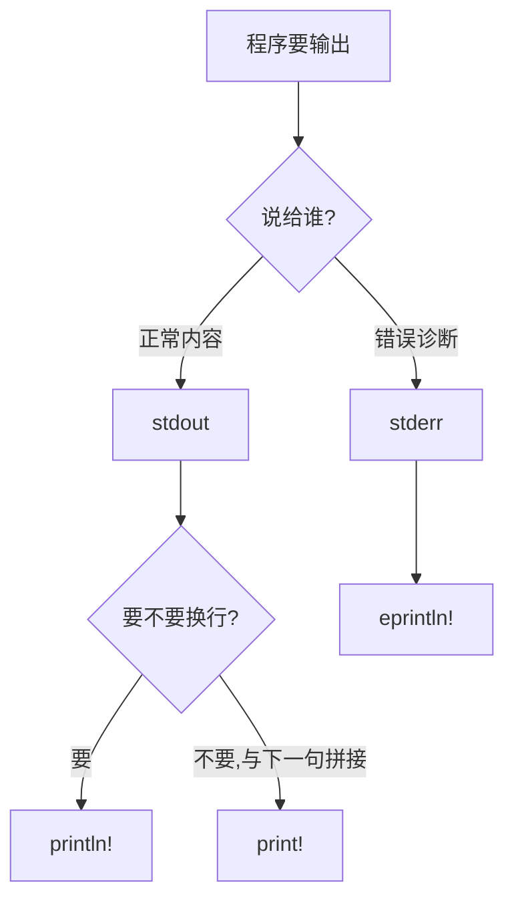

# Hello Cargo(你好 Cargo)

一句话:第一个 Rust 程序不该手敲 rustc——用 Cargo 创建工程、一条命令跑起来,顺便把打印用的 println! 宏玩明白。

## 它解决什么问题

任何语言的第一课都是让程序说话。Rust 里「说话」由宏 println! 完成:名字带 `!` 表示它是编译期展开的宏,不是函数,所以能接受任意个参数、任意格式。而真实项目从第一天起就该交给 Cargo 管:创建工程、声明依赖、编译、运行各有现成命令,不再手敲编译器。

本 crate 把 println! 的格式化能力一次摆全:Display/Debug、对齐、精度、进制、命名参数、stdout/stderr 分流、转义与原始字符串。后面所有 crate 的演示输出都靠这套本事,值得先吃透。

## 核心规则

三个输出宏按「说给谁 + 要不要换行」选:



- eprintln! 单独走 stderr 的价值:重定向 stdout 时(比如把正常输出写进日志),错误信息仍然落在屏幕上。
- 占位符 `{}` 走 Display 给人看;`{:?}` 走 Debug 给调试看,`{:#?}` 再加多行缩进美化——vec、元组这类类型只有 Debug 实现,用 `{}` 打印会直接编译错误。
- 占位符里可带指令:对齐 `> < ^` 配宽度,精度 `.2`,进制 `b o x X`,科学计数法 `e`,按需组合。
- 命名参数按名字对上:格式串写 `{name}`,实参传 `name = value`,不依赖位置顺序。

## 示例

摘自 `01-hello/src/main.rs`(节选,其余小节见下方解读):

```rust
fn main() {
    // --- 1. 最基础的 Hello World ---
    // println! 是宏（macro），不是函数，以 ! 结尾
    // 宏在编译时展开，比函数更灵活，可以接受可变参数
    println!("Hello, World!");

    // --- 2. 基本格式化 {} ---
    // {} 调用 Display trait，适合人类阅读的输出
    println!("{} 今年 {} 岁", "小明", 18);

    // --- 3. Debug 格式化 {:?} 和 {:#?} ---
    // {:?} 调用 Debug trait，单行输出
    // {:#?} 多行美化输出，带缩进，适合复杂结构
    let nums = vec![1, 2, 3]; // 这里用 vec 演示，后面 collections 会详讲
    println!("Debug 单行: {:?}", nums);
    println!("Debug 美化:\n{:#?}", nums);

    // ...(4-7 节:对齐、精度、进制、科学计数法,省略)

    // --- 8. 命名参数 ---
    // {name} 使用命名参数，比位置参数更清晰
    println!(
        "{name} 的成绩: 语文 {chinese}, 数学 {math}",
        name = "小红",
        chinese = 95,
        math = 98
    );

    // --- 9. print! vs println! vs eprintln! ---
    // print!   不换行输出到 stdout
    // println! 换行输出到 stdout
    // eprintln! 输出到 stderr（标准错误流），适合错误信息
    print!("这段文字");
    print!("不会自动换行");
    println!("；直到 println! 才换行");

    eprintln!("这条消息输出到 stderr（标准错误流）");

    // ...(10、12 节:转义字符、多行字符串,省略)

    // --- 11. 原始字符串 r"" ---
    // r"" 原始字符串，不处理转义
    println!(r"原始字符串: C:\Users\name 不需要转义");
}
```

## 源码解读

crate:`01-hello/src/main.rs`,`cargo run -p hello_demo` 可运行。

| 小节 | 演示什么 | 关键行 |
|---|---|---|
| Hello World | println! 以 `!` 结尾,编译期展开,可变参数 | `println!("Hello, World!")` |
| Display 与 Debug | `{}` 人读;`{:?}` 单行、`{:#?}` 多行美化 | `println!("{:?}", nums)` |
| 对齐与精度 | `> < ^` 配宽度,`.2/.4` 控小数位 | `println!("{:>10}", "right")` |
| 进制与科学计数法 | 255 按 b/o/x/X 输出,`{:e}` 科学计数法 | `println!("{:b}", n)` |
| 命名参数 | 占位符与实参按名字对应 | `println!("{name} 的成绩: ...")` |
| 三种输出宏 | print! 连拼两句不换行,println! 才收尾换行,eprintln! 另走 stderr | `print!("这段文字")` |
| 转义与原始字符串 | `\t \n \\ \"` 要转义;r"" 原样输出;字面量可跨行 | `println!(r"原始字符串: ...")` |

## 实践项

| 练习 | 内容 | 对照组与评判标准 |
|---|---|---|
| [Rustlings 00_intro](https://github.com/rust-lang/rustlings/tree/main/exercises/00_intro) | intro 系列:修复编译错误,跑通第一个程序 | 先自己写,再对照 [官方解答](https://github.com/rust-lang/rustlings/tree/main/solutions/00_intro);标准:全绿,且能说出宏与函数在写法上的区别 |
| [RBE Formatted print](https://doc.rust-lang.org/stable/rust-by-example/hello/print.html) | 跟示例练 Display/Debug/对齐/命名参数 | 对照组:不查资料写出右对齐宽 10、两位小数、命名参数各一例,输出符合预期 |
| [Book Hello, Cargo!](https://doc.rust-lang.org/book/ch01-03-hello-cargo.html) | 用 cargo 完成新建→运行→检查全流程 | 标准:`cargo new` 后 `cargo run` 打出 Hello, world!,`cargo check` 通过 |

## 避坑

- `!` 不能省:少写会被当成函数调用,报「找不到 println」类错误;宏与函数长得像,全靠 `!` 区分。
- `print!` 不换行,行缓冲下内容可能压在缓冲区里迟迟不显示;要立即看到就用 `println!`。
- 对没有 Display 实现的类型(元组、自定义结构体等)用 `{}` 会编译错误,提示改用 `{:?}`:给人看找 Display,给调试看找 Debug。

## 参考资料

- [The Rust Book ch1.2 Hello, World!](https://doc.rust-lang.org/book/ch01-02-hello-world.html)
- [The Rust Book ch1.3 Hello, Cargo!](https://doc.rust-lang.org/book/ch01-03-hello-cargo.html)
- [std::fmt 格式化文档](https://doc.rust-lang.org/std/fmt/)
