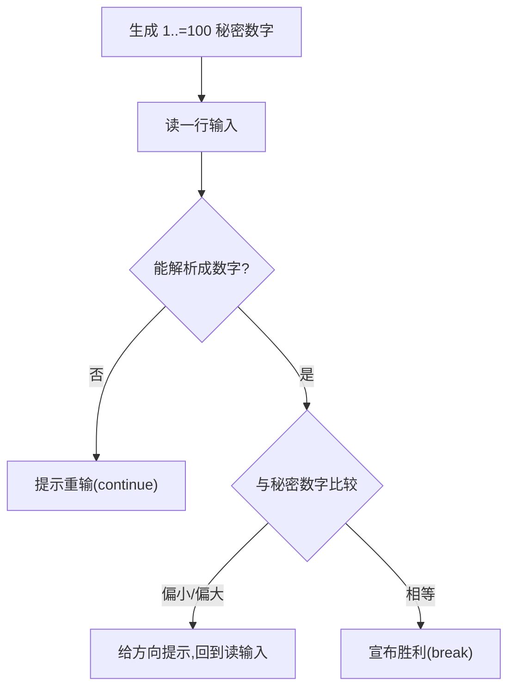

# Guessing Game(猜数字游戏)

一句话:第一个把输入、随机数、循环、错误处理串成一个完整可玩程序的练习,官方教程也拿它当第二章。

## 它解决什么问题

单个语法点好学,难的是串起来。猜数字每一轮做四件事:读一行用户输入、把字符串解析成数字、与秘密数字比较、按结果走三种分支之一,直到猜中才退出。这些都是真实程序的基础动作,一次练全。

它还顺带示范了 Rust 怎么接住外部世界的不确定性:输入可能不是数字、读取可能失败、比较只有三种结果——分别用 match 的 Err 分支、expect 和穷尽匹配处理。

## 核心规则

整个游戏是一根「循环 + 三处出口」的链:



- loop 没有条件,唯一出口是猜对后的 break;continue 把非法输入挡在门外,程序不崩。
- match 必须穷尽:Ordering 的三个变体少写一个直接编译失败;`Err(_)` 里的 `_` 表示不关心具体错误是什么。
- `gen_range` 是 rand 的 Rng trait 方法,必须先 `use rand::Rng` 才调得到——方法跟着 trait 走。

## 示例

摘自 `02-guessing-game/src/main.rs`(省略部分讲解注释):

```rust
use std::io;
use rand::Rng;
use std::cmp::Ordering;

fn main() {
    println!("=== 猜数字游戏 ===");
    println!("我已经想好了一个 1 到 100 之间的数字，来猜猜看！");

    // ...(thread_rng / gen_range 的讲解注释省略)
    let secret_number = rand::thread_rng().gen_range(1..=100);

    // loop 无限循环，直到 break 才退出
    loop {
        println!("\n请输入你猜的数字：");

        // mut 声明可变变量（Rust 默认不可变）
        let mut guess = String::new();

        io::stdin()
            .read_line(&mut guess)
            .expect("读取输入失败");

        // ...(trim / parse / Result 的讲解注释省略)
        let guess: u32 = match guess.trim().parse() {
            Ok(num) => num,           // 解析成功，取出数字
            Err(_) => {               // _ 通配所有错误
                println!("请输入有效的数字！");
                continue;             // 跳过本次循环，重新输入
            }
        };

        println!("你猜的是: {}", guess);

        // guess.cmp(&secret_number) 比较两个值，返回 Ordering
        // match 对 Ordering 的三个变体分别处理
        match guess.cmp(&secret_number) {
            Ordering::Less => println!("太小了！"),    // guess < secret
            Ordering::Greater => println!("太大了！"), // guess > secret
            Ordering::Equal => {                      // guess == secret
                println!("恭喜你猜对了！");
                break;                                // 猜对后退出循环
            }
        }
    }
}
```

## 源码解读

crate:`02-guessing-game/src/main.rs`,`cargo run -p guessing_game` 可运行。

| 小节 | 演示什么 | 关键行 |
|---|---|---|
| 导入依赖 | io 管输入,Rng 管随机,Ordering 管比较;trait 方法要先 use trait | `use rand::Rng` |
| 生成秘密数字 | thread_rng 取线程随机数生成器,gen_range 取闭区间 | `gen_range(1..=100)` |
| 读输入 | stdin 读一行进 String,expect 接住罕见的读失败 | `read_line(&mut guess)` |
| 解析与容错 | trim 去换行,parse 转 u32,Err 分支 continue 重输 | `guess.trim().parse()` |
| 比较与退出 | cmp 返回 Ordering,match 三分支,猜中 break | `guess.cmp(&secret_number)` |

## 实践项

| 练习 | 内容 | 对照组与评判标准 |
|---|---|---|
| [The Rust Book ch2](https://doc.rust-lang.org/book/ch02-00-guessing-game-tutorial.html) | 跟书从零做出同款游戏 | 标准:合上书能写出 loop+read_line+parse+cmp 主干,输入字母不崩溃 |
| [Exercism Rust track](https://exercism.org/tracks/rust) | 入门题巩固 Result 处理与循环 | 对照组:给游戏加「最多猜 5 次,超了提示失败并退出」,自己评判行为是否可预测 |

## 避坑

- read_line 用 expect、parse 用 match,不是随手为之:读输入失败几乎不可能,panic 可接受;用户输错是常态,必须走 Err 分支重新提示。
- 漏掉 `use rand::Rng` 时,报错说 ThreadRng 上没有 gen_range 方法,而不是「缺依赖」——方法定义在 trait 上,导入 trait 才看得见。
- `let guess: u32` 是有意遮蔽同名的 String 变量:类型从字符串换成数字,后续比较直接用;这不是笔误,删掉反而编译不过(类型不匹配)。

## 参考资料

- [The Rust Book ch2 Guessing Game Tutorial](https://doc.rust-lang.org/book/ch02-00-guessing-game-tutorial.html)
- [rand crate 文档](https://docs.rs/rand/latest/rand/)
