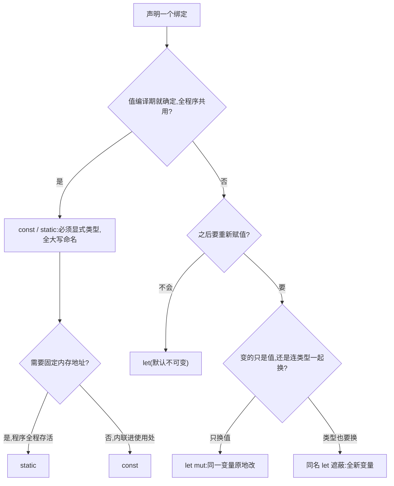

# Variables(变量)

一句话:Rust 默认不可变,要改必须显式写 mut——把「变」变成编译器和读者都看得见的显式动作。

## 它解决什么问题

大部分语言里 `x = 5; x = 6;` 天经地义,Rust 默认禁止——再赋值直接编译失败。理由是可变性是 bug 温床:一个值被到处改,你很难说清它现在是什么。

Rust 把默认反过来:不写 mut 就保证不变;真要改,一个 `mut` 同时告诉编译器和读者。全程序共享的固定值则由 const/static 接管,同样必须显式声明。

## 核心规则



- 默认不可变是给读者的承诺:绑定没有 mut,就可以放心假设它不变,编译器也据此帮你检查。
- 遮蔽的典型用途是转换后沿用旧名字,避免 z_str、z_num 这类凑数的命名。
- const 和 static 都只能用常量表达式初始化;static 默认不可变,可变 static 需要 unsafe。

## 示例

摘自 `03-variables/src/main.rs`:

```rust
const MAX_POINTS: u32 = 100_000;
static GREETING: &str = "Hello from static";

let x = 5;
println!("x = {}", x);
// x = 6;  // 编译错误！cannot assign twice to immutable variable

let mut y = 10;
y = 20; // mut 声明的变量可以重新赋值

let z = "42";       // z 是 &str 类型
let z: i32 = z.parse().unwrap(); // z 被 shadow 为 i32 类型
let z = z + 8;      // 继续遮蔽，类型不变
// ...(略)

let a = 5;          // 推导为 i32（默认整数类型）
let b: u64 = 5;     // 显式指定 u64
let c = 5u64;       // 字面量后缀指定类型

let _unused = 100;

let (p, q) = (1, 2);
```

## 源码解读

crate:`03-variables/src/main.rs`,`cargo run -p variables_demo` 可运行。

| 小节 | 演示什么 | 关键行 |
|---|---|---|
| 不可变变量 | 默认不可变,再赋值编译失败 | `let x = 5` |
| 可变变量 | mut 声明后可重新赋值 | `let mut y = 10` |
| 变量遮蔽 | 同名 let 建新变量,可换类型 | `let z: i32 = z.parse().unwrap()` |
| const 常量 | 编译期内联,必须显式类型和常量表达式 | `const MAX_POINTS: u32` |
| static 静态变量 | 固定内存地址,'static 生命周期 | `static GREETING: &str` |
| 类型标注 | 推断默认 i32,标注或字面量后缀可指定 | `let c = 5u64` |
| 未使用变量 | 下划线前缀消除未使用警告 | `let _unused = 100` |
| 解构赋值 | 元组模式一次拆出多个绑定 | `let (p, q) = (1, 2)` |

## 实践项

| 练习 | 内容 | 对照组与评判标准 |
|---|---|---|
| [Rustlings 01_variables](https://github.com/rust-lang/rustlings/tree/main/exercises/01_variables) | variables1~6:补类型标注、修不可变赋值、声明 const | 先自己写,再对照 [官方解答](https://github.com/rust-lang/rustlings/tree/main/solutions/01_variables);标准:全绿,且能说清 shadowing 和 mut 的区别 |
| [Exercism Rust track](https://exercism.org/tracks/rust) | 任意入门题,每个 let 先问「这个值会变吗」再决定要不要 mut | 标准:代码里没有多余的 mut,编译零警告 |

## 避坑

- 遮蔽不是 mut:遮蔽创建新变量所以能换类型,mut 是同一个变量、类型锁死;想让 mut 的变量换类型,编译器直接拒绝。
- const 必须显式标注类型,且只能用常量表达式初始化——`const X: u32 = some_fn();` 编译不过。
- `_unused` 只是消掉未使用警告,变量照样完整存在;模式里的 `_` 才是「不绑定值」。

## 参考资料

- [The Rust Book ch3.1 Variables and Mutability](https://doc.rust-lang.org/book/ch03-01-variables-and-mutability.html)
- [Rust By Example - Variable Bindings](https://doc.rust-lang.org/stable/rust-by-example/variable_bindings.html)
