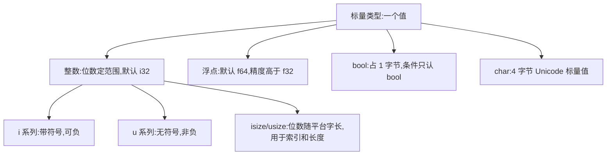
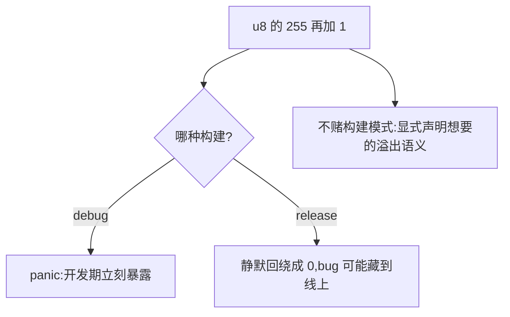

# Scalar Types(标量类型)

一句话:整数、浮点、bool、char 四种单值类型,位数明确、范围明确、溢出行为也明确。

## 它解决什么问题

数字、布尔、字符是所有代码的原料。Rust 把选择摆到台面上:每种整数都写明位数(i32 就是 32 位有符号),范围随之确定,越界了怎么办也有明确规则,而不是「看平台心情」。

代价是你要做更多显式决定——选类型、标注类型、处理溢出。换来的是跨平台行为一致,以及一大类「数字算着算着爆了」的 bug 在开发期就暴露。

## 核心规则





- isize/usize 只该用在索引、长度这类跟内存大小有关的场合;业务数字用定长类型。
- 四种显式溢出语义按业务选:计数回绕用 wrapping,可能溢出要检查用 checked,封顶用 saturating,既要结果又要标志位用 overflowing。
- 浮点遵循 IEEE 754:0.1 + 0.2 不等于 0.3,精确比较要用误差范围;金额类需求用整数(分)。

## 示例

摘自 `04-scalar-types/src/main.rs`:

```rust
let a: i8 = -128;           // i8 范围: -128 ~ 127
let b: u8 = 255;            // u8 范围: 0 ~ 255
let c: i32 = -100;          // i32 是默认整数类型
let f: usize = 42;          // usize 常用于数组索引和大小
// ...(略)

let hex = 0xff;          // 255
let bin = 0b1010;        // 10
let oct = 0o77;          // 63
let readable = 1_000_000; // 1000000
let byte_char = b'A';    // 65

let sum = 0.1 + 0.2;
println!("0.1 + 0.2 = {}", sum);     // 注意浮点精度问题：0.30000000000000004
// ...(略)

let letter: char = 'A';
let chinese = '中';
let emoji = '😀';
println!("'中' 的 Unicode 码点: {}", '中' as u32);

let max_u8: u8 = 255;
let wrapped = max_u8.wrapping_add(1);  // 结果 0
let checked = max_u8.checked_add(1);
let saturated = max_u8.saturating_add(1);
let (result, overflowed) = max_u8.overflowing_add(1);
```

## 源码解读

crate:`04-scalar-types/src/main.rs`,`cargo run -p scalar_types_demo` 可运行。

| 小节 | 演示什么 | 关键行 |
|---|---|---|
| 整数类型 | i/u 系列加 isize/usize,位数定范围 | `let a: i8 = -128` |
| 整数字面量 | 0x/0b/0o 前缀、下划线分隔、字节字面量 | `let byte_char = b'A'` |
| 浮点类型 | f32/f64,默认 f64;精度差异与 0.1+0.2 演示 | `let f64_val: f64 = 3.141592653589793` |
| bool | 逻辑与或非运算 | `let both = is_ready && is_done` |
| char | Unicode 标量值,4 字节,可存中文/emoji,可取码点 | `let emoji = '😀'` |
| 整数溢出 | 四种显式溢出语义逐一演示 | `max_u8.checked_add(1)` |

## 实践项

| 练习 | 内容 | 对照组与评判标准 |
|---|---|---|
| [Rustlings 04_primitive_types](https://github.com/rust-lang/rustlings/tree/main/exercises/04_primitive_types) | primitive_types1~6:bool/char/元组/数组,补类型标注 | 先自己写,再对照 [官方解答](https://github.com/rust-lang/rustlings/tree/main/solutions/04_primitive_types);标准:全绿,且能说出 u8 溢出在 debug 构建下的行为 |
| [Exercism Rust track](https://exercism.org/tracks/rust) | 任意入门题,整数题先确认推断出的类型再用 | 标准:没有依赖隐式转换的写法,编译零警告 |

## 避坑

- `0.1 + 0.2 == 0.3` 是 false;浮点比较要么用误差范围,要么换成整数运算。
- 条件表达式只认 bool:`if 1 {}` 编译不过,写 `if x != 0`——Rust 没有真值转换。
- char 占 4 字节而不是 1 字节;字符串里的「字符」也不等于 char,深入见 03-所有权系统的切片类型一文。

## 参考资料

- [The Rust Book ch3.2 Data Types](https://doc.rust-lang.org/book/ch03-02-data-types.html)
- [Rust By Example - Primitives](https://doc.rust-lang.org/stable/rust-by-example/primitives.html)
- 本地旧笔记:`D:\Myknows\Myknows\原理\Rust\02-核心语法\02-标量类型.md`(与本文持续同步)
