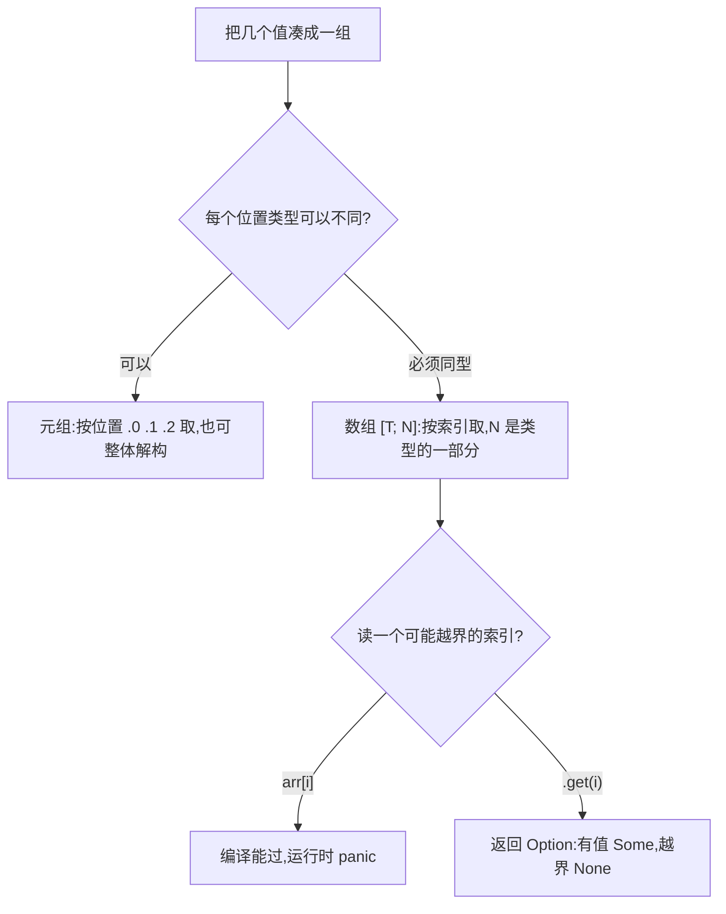

# Compound Types(复合类型)

一句话:元组把不同类型的值按位置打包,数组把同类型的值按索引排队,两者长度都在编译期定死。

## 它解决什么问题

坐标 (x, y)、RGB 三元组、固定大小的缓冲区——不必为它们各写一个 struct,Rust 提供两个现成的打包工具:元组和数组。

分界线有两条:类型要不要一致、长度会不会变。长度可变是另一个话题(Vec,后续主题),这里先把定长组合用熟——函数返回多个值、遍历固定序列都靠它们。

## 核心规则



- 元组没有名字,靠位置说话:适合临时组合,字段一多就该升级成 struct。
- 解构按模式拆值,`_` 占住不关心的位置;数组主要用法是遍历。
- `()` 是零成员元组,叫单元类型:函数没有返回值标注时,隐式返回的就是它。

## 示例

摘自 `05-compound-types/src/main.rs`:

```rust
let tup: (i32, f64, char) = (500, 6.4, 'A');
// 访问元组元素：用 .0 .1 .2 索引（从 0 开始）
println!("元组第 0 个: {}", tup.0);

let (a, b, c) = tup;
// 部分解构：用 _ 忽略不需要的
let (_, float_val, _) = tup;

// 函数没有返回值时隐式返回 ()
let unit: () = ();

// 数组：相同类型，长度固定，栈上分配
let arr: [i32; 5] = [1, 2, 3, 4, 5];

let zeros = [0; 5];   // 5 个 0

let safe = arr.get(10);
println!("arr.get(10) = {:?}", safe);    // None

let matrix: [[i32; 3]; 2] = [
    [1, 2, 3],
    [4, 5, 6],
];
println!("matrix[1][2] = {}", matrix[1][2]);  // 6
```

## 源码解读

crate:`05-compound-types/src/main.rs`,`cargo run -p compound_types_demo` 可运行。

| 小节 | 演示什么 | 关键行 |
|---|---|---|
| 元组与索引 | 不同类型按位置打包,.0 .1 .2 访问 | `let tup: (i32, f64, char)` |
| 元组解构 | 整体拆成变量,_ 忽略位置 | `let (_, float_val, _) = tup` |
| 单元类型 | 空元组 (),无返回值函数的隐式返回 | `let unit: () = ()` |
| 数组与初始化 | [T; N] 类型、[值; 数量] 重复初始化 | `let zeros = [0; 5]` |
| 数组遍历 | iter()、&arr、索引三种遍历 | `for x in &arr` |
| 越界与安全访问 | 中括号越界 panic,get 返回 Option | `arr.get(10)` |
| 多维数组 | 数组的数组,类型写作 [[T; 列数]; 行数] | `let matrix: [[i32; 3]; 2]` |

## 实践项

| 练习 | 内容 | 对照组与评判标准 |
|---|---|---|
| [Rustlings 04_primitive_types](https://github.com/rust-lang/rustlings/tree/main/exercises/04_primitive_types) | primitive_types3~6:数组、元组与切片,补标注和解构 | 先自己写,再对照 [官方解答](https://github.com/rust-lang/rustlings/tree/main/solutions/04_primitive_types);标准:全绿,且能用 .get() 解释越界为什么不 panic |
| [Exercism Rust track](https://exercism.org/tracks/rust) | 任意入门题,函数要返回多个值时用元组 | 标准:函数签名出现 `(T, T)` 返回值且编译通过 |

## 避坑

- `arr[10]` 这类越界编译器拦不住(索引可以运行时算出),安全读取用 `.get()` 拿 Option 再处理。
- `(5)` 是括号包着的 5,不是元组;单元素元组必须写 `(5,)`。
- 长度是数组类型的一部分:`[i32; 5]` 和 `[i32; 6]` 是两个类型;运行期要变长,换 Vec。

## 参考资料

- [The Rust Book ch3.2 Data Types](https://doc.rust-lang.org/book/ch03-02-data-types.html)
- [Rust By Example - Primitives](https://doc.rust-lang.org/stable/rust-by-example/primitives.html)
