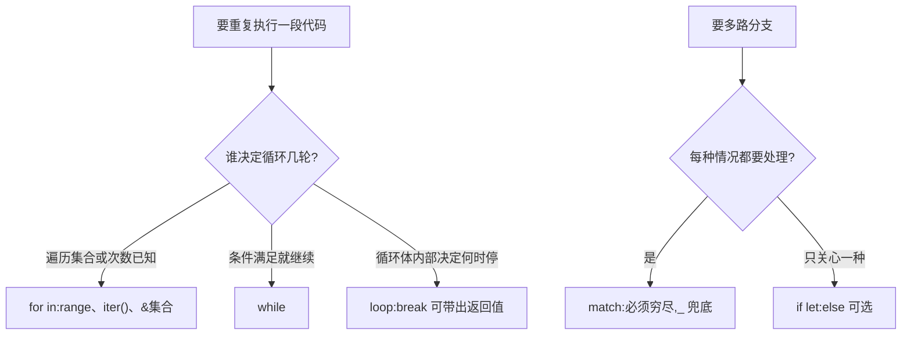

# Control Flow(控制流)

一句话:if、loop、while、for、match 五种控制结构,条件必须是 bool,而且 if/loop/match 都是表达式,可以直接产出值。

## 它解决什么问题

程序要分支和循环。Rust 的条件没有隐式转换(`if 1` 编译不过);循环家族按「谁决定退出」分工:for 数着数走,while 盯着条件走,loop 由循环体自己决定,break 还能把结果带出来。

match 把「多分支」升级成「模式匹配」:必须穷尽所有情况,漏一个编译失败。本章只打底,枚举配套的完整 match 见后续模式匹配主题。

## 核心规则



- if/loop/match 都是表达式:if 的分支类型必须一致,loop 靠 `break 值` 交出结果,match 取每个分支的值——所以它们都能直接写在 let 右边。
- if 只处理两路,需要穷尽的多路换 match;只关心一种情况时 if let 最省事。

## 示例

摘自 `07-control-flow/src/main.rs`:

```rust
let condition = true;
let result = if condition { 5 } else { 6 };

let mut count = 0;
let loop_result = loop {
    count += 1;
    if count == 5 {
        break count * 2;  // break 带返回值
    }
};

let mut countdown = 3;
while countdown > 0 {
    println!("倒计时: {}", countdown);
    countdown -= 1;
}

for i in 1..=5 { print!("{} ", i); }

let fruits = vec!["apple", "banana", "cherry"];
for fruit in &fruits { print!("{} ", fruit); }  // & 借用，不消费 fruits

let coin = 25;
let coin_name = match coin {
    1 => "一分",
    5 => "五分",
    10 => "一角",
    25 => "两角五",
    50 => "五角",
    _ => "未知面值",
};

let some_value: Option<i32> = Some(42);
if let Some(val) = some_value {
    println!("if let: 值是 {}", val);
}
```

## 源码解读

crate:`07-control-flow/src/main.rs`,`cargo run -p control_flow_demo` 可运行。

| 小节 | 演示什么 | 关键行 |
|---|---|---|
| if / else | 条件必须是 bool,不自动转换 | `if number % 4 == 0` |
| if 表达式 | 分支可返回值,类型必须一致 | `let result = if condition { 5 } else { 6 }` |
| loop | break 带值返回,continue 跳过本轮 | `break count * 2` |
| while | 条件为 false 即退出 | `while countdown > 0` |
| for in | range/数组/Vec 借用遍历,rev() 反转 | `for fruit in &fruits` |
| match | 穷尽所有可能,_ 通配兜底 | `_ => "未知面值"` |
| if let | 只关心一种模式时替代 match,else 可选 | `if let Some(val) = some_value` |

## 实践项

| 练习 | 内容 | 对照组与评判标准 |
|---|---|---|
| [Rustlings 03_if](https://github.com/rust-lang/rustlings/tree/main/exercises/03_if) | if 练习:条件分支、if 作为表达式 | 先自己写,再对照 [官方解答](https://github.com/rust-lang/rustlings/tree/main/solutions/03_if);标准:全绿,且能说出 match 漏分支时编译器会怎么报错 |
| [Exercism Rust track](https://exercism.org/tracks/rust) | 任意入门题,能数出轮次的循环一律用 for | 标准:不出现裸 loop,除非真的需要 break 带值 |

## 避坑

- 条件必须是 bool:`if x {}` 对整数编译不过,显式写 `if x != 0`。
- `1..5` 不含 5,`1..=5` 才含;少个等号循环就少跑一轮,而且不报错。
- match 漏分支编译失败;`_` 是显式的「其余不管」,别拿它掩盖本该处理的分支。

## 参考资料

- [The Rust Book ch3.5 Control Flow](https://doc.rust-lang.org/book/ch03-05-control-flow.html)
- [Rust By Example - loop](https://doc.rust-lang.org/stable/rust-by-example/flow_control/loop.html)
- [Rust By Example - match](https://doc.rust-lang.org/stable/rust-by-example/flow_control/match.html)
- [Rust By Example - for](https://doc.rust-lang.org/stable/rust-by-example/flow_control/for.html)
- 本地旧笔记:`D:\Myknows\Myknows\原理\Rust\02-核心语法\05-控制流.md`(与本文持续同步)
