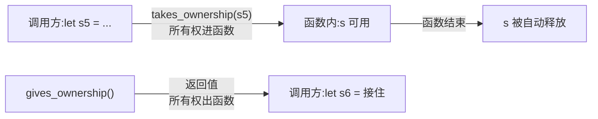

# Ownership(所有权)

一句话:Rust 让每个值都有唯一的主人,主人离开作用域值就被释放——内存安全不靠垃圾回收,靠编译器记账。

## 它解决什么问题

C/C++ 手动管内存:忘释放就泄漏,提前释放就悬垂指针;带 GC 的语言有运行时开销、延迟不可控。所有权把「什么时候释放」变成编译期可判定的规则:

- 每个值有且仅有一个所有者;
- 所有者离开作用域,值自动释放;
- 赋值/传参默认转移所有权,原变量失效——从根上杜绝两个指针同时管一块内存。

## 核心规则

赋值/传参时,同一个值有三种归宿:**移动**(所有权转移,原变量失效)、**克隆**(深拷贝,双方有效)、**复制**(Copy 类型按位复制,双方有效)。

跨函数时所有权随参数和返回值流动:



## 示例

摘自 `08-ownership/src/main.rs`:

```rust
let s1 = String::from("hello");
let s2 = s1;              // 移动:s1 失效
// println!("s1 = {}", s1);  // 编译错误:value borrowed here after move

let s3 = String::from("world");
let s4 = s3.clone();      // 深拷贝:s3 仍有效

let x = 42;
let y = x;                // i32 是 Copy:x 仍有效
```

## 源码解读

crate:`08-ownership/src/main.rs`,`cargo run -p ownership_demo` 可运行。

| 小节 | 演示什么 | 关键行 |
|---|---|---|
| 栈 vs 堆 | String 三件套(指针/长度/容量)存栈,内容存堆 | `let s1 = String::from("hello")` |
| 移动语义 | 赋值转移所有权,被注释的行取消即编译失败 | `let s2 = s1` |
| Clone | 显式深拷贝,原变量仍有效 | `let s4 = s3.clone()` |
| Copy | 纯栈类型赋值即复制 | `let y = x` |
| 函数转移 | 传参 move 进函数,返回值 move 出函数 | `takes_ownership(s5)`、`gives_ownership()` |

## 实践项

| 练习 | 内容 | 对照组与评判标准 |
|---|---|---|
| [Rustlings 06_move_semantics](https://github.com/rust-lang/rustlings/tree/main/exercises/06_move_semantics) | move_semantics1~5,修编译错误体会移动 | 做完再对照 [官方解答](https://github.com/rust-lang/rustlings/tree/main/solutions/06_move_semantics);标准:rustlings 全绿,且每题能说出「为什么原来错」 |
| [Exercism Rust track](https://exercism.org/tracks/rust) | 按解锁顺序做入门题 | 做完回读本文「核心规则」,能不看书复述三条 |

## 避坑

- move 之后原变量不能再用,编译器直接拒绝;想继续用,要么 clone,要么改用借用(下一章)。
- 不是所有赋值都是移动:i32、f64、bool、char、纯 Copy 元组/数组这类栈上类型赋值即复制;含堆数据的类型(String、Vec)默认移动。
- clone 是深拷贝但昂贵:别为绕过编译错误无脑 clone,先用借用重构。

## 参考资料

- [The Rust Book ch4.1 What is Ownership?](https://doc.rust-lang.org/book/ch04-01-what-is-ownership.html)
- [Rust By Example - Move semantics](https://doc.rust-lang.org/stable/rust-by-example/scope/move.html)
