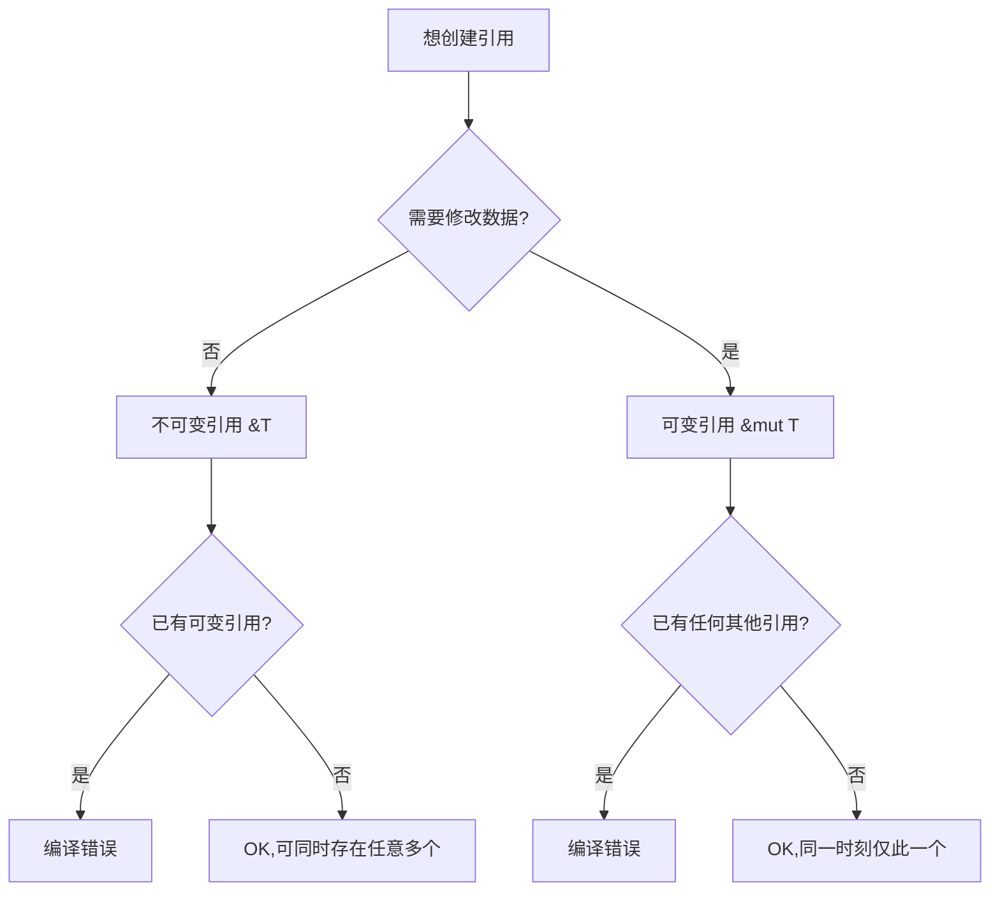

# Borrowing(借用)

一句话:移动太霸道,借用来补台——用引用临时使用数据,用完归还,所有权不动。

## 它解决什么问题

按所有权规则,每次把 String 传给函数都会失去所有权,想继续用就得传回来,很快没人受得了。借用解决「只想用一下」的场景:

- 创建引用不获取所有权,函数用完不释放任何数据;
- 引用分两种:不可变引用 `&T`(只读)、可变引用 `&mut T`(可写);
- 编译器(borrow checker)在编译期强制下面两条规则,违规直接编译失败。

## 核心规则

同一时刻:要么任意多个不可变引用,要么恰好一个可变引用,二者不可共存。



这条规则的本质:防止数据竞争。多个读者共享只读数据是安全的;但只要有写者,就只允许它一个在场。

## 示例

摘自 `09-references/src/main.rs`:

```rust
let s1 = String::from("hello");
let len = calculate_length(&s1);   // 借用,不转移所有权
println!("'{}' 的长度是 {}", s1, len); // s1 仍可用

let r1 = &s1;
let r2 = &s1;                      // 多个不可变引用共存:OK

let mut s2 = String::from("hi");
change(&mut s2);                   // 可变引用,函数内可修改
```

## 源码解读

crate:`09-references/src/main.rs`,`cargo run -p references_demo` 可运行。

| 小节 | 演示什么 | 关键行 |
|---|---|---|
| 不可变引用 | 借用不转移,借用后原变量可用;多个只读引用共存 | `calculate_length(&s1)`、`let r1 = &s1` |
| 可变引用 | 函数内修改被借数据;同一时刻只能有一个 | `change(&mut s2)` |
| NLL 切换 | 上一个引用最后一次使用后即可再借 | `let r4 = &mut s3` |
| 读写冲突 | 不可变借用未用完前可变借用被拒 | 注释掉的 `let r6 = &mut s4` |
| 悬垂引用 | 返回局部变量引用会被拒,正确做法是返回 String | `no_dangle()` |

## 实践项

| 练习 | 内容 | 对照组与评判标准 |
|---|---|---|
| [Rustlings 06_move_semantics](https://github.com/rust-lang/rustlings/tree/main/exercises/06_move_semantics) | move_semantics3~5:用借用/可变引用修错误 | 先自己写,再对照 [官方解答](https://github.com/rust-lang/rustlings/tree/main/solutions/06_move_semantics);标准:全绿,且能解释「什么时候必须 &mut」 |
| [Exercism Rust track](https://exercism.org/tracks/rust) | 任意入门题,尝试用引用减少 clone | 标准:代码里 `.clone()` 数量比第一版少,且编译通过 |

## 避坑

- 引用的有效范围到「最后一次使用」为止,不是块结束(NLL):前面例子中不可变引用用完就能再可变借用,这是合法的。
- 返回引用必须指向活得比函数久的数据;拿不准就返回 String 交出所有权,编译器会拦下所有悬垂引用。
- 参数类型写 `&str` 而不是 `&String`,更通用(原因见下一章切片)。

## 参考资料

- [The Rust Book ch4.2 References and Borrowing](https://doc.rust-lang.org/book/ch04-02-references-and-borrowing.html)
- [Rust By Example - Mutability](https://doc.rust-lang.org/stable/rust-by-example/scope/borrow/mut.html)
