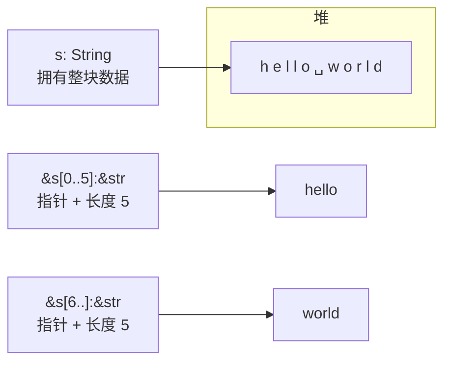

# Slice(切片)

一句话:切片是对集合中一段连续元素的引用视图——只借一段,不拥有任何东西。

## 它解决什么问题

「取第一个单词」这种需求,只需要数据的局部,拿走整个 String 的所有权太重,传索引又危险(索引可能比数据活得久)。切片给出第三种选择:指针 + 长度,指向原数据的一段,类型天然安全:

- 字符串切片 `&str`:指向 String/字面量的一段连续字节;
- 数组切片 `&[T]`:指向数组/Vec 的一段连续元素;
- 切片不持有所有权,原数据的所有者照常管理内存。

## 核心规则



三个要点:

- 简写形式:`&s[..2]` 从头切、`&s[2..]` 切到尾、`&s[..]` 整段;
- 字符串字面量本身就是 `&str`(`&'static str`),直接嵌入二进制;
- 函数参数写 `&str` 比 `&String` 通用:`&String` 会经 deref coercion 自动转成 `&str`,字面量也能直接传入。

## 示例

摘自 `10-slices/src/main.rs`:

```rust
let s = String::from("hello world");
let hello = &s[..5];        // "hello"
let world = &s[6..];        // "world"

let literal: &str = "I am a &str"; // 字面量就是 &str

let arr = [1, 2, 3, 4, 5];
let arr_slice = &arr[1..3]; // [2, 3]

fn first_word(s: &str) -> &str { /* 找空格,返回前缀切片 */ }
let word = first_word(&s);         // &String 自动转 &str
let literal_word = first_word("rust"); // 字面量直接传
```

## 源码解读

crate:`10-slices/src/main.rs`,`cargo run -p slices_demo` 可运行。

| 小节 | 演示什么 | 关键行 |
|---|---|---|
| 字符串切片 | 按字节索引取子串 | `&s[0..5]` |
| 切片简写 | 三种省略写法 | `&s[..5]`、`&s[6..]`、`&s[..]` |
| 字面量即 &str | 字面量类型是 `&'static str` | `let literal: &str = ...` |
| 数组切片 | `&[T]` 引用数组一段元素,不拥有 | `&arr[1..3]` |
| 参数通用化 | `&str` 参数兼容 &String 与字面量 | `first_word(&s)`、`first_word("rust")` |
| 数组切片作参数 | `&[T]` 入参接收任意长度视图 | `slice_sum(&arr[..])` |

## 实践项

| 练习 | 内容 | 对照组与评判标准 |
|---|---|---|
| [Rustlings 09_strings](https://github.com/rust-lang/rustlings/tree/main/exercises/09_strings) | strings1~4:在 String 与 &str 之间正确转换 | 先自己写,再对照 [官方解答](https://github.com/rust-lang/rustlings/tree/main/solutions/09_strings);标准:全绿,且能说清每处该用 String 还是 &str |
| [Exercism Rust track](https://exercism.org/tracks/rust) | 任意涉及文本处理的题 | 标准:函数签名全部用 `&str` 入参,不出现 `&String` |

## 避坑

- 切片按字节索引,不是按字符:中文一个字占 3 字节,`&"你好"[0..1]` 直接 panic;非 ASCII 文本用 `chars()` 处理。
- 字面量就是 `&'static str`,和 String 是两种类型;`String` 是拥有的数据,`&str` 是借用的视图。
- 越界切片(如 `&s[..100]`)在运行时 panic;长度越界是逻辑错误,编译器不帮你查。

## 参考资料

- [The Rust Book ch4.3 The Slice Type](https://doc.rust-lang.org/book/ch04-03-slices.html)
