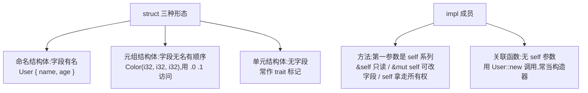

# Structs(结构体)

一句话:把一组相关数据打包成一个命名类型,再用 impl 把操作挂到类型上,让数据和行为住在一起。

## 它解决什么问题

散落的变量(名字、年龄、状态)传参时容易漏、容易传错顺序。结构体把这些字段打包成一个类型,编译器替你检查「字段是否存在、类型是否匹配」。

`impl` 块再把操作这些字段的函数挂到类型上:调用写成 `user1.greeting()`,而不是 `greeting(&user1)`,数据与行为的归属一目了然。

## 核心规则

三种结构体形态对应三种数据形状,impl 成员按有没有 self 参数分两类:



- 元组结构体适合「给一组同构值起类型名」:即使内部类型完全相同,`Color` 和 `Point` 也是不同类型。
- 方法用 `.` 调用,关联函数用 `::` 调用,区别只在有没有 self 参数。
- `self`(不带 &)与函数传值规则一致:实例被 move 走,调用后不能再使用。

## 示例

摘自 `12-structs/src/main.rs`:

```rust
struct User {
    name: String,
    age: u32,
    active: bool,
}

struct Color(i32, i32, i32);
struct AlwaysEqual;

impl User {
    // 关联函数（无 self）：类似构造器，用 User::new 调用
    fn new(name: String, age: u32) -> Self {
        Self { name, age, active: true } // 字段简写：name 变量名与字段名相同
    }

    // 方法 &self：只读访问
    fn greeting(&self) -> String {
        let status = if self.active { "活跃" } else { "停用" };
        format!("Hi, I'm {}, age {}, status={}", self.name, self.age, status)
    }

    // 方法 &mut self：可变修改
    fn birthday(&mut self) {
        self.age += 1;
    }

    // 方法 self（不是引用）：获取所有权，调用后实例被消耗
    fn into_name(self) -> String {
        self.name
    }
}
// ...(省略: 第二个 impl 块的 is_adult, 见下表)

// ---- main() 节选 ----
// 字段简写：当变量名与字段名相同时
let name = String::from("Bob");
let age = 25;
let user2 = User { name, age, active: false };

// ---- 关联函数调用：类似构造器 ----
let user3 = User::new(String::from("Carol"), 17);

// ---- &mut self 方法 ----
let mut user4 = User::new(String::from("Dave"), 20);
user4.birthday();

// ---- 元组结构体 ----
let red = Color(255, 0, 0);
println!("RGB = ({}, {}, {})", red.0, red.1, red.2);

// ---- 单元结构体 ----
let _marker = AlwaysEqual; // 常用于类型层面占位

// ---- self 方法（消耗实例）----
let user5 = User::new(String::from("Eve"), 40);
let name = user5.into_name(); // user5 被消耗
```

## 源码解读

crate:`12-structs/src/main.rs`,`cargo run -p structs_demo` 可运行。

| 小节 | 演示什么 | 关键行 |
|---|---|---|
| 命名结构体实例化 | 字段逐个赋值,方法用 `.` 调用 | `user1.greeting()` |
| 字段简写 | 变量名与字段名相同时省去重复 | `User { name, age, active: false }` |
| 关联函数 | 无 self 的构造器,`::` 调用 | `User::new(String::from("Carol"), 17)` |
| &mut self 方法 | 就地修改字段,实例需 let mut | `user4.birthday()` |
| 元组结构体 | 字段无名有顺序,按位置访问 | `red.0`、`red.1`、`red.2` |
| 单元结构体 | 无字段,类型层面占位 | `let _marker = AlwaysEqual` |
| self 方法 | 拿走所有权,实例被消耗 | `user5.into_name()` |
| 多个 impl 块 | 同一类型可分散实现 | `user6.is_adult()` |

## 实践项

| 练习 | 内容 | 对照组与评判标准 |
|---|---|---|
| [Rustlings 07_structs](https://github.com/rust-lang/rustlings/tree/main/exercises/07_structs) | structs1~3:补结构体定义、元组结构体与方法 | 先自己写,再对照 [官方解答](https://github.com/rust-lang/rustlings/tree/main/solutions/07_structs);标准:全绿,能说清 `User::new` 与 `user.greeting()` 的调用差异 |
| [Exercism Rust track](https://exercism.org/tracks/rust) | 任意含自定义数据的题,为类型补 impl 块 | 标准:构造逻辑收敛到一个关联函数,字段访问不再散落在函数之间 |

## 避坑

- `&mut self` 方法要求实例本身 `let mut`:改的是实例,不是方法,少写 mut 直接编译失败。
- `self` 方法调用后实例被 move,再用就编译错误;只想读数据就用 `&self`。
- 可变性是整个实例级别的:不能只把某个字段声明成 mut。

## 参考资料

- [The Rust Book ch5.1 Defining Structs](https://doc.rust-lang.org/book/ch05-01-defining-structs.html)
- [The Rust Book ch5.3 Method Syntax](https://doc.rust-lang.org/book/ch05-03-method-syntax.html)
- [Rust By Example - Structs](https://doc.rust-lang.org/stable/rust-by-example/custom_types/structs.html)
