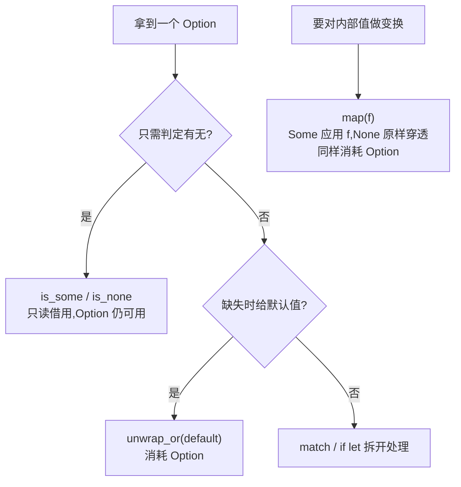

# Enum(枚举与Option)

一句话:一个值只有几种确定的可能、每种可能还能带自己的数据——枚举把可能列成类型,Option 再用同一思路消灭 null。

## 它解决什么问题

「IP 是 v4 还是 v6」「消息是退出还是移动」这类状态,用 bool 标志或裸字符串表示时,非法组合编译器发现不了。枚举把所有合法可能写进类型定义,一个值只能是列出的变体之一。

`Option<T>` 是这个思路的极致:Rust 没有 null,「可能有值」被建模成 `Some(值)` / `None` 两个变体。`Option<i32>` 和 `i32` 是不同类型,想用里面的值必须先拆包——「忘了判空」这类 bug 从语言层面消失。

## 核心规则

拿到 Option 后按需求选方法,关键差别在「是否消耗值」:



- 变体可以携带三种形态的数据:无数据、命名字段(结构体式)、按位置(元组式),一个枚举里可混用。
- `unwrap` 有值返回值、None 直接 panic,生产代码慎用;拿不准就用 match 显式处理两个分支。
- `unwrap_or` / `map` 会消耗 Option(move 走内部值),同一个变量不能连着调用两次消耗型方法——源码里每个方法用独立变量演示,就是这个原因。

## 示例

摘自 `13-enums/src/main.rs`:

```rust
enum Message {
    Quit,                       // 类单元变体：无数据
    Move { x: i32, y: i32 },    // 结构体变体：命名字段
    Write(String),              // 元组变体：单值
    ChangeColor(i32, i32, i32), // 元组变体：多值
}
// ...(省略: IpAddrKind / IpAddr 带值枚举, 见下表)

// ---- Option<T>：Rust 没有 null，用 Option 表示可能缺失 ----
let some_num: Option<i32> = Some(42);
let no_num: Option<i32> = None;

// is_some / is_none：判断是否有值（只读借用，不消耗 Option）
println!("some_num.is_some() = {}", some_num.is_some());
println!("no_num.is_none() = {}", no_num.is_none());

// unwrap：有值返回值，无值 panic（生产代码慎用）
let value = some_num.unwrap();
println!("some_num.unwrap() = {}", value);

// unwrap_or：无值时返回默认值（消耗 Option）
let fallback = no_num.unwrap_or(0);
println!("no_num.unwrap_or(0) = {}", fallback);

// map：对内部的值做变换，Some 时应用函数，None 时保持 None
let doubled = Some(42).map(|x| x * 2);
println!("Some(42).map(|x| x*2) = {:?}", doubled);
```

## 源码解读

crate:`13-enums/src/main.rs`,`cargo run -p enums_demo` 可运行。

| 小节 | 演示什么 | 关键行 |
|---|---|---|
| 简单枚举 | 无数据变体,match 分支决定输出 | `print_ip_kind(kind4)` |
| 带值枚举 | 变体携带数据,match 模式解出内部值 | `print_ip_addr(home)` |
| 混合变体 | 单元/结构体/元组三种变体共存 | `describe_message(m)` |
| Option 基础 | Some 表示有值,None 表示缺失 | `let no_num: Option<i32> = None` |
| 只读判定 | is_some/is_none 不消耗 Option | `no_num.is_none()` |
| unwrap | 有值取出,None panic | `some_num.unwrap()` |
| unwrap_or | None 时回退默认值 | `no_num.unwrap_or(0)` |
| map | Some 应用函数,None 穿透 | `Some(42).map(\|x\| x * 2)` |

## 实践项

| 练习 | 内容 | 对照组与评判标准 |
|---|---|---|
| [Rustlings 08_enums](https://github.com/rust-lang/rustlings/tree/main/exercises/08_enums) | enums1~3:补全枚举定义,用 match 处理全部变体 | 先自己写,再对照 [官方解答](https://github.com/rust-lang/rustlings/tree/main/solutions/08_enums);标准:全绿,match 覆盖所有变体无遗漏 |
| [Exercism Rust track](https://exercism.org/tracks/rust) | 任意「结果可能缺失」的题,返回类型用 Option | 标准:调用侧用 unwrap_or 或 match 消费,全程不依赖 unwrap |

## 避坑

- `unwrap_or` / `map` 消耗 Option:同一个变量连用两次消耗型方法会报 move 错误;只想读就先 `as_ref()` 再操作。
- `let n = None;` 编译不过:None 不带类型信息,必须标注 `Option<i32>` 之类的具体类型。
- `Option<i32>` 不能直接当 i32 参与运算——它是独立类型,先拆包再算。

## 参考资料

- [The Rust Book ch6 Enums](https://doc.rust-lang.org/book/ch06-00-enums.html)
- [The Rust Book ch6.1 Defining an Enum](https://doc.rust-lang.org/book/ch06-01-defining-an-enum.html)
- [Rust By Example - Option](https://doc.rust-lang.org/stable/rust-by-example/std/option.html)
