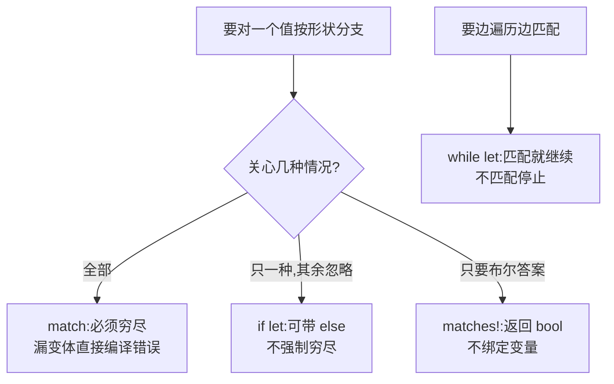

# Match(模式匹配)

一句话:match 把「值长什么样」写成可检查的模式,匹配中就绑定内部数据,而且编译器保证所有可能都被处理。

## 它解决什么问题

if-else 链判断枚举变体又长又容易漏分支,漏了编译器也不提醒。match 是为解构而生的表达式:每个分支是「模式 => 结果」,模式一步完成「判断形状」和「取出内部数据」两件事。

更关键的是穷尽性检查:枚举有 4 个变体,match 就必须覆盖 4 个。以后给枚举加一个变体,所有没更新的 match 全部编译报错——重构时编译器替你找出每一处遗漏。

## 核心规则

选哪种匹配手段,取决于你关心几种结果:



- 模式不只是常量:`Some(v)`、`Move { x, y }`、`[first, .., last]` 都能一步解构并绑定名字,`..` 忽略中间元素。
- match 是表达式,每个分支返回同一类型,可以直接 `let cents = match coin { ... };`。
- 解构会 move 非 Copy 类型:`let User { name, age } = user;` 之后 user 不能再整体使用;只想借用就匹配引用。

## 示例

摘自 `14-pattern-matching/src/main.rs`:

```rust
// ---- match 表达式：必须穷尽 ----
let coin = 25;
let cents = match coin {
    1 => "一分",
    5 => "五分",
    10 => "一角",
    25 => "两角五",
    _ => "未知面值", // 通配符：处理剩余所有情况，保证穷尽
};
println!("硬币面值: {}", cents);

// ---- 解构结构体 ----
let user = User {
    name: String::from("Alice"),
    age: 30,
};
let User { name, age } = user; // 字段名必须一致

// ...(解构元组省略, 见下表)

// ---- 解构数组 ----
let arr = [1, 2, 3, 4, 5];
let [first, second, .., last] = arr; // .. 忽略中间元素

// ---- if let：只关心一种情况时的简写 ----
let some_value: Option<i32> = Some(42);
if let Some(v) = some_value {
    println!("if let 捕获到: {}", v);
} else {
    println!("None");
}

// ---- while let：循环中匹配，直到不匹配为止 ----
let mut stack = vec![1, 2, 3];
while let Some(top) = stack.pop() {
    println!("while let 弹出: {}", top);
}

// ---- matches! 宏：返回布尔值，简写单个模式判定 ----
let opt: Option<i32> = Some(5);
if matches!(opt, Some(_)) {
    println!("matches! 判定 opt 是 Some");
}
```

## 源码解读

crate:`14-pattern-matching/src/main.rs`,`cargo run -p pattern_matching_demo` 可运行。

| 小节 | 演示什么 | 关键行 |
|---|---|---|
| match 表达式 | 字面量分支 + 通配符兜底穷尽 | `_ => "未知面值"` |
| 解构结构体 | 按字段名拆出值 | `let User { name, age } = user` |
| 解构元组 | 一条 let 拆出三个值 | `let (a, b, c) = tup` |
| 解构数组 | `..` 忽略中间,首尾绑定 | `let [first, second, .., last] = arr` |
| 解构枚举 | match 按变体解出内部数据 | `Message::Move { x, y }` 分支 |
| if let | 只处理一种情况,可带 else | `if let Some(v) = some_value` |
| while let | pop 返回 Some 就继续弹栈 | `while let Some(top) = stack.pop()` |
| matches! | 模式判定返回布尔 | `matches!(opt, Some(_))` |

## 实践项

| 练习 | 内容 | 对照组与评判标准 |
|---|---|---|
| [Exercism Rust track](https://exercism.org/tracks/rust) | 任意解析/分类题,用 match 解构替代 if-else 链 | 标准:不再出现连续 3 层以上的 if-else,match 覆盖全部输入形态 |

## 避坑

- 漏写变体且没有 `_` 兜底,match 直接编译失败——这是特性不是缺陷。
- match 各分支返回类型必须一致,不能一支返回 i32 一支返回 String;复杂逻辑用块,最后一个表达式作为返回值。
- `_` 与绑定变量的区别:`_` 不 move 值,`Some(x)` 这类绑定会把非 Copy 值 move 走;只要判定就写 `Some(_)`。
- `if let` 不检查穷尽,只匹配你写的那个模式;想强制处理所有情况就老实用 match。

## 参考资料

- [The Rust Book ch6.2 The match Control Flow Construct](https://doc.rust-lang.org/book/ch06-02-match.html)
- [The Rust Book ch6.3 if let](https://doc.rust-lang.org/book/ch06-03-if-let.html)
- [Rust By Example - match](https://doc.rust-lang.org/stable/rust-by-example/flow_control/match.html)
