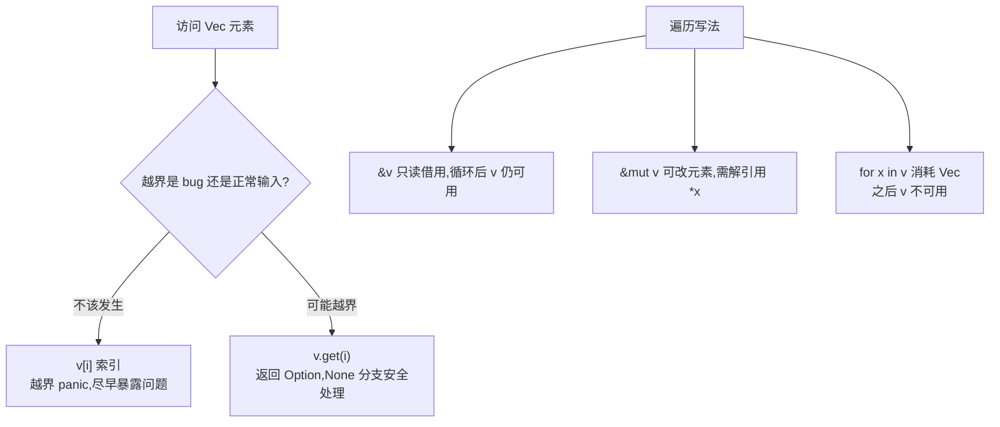

# Vec(集合)

一句话:Vec 是堆上可增长的动态数组,同类型元素的默认集合,配套的方法链把「变换+筛选+收集」写成一条流水线。

## 它解决什么问题

数组 `[T; N]` 长度编译期定死,而大多数场景元素个数运行时才知道——读多少行输入、解析多少条记录。Vec 把数据放堆上,长度随 push 增长,容量不够时自动扩容。

取元素时它还逼你做一个设计决定:索引越界到底算 bug 还是正常输入。两种访问方式 `v[i]` 与 `v.get(i)` 分别对应这两种预期,选错会在错误的时间 panic 或掩盖问题。

## 核心规则

访问与遍历的写法选择:



- `capacity >= len`:len 追平 capacity 后再 push 会重新分配内存并整体搬迁;预知规模就用 `Vec::with_capacity` 一次到位。
- Vec 元素类型必须一致;要存异构数据,用枚举包一层,让所有元素变成同一类型。
- `map`/`filter` 是惰性适配器,`.collect()` 才触发执行,并由标注决定产物类型(`Vec<i32>` 等)。

## 示例

摘自 `15-collections/src/main.rs`:

```rust
// ---- 1. 创建 Vec ----
let v1: Vec<i32> = Vec::new();        // 空向量，需标注类型
let v2 = vec![1, 2, 3, 4, 5];         // 宏初始化，自动推断

// ---- 2. 增删访问 ----
let mut v = Vec::new();
v.push(10);                            // 末尾添加
v.push(20);
v.push(30);

let last = v.pop();                    // 弹出末尾

// 索引访问：越界会 panic
let first = v[0];

// get 返回 Option，越界返回 None（更安全）
match v.get(0) {
    Some(val) => println!("v.get(0) = {}", val),
    None => println!("无此索引"),
}
println!("v.get(5) = {:?}", v.get(5)); // None

// ---- 4. 方法链 ----
// ...(nums = vec![1, 2, 3, 4, 5], 见下表)
let doubled: Vec<i32> = nums.iter()
    .map(|&x| x * 2)                  // 每个元素乘 2
    .filter(|&x| x > 5)               // 保留大于 5 的
    .collect();                       // 收集为 Vec

// ---- 6. 容量与长度 ----
let mut cap_demo: Vec<i32> = Vec::with_capacity(10); // 预分配容量
println!("空时: len={}, capacity={}", cap_demo.len(), cap_demo.capacity());
```

## 源码解读

crate:`15-collections/src/main.rs`,`cargo run -p collections_demo` 可运行。

| 小节 | 演示什么 | 关键行 |
|---|---|---|
| 创建 | `Vec::new` 需类型标注,`vec![]` 宏自动推断 | `let v2 = vec![1, 2, 3, 4, 5]` |
| 增删访问 | push/pop 与两种索引方式对比 | `v.pop()`、`v.get(0)` |
| 遍历 | `&nums` 只读、`&mut` 就地乘 10 | `for x in &mut mut_nums` |
| 方法链 | map+filter 惰性变换,collect 收集 | `nums.iter().map(...).filter(...).collect()` |
| enumerate | 带索引遍历 | `nums.iter().enumerate()` |
| 枚举存异构 | enum 包装后同一 Vec 装三种类型 | `Cell::Int(42)`、`Cell::Text(...)` |
| 容量与长度 | 预分配容量,观察 len 与 capacity 差值 | `Vec::with_capacity(10)` |
| VecDeque | 双端队列,两端都可进出 | `dq.push_front(0)` |

## 实践项

| 练习 | 内容 | 对照组与评判标准 |
|---|---|---|
| [Rustlings 05_vecs](https://github.com/rust-lang/rustlings/tree/main/exercises/05_vecs) | vec1~2:补全 Vec 创建与迭代器操作 | 先自己写,再对照 [官方解答](https://github.com/rust-lang/rustlings/tree/main/solutions/05_vecs);标准:全绿,能说清 `v[i]` 与 `v.get(i)` 的取舍 |
| [Exercism Rust track](https://exercism.org/tracks/rust) | 任意列表加工题,用 map/filter/collect 流水线 | 标准:不手写带临时 Vec 的可变循环,链式一次成型 |

## 避坑

- 越界访问 `v[5]` 直接 panic;输入来自外部时一律 `get` + 处理 None。
- 遍历中同时 push 会撞可变借用冲突(扩容还可能整体搬迁);先收集要加的元素,遍历完再 push。
- `for x in v`(不带 &)把 Vec 消耗掉,之后无法再用;循环后还要用就写 `&v`。

## 参考资料

- [The Rust Book ch8.1 Storing Lists of Values with Vectors](https://doc.rust-lang.org/book/ch08-01-vectors.html)
- [Rust By Example - Vectors](https://doc.rust-lang.org/stable/rust-by-example/std/vec.html)
