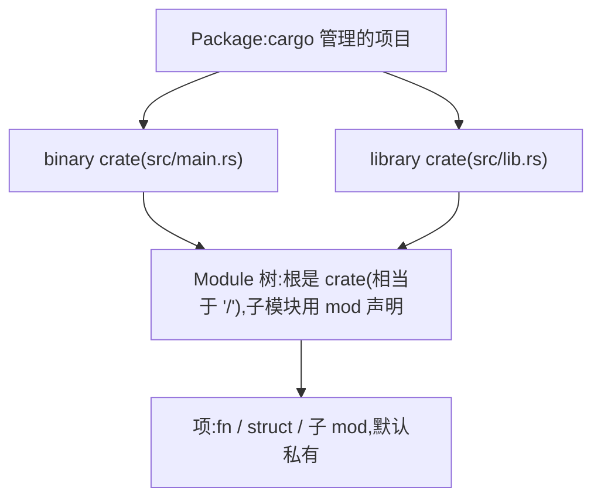
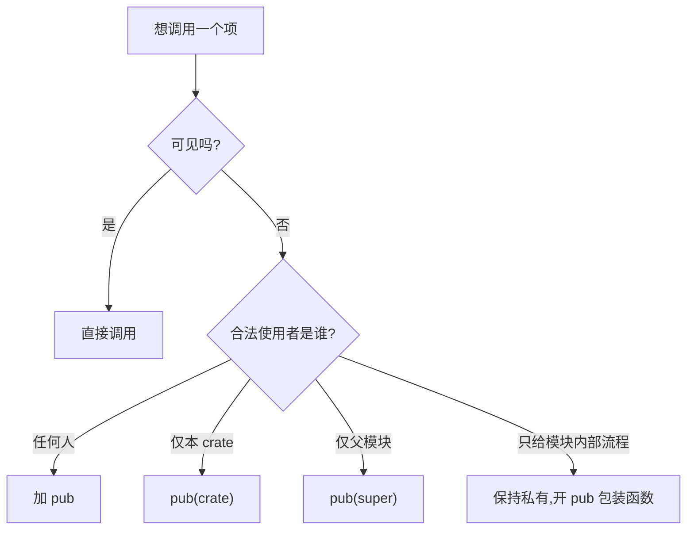

# Modules(模块)

一句话:代码一多就得拆,Rust 用 mod 把代码组织成树,用路径找东西,用 pub 控制谁能看见谁。

## 它解决什么问题

所有代码堆在 main.rs 里:函数名容易撞车,谁跟谁是一伙的看不出来,想限制某个函数只给特定代码用也没有手段。模块把代码切成有边界的单元——模块内部共享一切,模块之间只通过公开项来往。

Rust 与多数语言不同:一切默认私有,封装由编译器强制。想被外部访问必须逐级标 pub,这份「麻烦」换来的是每条调用关系都在编译期得到确认。

## 核心规则

三层组织各管一件事:package 是交付单元,crate 是编译单元,module 是 crate 内的可见性边界。





- `mod X {}` 内联声明;`mod X;` 声明文件模块,编译器去找 `src/X.rs`。
- 路径:从 crate 根写起是绝对路径 `crate::kitchen::storage`,从当前模块写起是相对路径 `kitchen::storage`,`super::` 指父模块。
- `use` 把路径提成本地名字,调用处少打前缀;`as` 换名,避冲突或缩短。

## 示例

摘自 `18-modules/src/main.rs`:

```rust
// 声明子模块：Rust 会找 src/front_of_house.rs
mod front_of_house;

// 内联模块演示嵌套与可见性
mod kitchen {
    // 私有函数：模块外不可见
    fn wash_dishes() {
        println!("  厨房：洗碗完毕");
    }

    // pub 函数：对外公开
    pub fn cook_meal(name: &str) {
        println!("  厨房：正在烹饪 {}", name);
        wash_dishes(); // 模块内可调用私有函数
    }

    // 调用 storage 的 check_inventory（pub(super) 只对 kitchen 可见）
    pub fn check_storage() {
        storage::check_inventory();
    }

    // 嵌套模块
    pub mod storage {
        // pub(super)：对父模块 kitchen 可见
        pub(super) fn check_inventory() {
            println!("  仓库：库存检查完毕");
        }

        // pub(crate)：对整个 crate 可见
        pub(crate) fn restock() {
            println!("  仓库：已补货");
        }
    }
}

// use 引入路径，as 重命名
use kitchen::cook_meal as prepare;
use front_of_house::hosting;
use front_of_house::serving;

fn main() {
    println!("=== 模块系统演示 ===");

    // 调用内联模块的公开函数
    println!("[内联模块]");
    kitchen::cook_meal("红烧肉");
    prepare("清蒸鱼"); // as 重命名后的调用

    // 调用嵌套模块
    // check_inventory 是 pub(super) 只对 kitchen 可见，main 不能直接调
    // 通过 kitchen 的公开函数 check_storage 间接调用
    println!("[嵌套模块]");
    kitchen::check_storage();
    kitchen::storage::restock();

    // ...(文件模块、serving、[完整路径]、use 短路径等调用,见源码)
}
```

摘自 `18-modules/src/front_of_house.rs`:

```rust
// 文件作为模块：src/front_of_house.rs
// 对应 main.rs 里的 mod front_of_house; 声明

/// hosting 子模块：接待客人的逻辑
pub mod hosting {
    pub fn add_to_waitlist() {
        println!("  前厅：客人已加入等候名单");
    }
    // ...(seat_at_table / greet 均为 pub fn; serving 子模块同理,略)
}
```

## 源码解读

crate:`18-modules/src/main.rs`,`cargo run -p modules_demo` 可运行。

| 小节 | 演示什么 | 关键行 |
|---|---|---|
| 文件模块 | `mod X;` 对应 `src/X.rs`;文件里定义嵌套公开模块 hosting/serving | `mod front_of_house;`、`hosting::add_to_waitlist()`、`serving::serve_order(1)` |
| 私有边界 | 模块内随便调私有函数,外部只能调 pub 项 | `wash_dishes()` 只被 `cook_meal` 调用 |
| pub(super) | 子模块项只对父模块可见,外部走公开入口 | `check_inventory` 由 `kitchen::check_storage()` 间接调 |
| pub(crate) | 对整个 crate 可见,main 直接调用 | `kitchen::storage::restock()` |
| use 与 as | 路径提为本地名字,as 换名避冲突 | `use kitchen::cook_meal as prepare` → `prepare("清蒸鱼")` |
| 路径两写法 | use 后的短路径与完整路径等价 | `hosting::greet("Alice")` 与 `front_of_house::hosting::greet("Bob")` |

## 实践项

| 练习 | 内容 | 对照组与评判标准 |
|---|---|---|
| [Rustlings 10_modules](https://github.com/rust-lang/rustlings/tree/main/exercises/10_modules) | modules1~3:补 pub、写 use、修模块路径 | 先自己写,再对照 [官方解答](https://github.com/rust-lang/rustlings/tree/main/solutions/10_modules);标准:全绿,能说清每处错误是可见性问题还是路径写错 |
| [RBE - Modules](https://doc.rust-lang.org/stable/rust-by-example/mod.html) | 本地复现嵌套模块与可见性,再读 [文件拆分](https://doc.rust-lang.org/stable/rust-by-example/mod/split.html) 对照本 crate 的两文件结构 | 标准:能解释 `mod X;` 与 `src/X.rs` 的对应关系 |

## 避坑

- `mod X;` 是声明不是导入:只建了 `src/X.rs` 而没在任何模块里写 `mod X;`,文件根本不参与编译。
- 函数 pub 不等于处处可达:路径上每级模块都要能通过;pub(super) 项出了父模块(如 main 里直调 `check_inventory`)就是编译错误。
- 无脑 pub 会把内部实现暴露成公共 API;`pub(crate)` / `pub(super)` 收窄可见面,以后改动不必顾虑外部调用者。

## 参考资料

- [The Rust Book ch7.1 Packages and Crates](https://doc.rust-lang.org/book/ch07-01-packages-and-crates.html)
- [The Rust Book ch7.2 Defining Modules](https://doc.rust-lang.org/book/ch07-02-defining-modules-to-control-scope-and-privacy.html)
- [The Rust Book ch7.3 Paths](https://doc.rust-lang.org/book/ch07-03-paths-for-referring-to-an-item-in-the-module-tree.html)
- [The Rust Book ch7.4 use](https://doc.rust-lang.org/book/ch07-04-bringing-paths-into-scope-with-the-use-keyword.html)
- [The Rust Book ch7.5 Separating Modules into Different Files](https://doc.rust-lang.org/book/ch07-05-separating-modules-into-different-files.html)
- 本地旧笔记:`D:\Myknows\Myknows\原理\Rust\05-模块与组织\01-Package-Crate-Module.md`(与本文持续同步)
