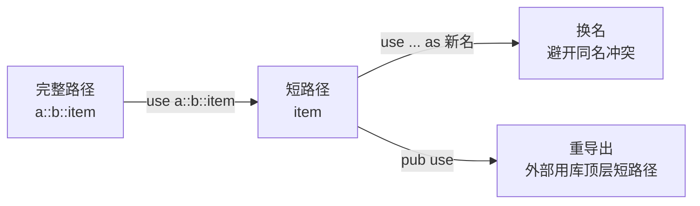

# Paths and use(路径与 use)

一句话:路径是模块树里的门牌号,use 把长门牌提成本地短名——声明一次,处处省字。

## 它解决什么问题

模块把代码切成了树,找任何一项都要写出「从哪走到哪」。每次重抄 `std::collections::HashMap` 一类全路径不可忍受;内部模块一旦重排,写死的长路径还成了调用方的负担。路径与 use 的分工:

- 路径负责「找到」:绝对路径从 crate 根(`crate::` 或外部 crate 名)出发,相对路径从当前模块出发,`super::` 上溯一层;
- `use` 负责「少写」:把路径提成本地名字,一处声明、处处短名;
- `pub use` 负责「稳住 API」:把内部项重导出为顶层短路径。

模块树与可见性的基础见 [01 Package/Crate/Module](./01-Package-Crate-Module.md),本文只讲寻址与引入。

## 核心规则

use 引入的是名字,不是权限:被引项自身仍受可见性约束,路径上任何一级不可见,写法再短也通不过。



- 惯例:引函数引到其父模块(调用处写 `hosting::greet`,来源清晰),引类型/枚举直接引到类型名(`use std::collections::HashMap`);
- 嵌套写法 `use std::io::{self, Write}` 可同时引入模块本身与其子项;
- 通配导入 `use 路径::*` 一次引入全部公开项,名字来源难追溯,留给测试模块等受控场景。

## 示例

摘自 `18-modules/src/main.rs`:

```rust
// use 引入路径，as 重命名
use kitchen::cook_meal as prepare;
use front_of_house::hosting;
use front_of_house::serving;
```

```rust
    // 通过 use 简化路径
    println!("[use 引入]");
    hosting::greet("Alice");

    // 调用 serving 子模块
    println!("[serving 子模块]");
    serving::serve_order(1);
    serving::take_payment(1);

    // 演示完整路径调用（不使用 use）
    println!("[完整路径]");
    front_of_house::hosting::greet("Bob");
```

## 源码解读

crate:`18-modules/src/main.rs`,`cargo run -p modules_demo` 可运行。

| 小节 | 演示什么 | 关键行 |
|---|---|---|
| use 声明区 | 三条 use 各立一个本地名,as 把 cook_meal 换成 prepare | `use kitchen::cook_meal as prepare` |
| [use 引入] | 引入后短名调用,与完整路径语义等价 | `hosting::greet("Alice")` |
| [serving 子模块] | 兄弟路径经 use 引入后同样短名直达 | `serving::serve_order(1)`、`serving::take_payment(1)` |
| [完整路径] | 不 use 也能调,use 只省前缀不改语义 | `front_of_house::hosting::greet("Bob")` |

## 实践项

| 练习 | 内容 | 对照组与评判标准 |
|---|---|---|
| [Rustlings 10_modules](https://github.com/rust-lang/rustlings/tree/main/exercises/10_modules) | modules2~3:用 use(含 as)把路径引入作用域,modules3 练标准库路径 | 先自己写,再对照 [官方解答](https://github.com/rust-lang/rustlings/tree/main/solutions/10_modules);标准:全绿,能说出每条 use 引入的是模块还是具体类型 |
| [RBE - Modules](https://doc.rust-lang.org/stable/rust-by-example/mod.html) | 本地复现 use as 重命名,构造两个同名类型验证冲突与化解 | 标准:两个同名类型同时裸引入编译失败,as 改名一个后通过 |

## 避坑

- 两个来源的同名类型(如 `std::fmt::Result` 与 `std::io::Result`)不能同时裸引入,至少一个要用 as 改名。
- use 建立的名字只属于声明它的模块:子模块要用,得自己再 `use super::名字` 或写全路径,不会自动继承。
- 库只 pub 不 pub use 时,外部被迫写内部完整路径:内部结构泄漏成事实 API,日后重排模块即破坏调用方——重导出是给内部结构留的缓冲带。

## 参考资料

- [The Rust Book ch7.3 Paths for Referring to an Item](https://doc.rust-lang.org/book/ch07-03-paths-for-referring-to-an-item-in-the-module-tree.html)
- [The Rust Book ch7.4 Bringing Paths into Scope with use](https://doc.rust-lang.org/book/ch07-04-bringing-paths-into-scope-with-the-use-keyword.html)
