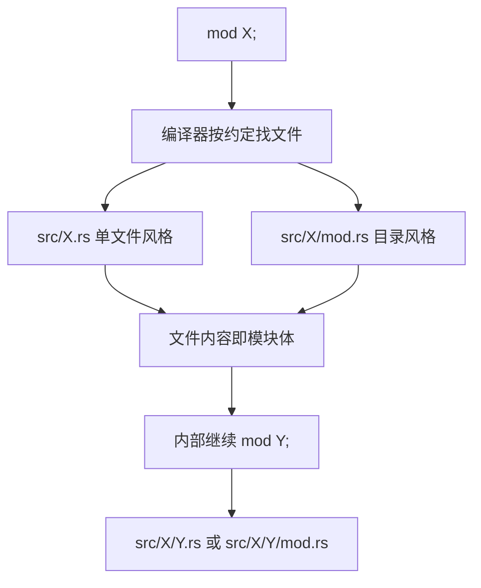

# Splitting Modules(分离模块文件)

一句话:mod 声明把文件挂上模块树,拆分只是搬代码——树不变,调用就不变。

## 它解决什么问题

模块写多了,单个 main.rs / lib.rs 会膨胀到难以导航。Rust 的拆分方案不引入新机制:`mod X;` 声明后,编译器按固定约定找到 `src/X.rs`,文件内容就是模块体。于是:

- 拆分是纯文件操作,模块树形状与文件布局一一对应;
- 调用方代码零改动,路径照写、use 照用;
- 子模块用同样的约定向下生长,层级任意深。

mod 声明与可见性的基础见 [01 Package/Crate/Module](./01-Package-Crate-Module.md),本文只讲文件布局约定。

## 核心规则

模块树从 crate root(src/main.rs 或 src/lib.rs)向下生长,每一层 mod 都对应一段内联模块体或一个文件。



- 子模块相对父模块文件解析:`front_of_house.rs` 里的 `mod serving;` 找 `src/front_of_house/serving.rs`(或 `serving/mod.rs`);
- 内联模块 `mod X { ... }` 与文件模块 `mod X;` 可同层混用,树上一层一个 X,住得远不改变身份。

## 示例

摘自 `18-modules/src/main.rs`:

```rust
// 声明子模块：Rust 会找 src/front_of_house.rs
mod front_of_house;
```

```rust
    // 调用文件模块
    println!("[文件模块 front_of_house]");
    hosting::add_to_waitlist();
    hosting::seat_at_table(3);
```

摘自 `18-modules/src/front_of_house.rs`:

```rust
/// hosting 子模块：接待客人的逻辑
pub mod hosting {
    /// 添加到等候名单
    pub fn add_to_waitlist() {
        println!("  前厅：客人已加入等候名单");
    }

    /// 安排入座
    pub fn seat_at_table(count: u32) {
        println!("  前厅：安排 {} 人入座", count);
    }

    /// 打招呼
    pub fn greet(name: &str) {
        println!("  前厅：欢迎 {} 光临！", name);
    }
}
```

## 源码解读

crate:`18-modules/src/main.rs` 与 `18-modules/src/front_of_house.rs`,`cargo run -p modules_demo` 可运行。

| 小节 | 演示什么 | 关键行 |
|---|---|---|
| mod 声明 | 文件模块声明,编译器自动对接 src/front_of_house.rs | `mod front_of_house;` |
| [文件模块 front_of_house] | 文件模块的调用与内联模块毫无区别 | `hosting::add_to_waitlist()`、`hosting::seat_at_table(3)` |
| [serving 子模块] | 同一文件的兄弟子模块同样短名可达 | `serving::serve_order(1)`、`serving::take_payment(1)` |
| front_of_house.rs | pub mod 在文件里继续声明子模块,树上向下生长 | `pub mod hosting`、`pub mod serving` |

## 实践项

| 练习 | 内容 | 对照组与评判标准 |
|---|---|---|
| [Rustlings 10_modules](https://github.com/rust-lang/rustlings/tree/main/exercises/10_modules) | modules1:补上 pub 让跨模块调用通过——文件拆开后第一道坎是可见性 | 先自己写,再对照 [官方解答](https://github.com/rust-lang/rustlings/tree/main/solutions/10_modules);标准:全绿,能指出每处缺 pub 的确切位置 |
| [RBE - Splitting modules](https://doc.rust-lang.org/stable/rust-by-example/mod/split.html) | 本地复现单文件与目录两种布局 | 标准:不看资料说出 `mod X;` 对应的两种文件路径 |

## 避坑

- `src/X.rs` 与 `src/X/mod.rs` 同时存在:编译器拒绝裁决,二选一。
- `mod foo::bar;` 直接语法错误:层级必须逐级声明,文件按约定归位。
- 拆文件不改变可见性:访问规则只看模块树不看文件,跨文件调用缺 pub 照样被拒。

## 参考资料

- [The Rust Book ch7.5 Separating Modules into Different Files](https://doc.rust-lang.org/book/ch07-05-separating-modules-into-different-files.html)
- [Rust By Example - Modules](https://doc.rust-lang.org/stable/rust-by-example/mod.html)
