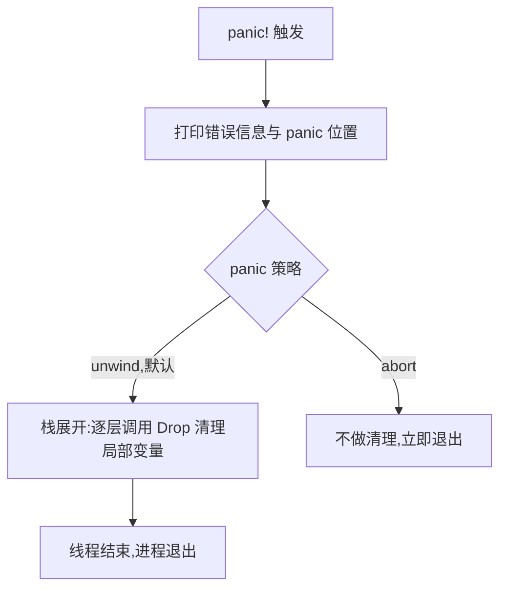

# panic!(不可恢复错误)

一句话:遇到「逻辑上不可能发生」的 bug 时让程序立刻崩溃——但安全地崩溃,而不是带病继续跑;可恢复的失败走 `Result`,见 02-Result可恢复。

## 它解决什么问题

失败分两种性质:文件打不开、输入解析失败,调用方有能力应对,该作为 `Result<T, E>` 返回;数组越界、不变式被破坏,说明代码本身有 bug,继续运行毫无意义。panic! 是后者的处理机制:

- 触发即打印错误信息与源码位置,帮你在第一现场定位问题;
- 默认策略(unwind)逐层展开调用栈,对每层局部变量调用 `Drop` 做清理;
- 进程退出,绝不带着损坏的状态往下走。

## 核心规则

panic! 的默认路径是「打印、展开、退出」,可选 abort 策略跳过展开直接退出:



- 触发方式两种:代码里主动调用 `panic!("原因")`,或违反语言规则被动触发(数组越界、对 `None` 调用 unwrap);
- 判断标准:是 bug 就 panic,调用方能应对就返回 `Result`——完整的判据与处置分支见 02-Result可恢复;
- 默认只打印一行 panic 信息,设环境变量 `RUST_BACKTRACE=1` 可看到完整调用栈。

## 示例

摘自 `19-error-handling/src/main.rs`(panic 代码以注释形式保留,取消注释即复现崩溃):

```rust
    // ---- 1. panic! ----
    // 不可恢复错误：程序会终止，打印回溯
    // panic!("致命错误：无法继续"); // 取消注释会导致崩溃
```

unwrap/expect 在 `Err` 上同样触发 panic,crate 用注释保留了这条路径:

```rust
    // let bad = Err("oops").unwrap(); // panic!
```

取消注释第一段后运行,输出为 `thread 'main' panicked at <源码位置>: 致命错误：无法继续`,并提示设置 `RUST_BACKTRACE` 查看调用栈。

## 源码解读

crate:`19-error-handling/src/main.rs`,`cargo run -p error_handling_demo` 可运行。

| 小节 | 演示什么 | 关键行 |
|---|---|---|
| panic! | 不可恢复错误:取消注释即崩溃并打印回溯 | `panic!("致命错误：无法继续")` |
| unwrap 失败路径 | 在 `Err` 上调用 unwrap 等价于手动 panic(unwrap 的可恢复用法见 02-Result可恢复) | `Err("oops").unwrap()` |

## 实践项

| 练习 | 内容 | 对照组与评判标准 |
|---|---|---|
| [Rustlings 13_error_handling](https://github.com/rust-lang/rustlings/tree/main/exercises/13_error_handling) | errors 系列:把「失败即 panic」的函数改成返回 `Result`,练习 `?` 传播 | 先自己写,再对照 [官方解答](https://github.com/rust-lang/rustlings/tree/main/solutions/13_error_handling);标准:全绿,且能说出哪些场景不该 panic |
| [Exercism Rust track](https://exercism.org/tracks/rust) | 挑一道解析/IO 题,先写成 panic 版再改成 `Result` 版 | 标准:两个版本都能编译,能对比说明取舍 |

## 避坑

- abort 策略(`Cargo.toml` 的 `[profile.release]` 里设 `panic = "abort"`)能减小二进制,但栈不再展开、`Drop` 不执行——依赖析构清理的资源(文件句柄、锁)不会被释放。
- panic 信息默认只有一行,排查崩溃先设 `RUST_BACKTRACE=1` 重跑,从栈底往上找第一个属于自己的函数。
- panic 不能跨越 FFI 边界(未定义行为):跨语言场景在边界前用 `std::panic::catch_unwind` 捕获,它不是通用 try/catch,别当异常用。

## 参考资料

- [The Rust Book ch9.1 Unrecoverable Errors with panic!](https://doc.rust-lang.org/book/ch09-01-unrecoverable-errors-with-panic.html)
- [The Rust Book ch9.3 To panic! or Not to panic!](https://doc.rust-lang.org/book/ch09-03-to-panic-or-not-to-panic.html)
- [Rust By Example - panic!](https://doc.rust-lang.org/stable/rust-by-example/error/panic.html)
