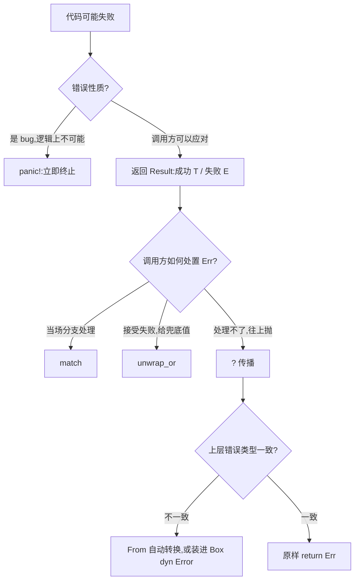

# Error Handling(错误处理)

一句话:Rust 没有异常——不可恢复的错误用 panic! 崩溃,可恢复的失败用 `Result<T, E>` 编码进返回值,由调用方决定处理、兜底还是继续往上抛。

## 它解决什么问题

别的语言靠异常或错误码传失败:前者不知道哪一行会抛,后者容易忘检查。Rust 把「可能失败」直接写进函数签名——返回 `Result<T, E>`,编译器强制你面对 Err 分支,漏处理会有 warning。

panic! 则留给真正不该发生的事(越界、不变式被破坏):程序安全崩溃并打印回溯,逼你修代码,而不是带病运行。

## 核心规则

遇到失败先问错误性质,再逐层决定处置方式:



- `?` 是传播的简写:Ok 时取出值继续,Err 时提前 `return`,并先经 `From` 转换成函数签名声明的错误类型;
- 错误类型不统一时两条路:为自定义错误实现 `From`(类型可精确匹配),或统一装进 `Box<dyn Error>`(零样板,但丢失具体类型);
- unwrap/expect 是「失败就 panic」的快捷方式,只适合原型和测试。

## 示例

摘自 `19-error-handling/src/main.rs`:

```rust
// ---- 8. 自定义错误类型 ----
#[derive(Debug)]
struct AppError {
    code: i32,
    message: String,
}

// ...（Display、Error 两个 impl 略,见源码）...

// From<ParseIntError> 让 ? 自动转换 ParseIntError -> AppError
impl From<ParseIntError> for AppError {
    fn from(e: ParseIntError) -> Self {
        AppError { code: 1001, message: format!("解析失败: {}", e) }
    }
}

/// 解析字符串为整数，失败时返回自定义错误
fn parse_number(input: &str) -> Result<i32, AppError> {
    // ? 会自动调用 From 转换错误类型
    let n: i32 = input.parse()?;
    Ok(n * 2)
}

/// 用 ? 传播错误，返回 Box<dyn Error> 通用类型
fn read_and_parse(path: &str) -> Result<i32, Box<dyn Error>> {
    let content = fs::read_to_string(path)?;       // IO 错误自动传播
    let num: i32 = content.trim().parse()?;        // 解析错误自动传播
    Ok(num)
}

fn main() {
    println!("=== 错误处理演示 ===");

    // ---- 2 & 3. Result 与 match ----
    let result: Result<i32, &str> = Ok(42);
    match result {
        Ok(v) => println!("match Ok: {}", v),
        Err(e) => println!("match Err: {}", e),
    }

    // ---- 4. unwrap / expect ----
    let ok_val: i32 = Ok::<i32, &str>(100).unwrap();
    println!("unwrap Ok: {}", ok_val);

    // ...（panic! 注释、expect、parse_number 调用、Display 打印见源码）...

    // ---- 6 & 7. ? + From + Box<dyn Error> ----
    match read_and_parse("不存在的文件.txt") {
        Ok(n) => println!("文件读到: {}", n),
        Err(e) => println!("文件操作失败: {}", e),
    }
}
```

## 源码解读

crate:`19-error-handling/src/main.rs`,`cargo run -p error_handling_demo` 可运行。

| 小节 | 演示什么 | 关键行 |
|---|---|---|
| panic!(注释) | 不可恢复错误:取消注释即崩溃并打印回溯 | `panic!("致命错误：无法继续")` |
| Result 与 match | Ok/Err 两种取值各走对应分支,必须穷尽 | `match result { Ok(v) => …, Err(e) => … }` |
| unwrap / expect | 失败直接 panic 的快捷方式,泛型参数需显式标注 | `Ok::<i32, &str>(100).unwrap()` |
| ? 传播 | Ok 取值继续,Err 提前 return | `let n: i32 = input.parse()?` |
| From 自动转换 | `?` 遇到源错误时调 From 转成 AppError | `impl From<ParseIntError> for AppError` |
| Box dyn Error | 多种错误(io、parse)统一装进一个容器往上抛 | `read_and_parse(path)` 返回 `Result<i32, Box<dyn Error>>` |
| 自定义错误 Display | 实现 Display 后错误打印可读 | `println!("自定义错误: {}", custom_err)` |
| Option unwrap_or | Option 的兜底取值,与 Result 的失败路径互补 | `maybe.unwrap_or(0)` |

## 实践项

| 练习 | 内容 | 对照组与评判标准 |
|---|---|---|
| [Rustlings 13_error_handling](https://github.com/rust-lang/rustlings/tree/main/exercises/13_error_handling) | errors 系列:补 Result 签名、用 `?` 传播、实现自定义错误 | 先自己写,再对照 [官方解答](https://github.com/rust-lang/rustlings/tree/main/solutions/13_error_handling);标准:全绿,且能说出 `?` 在 Err 分支展开成什么 |
| [Rustlings 12_options](https://github.com/rust-lang/rustlings/tree/main/exercises/12_options) | Option 的处理与兜底(对应 crate 的 unwrap_or) | 标准:全绿,能说清 Option(有没有)与 Result(成败)的分工 |
| [Exercism Rust track](https://exercism.org/tracks/rust) | 挑一道会失败的题(解析、IO),用自定义错误 + From 完成 | 标准:错误类型实现 Display/Error/From,代码里没有 unwrap |

## 避坑

- `?` 只能在返回 Result 的函数里用;`main` 默认返回 `()`,想用 `?` 就把签名改成 `-> Result<(), Box<dyn Error>>`,失败时自动打印错误并以非零码退出。
- unwrap/expect 失败即 panic:原型救急可以,进生产前换成 match 或 `?`;非用不可时改用 expect 留一句「为什么这里不该失败」。
- 自定义错误三件套:`Debug`、`Display`、`Error`,再给每个源错误实现 `From`——漏掉 `From`,`?` 不会自动转换,只会报类型不匹配。

## 参考资料

- [The Rust Book ch9.1 Unrecoverable Errors with panic!](https://doc.rust-lang.org/book/ch09-01-unrecoverable-errors-with-panic.html)
- [The Rust Book ch9.2 Recoverable Errors with Result](https://doc.rust-lang.org/book/ch09-02-recoverable-errors-with-result.html)
- [The Rust Book ch9.3 To panic! or Not to panic!](https://doc.rust-lang.org/book/ch09-03-to-panic-or-not-to-panic.html)
- [Rust By Example - panic!](https://doc.rust-lang.org/stable/rust-by-example/error/panic.html)
- [Rust By Example - Result](https://doc.rust-lang.org/stable/rust-by-example/error/result.html)
