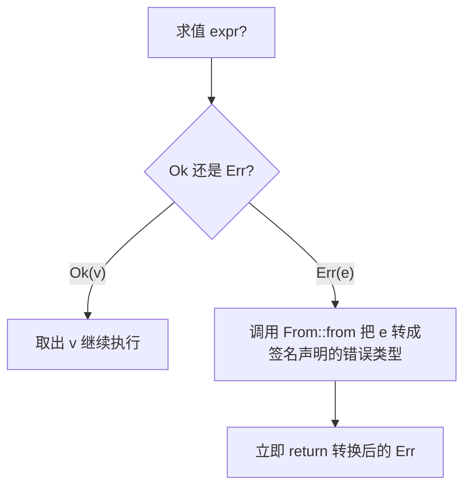

# Error Propagation(错误传播与转换)

一句话:下层函数各返回各的错误类型,`?` 把它们沿调用链向上抛,`From` 负责在抛出时统一转换——Result 的 match/unwrap 基础见 02-Result可恢复。

## 它解决什么问题

一个函数往往调用多个可能失败的函数:文件操作返回 `io::Error`,解析返回 `ParseIntError`,而它自己的签名只能声明一种错误类型。不解决,每个调用点都要手写 match 做转换,样板淹没有效逻辑。传播与转换机制给出三层方案:

- 错误类型一致:`?` 原样向上抛;
- 定义自己的错误类型并实现 `From`:不同源错误自动转成统一类型,原始信息不丢;
- 不想写样板:统一装进 `Box<dyn Error>`,任何错误都能装,代价是调用方拿不到具体类型。

## 核心规则

`expr?` 不只是取值,Err 分支里还包含一次 From 转换和一次提前返回:



- `From` 是转换协议:为自定义错误实现 `From<源错误>`,`?` 遇到该源错误即自动包装;转换是「包装」不是「丢弃」,原始错误仍在变体里可取回;
- `Box<dyn Error>` 的自动转换来自标准库提供的 `From` 实现:凡实现 `Error` 的类型都能零样板装入,调用方要拿回具体类型需 downcast;
- 错误类型选型:库对外接口用具体自定义类型(调用方可精确 match);原型、`main`、脚本用 `Box<dyn Error>`;应用层聚合可用 anyhow(机制同 `Box<dyn Error>`,额外能附上下文消息)。

## 示例

摘自 `19-error-handling/src/main.rs`:

```rust
// ---- 8. 自定义错误类型 ----
#[derive(Debug)]
struct AppError {
    code: i32,
    message: String,
}

impl fmt::Display for AppError {
    fn fmt(&self, f: &mut fmt::Formatter) -> fmt::Result {
        write!(f, "[错误{}] {}", self.code, self.message)
    }
}

impl Error for AppError {}

// From<ParseIntError> 让 ? 自动转换 ParseIntError -> AppError
impl From<ParseIntError> for AppError {
    fn from(e: ParseIntError) -> Self {
        AppError { code: 1001, message: format!("解析失败: {}", e) }
    }
}

/// 解析字符串为整数，失败时返回自定义错误
fn parse_number(input: &str) -> Result<i32, AppError> {
    // ? 会自动调用 From 转换错误类型
    let n: i32 = input.parse()?;
    Ok(n * 2)
}

/// 用 ? 传播错误，返回 Box<dyn Error> 通用类型
fn read_and_parse(path: &str) -> Result<i32, Box<dyn Error>> {
    let content = fs::read_to_string(path)?;       // IO 错误自动传播
    let num: i32 = content.trim().parse()?;        // 解析错误自动传播
    Ok(num)
}
```

## 源码解读

crate:`19-error-handling/src/main.rs`,`cargo run -p error_handling_demo` 可运行。

| 小节 | 演示什么 | 关键行 |
|---|---|---|
| 自定义错误类型 | Debug+Display+Error 三件套,错误既可传播也可打印 | `impl Error for AppError {}` |
| From 自动转换 | 实现 From 后,`?` 遇到源错误自动转成 AppError | `impl From<ParseIntError> for AppError` |
| ? 传播 | Ok 取值继续,Err 转换后提前 return;成功「21」与失败「abc」两条路都演示 | `let n: i32 = input.parse()?` |
| Box dyn Error | io 与 parse 两种异构错误,不写任何 From 实现即统一装入一个容器 | `read_and_parse(path)` 返回 `Result<i32, Box<dyn Error>>` |
| 自定义错误 Display | 实现 Display 后错误信息可直接打印 | `println!("自定义错误: {}", custom_err)` |

## 实践项

| 练习 | 内容 | 对照组与评判标准 |
|---|---|---|
| [Rustlings 13_error_handling](https://github.com/rust-lang/rustlings/tree/main/exercises/13_error_handling) | errors 系列:补函数签名返回 `Result`、用 `?` 传播、为自定义错误实现 From | 先自己写,再对照 [官方解答](https://github.com/rust-lang/rustlings/tree/main/solutions/13_error_handling);标准:全绿,且能说出 `?` 在 Err 分支展开成什么 |
| [Exercism Rust track](https://exercism.org/tracks/rust) | 挑一道解析/IO 题,定义错误枚举 + From 完成 | 标准:错误类型实现 Debug/Display/Error/From,代码里没有 unwrap |

## 避坑

- `From` 是单向的:`?` 只把源错误转成签名声明的目标类型,不会反向;想把 `Box<dyn Error>` 拆回具体类型只能 downcast——对外接口优先用具体错误类型。
- 实现转换时包装而非吞掉源错误:AppError 的变体里保留原始 `ParseIntError`,上层才能区分「哪一步、为什么」失败;丢掉源错误等于抹掉现场。
- 真实项目用 thiserror(写库,派生 Display/Error/From)与 anyhow(写应用,`Box<dyn Error>` 增强版)省样板——前提是本文的手写机制已经清楚,否则转换出错无从排查。

## 参考资料

- [The Rust Book ch9.2 Recoverable Errors with Result](https://doc.rust-lang.org/book/ch09-02-recoverable-errors-with-result.html)
- [std::error::Error trait](https://doc.rust-lang.org/std/error/trait.Error.html)
- [Rust By Example - Result](https://doc.rust-lang.org/stable/rust-by-example/error/result.html)
