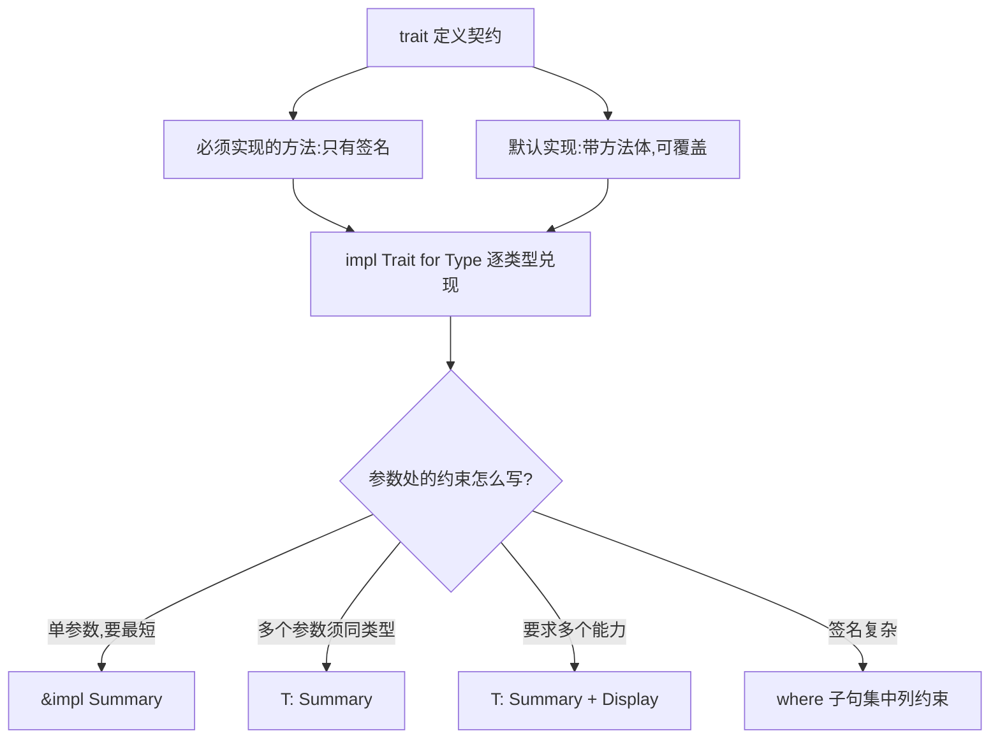

# Traits(Trait 特征)

一句话:trait 是类型的行为契约——定义一组方法签名,谁实现谁就拥有这组能力,函数靠它按「能做什么」而不是「是什么类型」接收参数。

## 它解决什么问题

要让「新闻文章」和「推文」都能被摘要,继承帮不上忙:两个结构体毫无亲缘。trait 把共同行为抽出来,各类型用 `impl Summary for Tweet` 认领,方法体各自兑现。

更有用的是把 trait 当参数约束:签名写 `&impl Summary`,任何实现了 Summary 的类型都能传入——多态由此而来,且全部在编译期检查。

## 核心规则



- 默认实现是共享兜底:不覆盖就用它,源码里 Tweet 的 `author()` 即是;NewsArticle 则两项都覆盖。
- `&impl Summary` 与 `<T: Summary>` 等价;差别在多参数:两个 `&impl Summary` 可以是不同类型,两个 `<T: Summary>` 强制同类型。
- blanket 实现(`impl<T: Display> Shout for T`)一次性给所有 Display 类型装上 Shout;动手范围受孤儿规则约束——只能为「自己的类型实现 trait」或「自己的 trait 实现到外部类型」。

## 示例

摘自 `21-traits/src/main.rs`(NewsArticle 与 Tweet 的结构体定义省略):

```rust
use std::fmt::{Debug, Display};

/// 1. 定义 trait：抽象行为契约
trait Summary {
    /// 必须实现的方法
    fn summarize(&self) -> String;

    /// 3. 默认实现：可选择覆盖
    fn author(&self) -> String {
        String::from("(未知作者)")
    }
}

impl Summary for NewsArticle {
    fn summarize(&self) -> String {
        format!("{} - {}", self.title, self.author)
    }
    // 覆盖默认实现
    fn author(&self) -> String {
        self.author.clone()
    }
}

impl Summary for Tweet {
    fn summarize(&self) -> String {
        format!("@{}: {}", self.username, self.text)
    }
    // 不覆盖 author，使用默认实现
}

/// 5. trait 作为参数：impl Trait 语法（语法糖）
fn print_summary(item: &impl Summary) {
    println!("摘要: {}", item.summarize());
    println!("作者: {}", item.author());
}

/// 7. 多个 trait bound 用 + 连接
/// 同时要求实现 Summary 和 Display
fn show_summary_and_display<T: Summary + Display>(item: &T) {
    println!("[多bound] {} | 摘要: {}", item, item.summarize());
}

/// 8. where 子句：让复杂签名更清晰
fn show_both<T, U>(t: &T, u: &U)
where
    T: Summary + Debug,
    U: Summary + Display,
{
    println!("[where] T={:?} 摘要={} | U={} 摘要={}", t, t.summarize(), u, u.summarize());
}

trait Shout {
    fn shout(&self) -> String;
}

// blanket implementation：为所有实现了 Display 的类型实现 Shout
impl<T: Display> Shout for T {
    fn shout(&self) -> String {
        format!("{}!!!", self)
    }
}
```

调用处(main 节选):

```rust
println!("推文作者(默认): {}", tweet.author()); // 未覆盖,走默认实现
show_summary_and_display(&tweet); // Tweet 同时实现 Summary + Display
println!("42 shout: {}", 42i32.shout()); // blanket 实现的效果
```

## 源码解读

crate:`21-traits/src/main.rs`,`cargo run -p traits_demo` 可运行。

| 小节 | 演示什么 | 关键行 |
|---|---|---|
| Summary 定义 | 必须方法 summarize + 可覆盖的默认 author | `fn author(&self) -> String { ... }` |
| NewsArticle 实现 | 两个方法都覆盖默认实现 | `self.author.clone()` |
| Tweet 实现 | 只实现必须方法,author 落到默认 | 注释「不覆盖 author，使用默认实现」 |
| 为 Tweet 实现 Display | 一个类型可拥有多个 trait,多 bound 才有抓手 | `impl Display for Tweet` |
| impl Trait 参数 | `&impl Summary` 是 bound 的语法糖 | `print_summary(&article)` |
| bound 写法 | 等价的完整泛型写法 | `print_summary_bound(&tweet)` |
| 多 bound 与 where | `+` 要求多个能力;复杂签名交给 where | `show_both(&article, &tweet)` |
| blanket 实现 | 所有 Display 类型自动获得 Shout | `42i32.shout()` |

## 实践项

| 练习 | 内容 | 对照组与评判标准 |
|---|---|---|
| [Rustlings 15_traits](https://github.com/rust-lang/rustlings/tree/main/exercises/15_traits) | 为给定类型实现 trait,补齐方法签名、覆盖默认方法 | 先自己写,再对照 [官方解答](https://github.com/rust-lang/rustlings/tree/main/solutions/15_traits);标准:全绿,且能说清 `impl Trait` 与 `T: Trait` 的差别 |
| [Exercism Rust track](https://exercism.org/tracks/rust) | 任选一题,为自己的结构体定义并实现一个 trait,再以它为约束写函数 | 标准:函数不接受具体类型,只认 trait,所有测试通过 |

## 避坑

- trait 方法必须先把 trait 引入作用域才能调用(`use` 一下);prelude 里的 Display、Clone 等例外,所以平时感觉不到这条规则。
- 返回 `impl Summary` 的函数只能返回一种具体类型;想按条件返回 NewsArticle 或 Tweet,得用 `Box<dyn Trait>`(见下一篇)。
- 孤儿规则:不能为外部类型实现外部 trait;确有需要,就把外部类型包进自己的结构体再实现。

## 参考资料

- [The Rust Book ch10.2 Traits](https://doc.rust-lang.org/book/ch10-02-traits.html)
- [Rust By Example - Traits](https://doc.rust-lang.org/stable/rust-by-example/trait.html)
- [Rust By Example - where](https://doc.rust-lang.org/stable/rust-by-example/generics/where.html)
