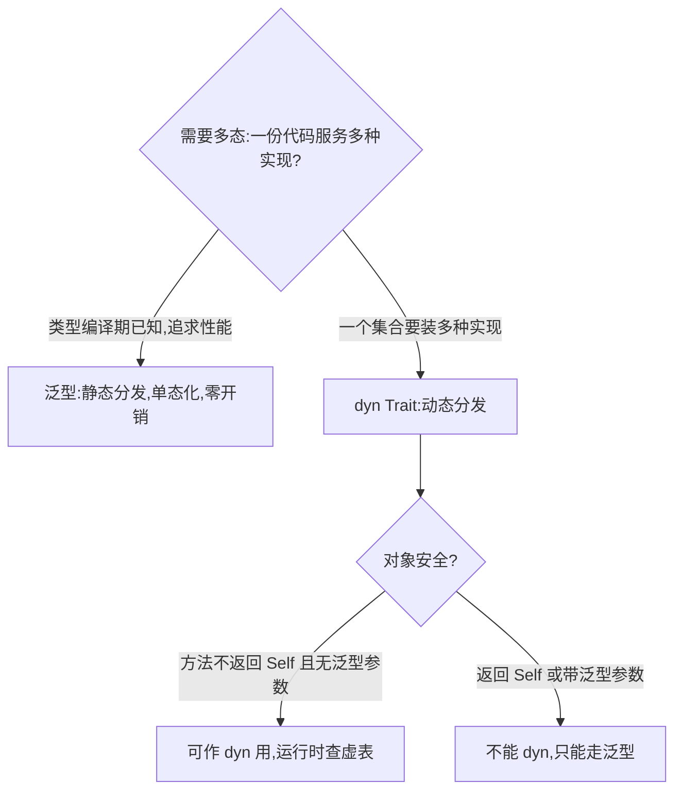

# Trait Objects(Trait 对象)

一句话:`dyn Trait` 把「某种实现了该 trait 的类型」变成运行时才能确定的值,经虚表分发方法,让一个集合能装下多种实现。

## 它解决什么问题

泛型 `Vec<T>` 里只能装一种 T:想用一个 Vec 同时装 Circle、Rectangle、Triangle,元素类型就对不上。trait 对象用「数据指针 + 虚表」表示任意实现者,类型检查推迟到运行时,异构集合由此可行。

代价是分发方式改变:泛型在编译期就确定调用哪个方法,`dyn Trait` 在运行时查虚表,多一次间接调用。

## 核心规则



- 静态分发(泛型):编译期为每个类型生成专用代码,可内联、零运行时开销,但二进制更大、集合只能单类型。
- 动态分发(`&dyn Drawable` / `Box<dyn Drawable>`):trait 对象内部是数据指针 + 虚表,每次方法调用多一次查表,换来异构与扩展性。
- 对象安全是 dyn 的门槛:`fn make(&self) -> Self`(不知道具体类型造不出自己)和 `fn process<T>(&self, x: T)`(单态化版本无限多)都会让整个 trait 不可 dyn。

## 示例

摘自 `22-trait-objects/src/main.rs`(Rectangle、Triangle 的实现省略):

```rust
/// 共同的 trait：可绘制图形
trait Drawable {
    fn draw(&self) -> String;
    fn area(&self) -> f64;
}

struct Circle { radius: f64 }

impl Drawable for Circle {
    fn draw(&self) -> String {
        format!("画一个半径为 {} 的圆", self.radius)
    }
    fn area(&self) -> f64 {
        std::f64::consts::PI * self.radius * self.radius
    }
}

// ...(Rectangle、Triangle 以同样方式实现 Drawable)

/// 1. 静态分发：泛型 + trait bound
/// 编译时为每种类型生成专用代码（单态化），零运行时开销
fn draw_static<T: Drawable>(shape: &T) {
    println!("[静态] {} 面积={:.2}", shape.draw(), shape.area());
}

/// 2. 动态分发：dyn Trait
/// 运行时通过虚表查找方法，有一次间接调用
fn draw_dynamic(shape: &dyn Drawable) {
    println!("[动态] {} 面积={:.2}", shape.draw(), shape.area());
}

/// 对象安全的 trait：方法不返回 Self，无泛型参数
trait Greetable {
    fn greet(&self) -> String;
    // fn make(&self) -> Self;        // 不安全：返回 Self
    // fn process<T>(&self, x: T);   // 不安全：有泛型参数
}
```

调用处(main 节选):泛型与 dyn 各画一遍三个图形;异构集合则只有 dyn 能写:

```rust
let shapes: Vec<Box<dyn Drawable>> = vec![
    Box::new(Circle { radius: 2.0 }),
    Box::new(Rectangle { width: 3.0, height: 4.0 }),
    Box::new(Triangle { base: 5.0, height: 2.0 }),
];
for shape in &shapes {
    println!("  {} 面积={:.2}", shape.draw(), shape.area());
}
```

## 源码解读

crate:`22-trait-objects/src/main.rs`,`cargo run -p trait_objects_demo` 可运行。

| 小节 | 演示什么 | 关键行 |
|---|---|---|
| Drawable 与三个实现 | 同一契约,三种图形各自兑现 | `impl Drawable for Circle` 等 |
| draw_static | 泛型静态分发:编译期单态化 | `fn draw_static<T: Drawable>(shape: &T)` |
| draw_dynamic | dyn Trait 动态分发:运行时查虚表 | `fn draw_dynamic(shape: &dyn Drawable)` |
| 异构集合 | 一个 Vec 装三种图形并求总面积 | `let shapes: Vec<Box<dyn Drawable>>` |
| 对象安全 | 不返回 Self、无泛型参数才可 dyn | `trait Greetable` 的注释行 |
| 性能对比 | 静态零开销二进制大,动态一次间接调用 | main 末尾三行输出 |

## 实践项

| 练习 | 内容 | 对照组与评判标准 |
|---|---|---|
| [Exercism Rust track](https://exercism.org/tracks/rust) | 任选一题,先用泛型实现同一行为,再改用 `Box<dyn Trait>` | 标准:两版都编译通过,且能说出各自用哪种分发、取舍在哪 |

## 避坑

- 泛型救不了异构集合:`Vec<T>` 的 T 是唯一类型,想让元素类型不同,只能上 `Box<dyn Trait>`。
- 对象安全在定义处就定型:trait 里有一个返回 `Self` 或带泛型参数的方法,整个 trait 都不能用 dyn;报错时先查方法签名。
- 热路径优先泛型:虚表调用本身不贵,但它阻止内联,循环内的微小函数会感觉得到。

## 参考资料

- [The Rust Book ch18.2 Trait Objects](https://doc.rust-lang.org/book/ch18-02-trait-objects.html)
