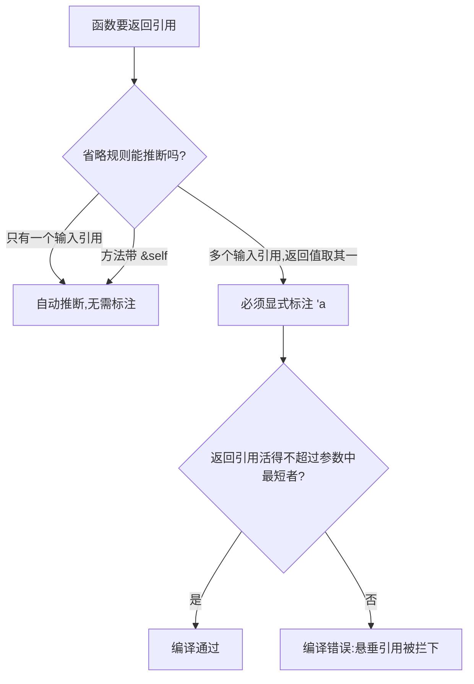

# Lifetimes(生命周期)

一句话:生命周期标注不改变任何数据的真实寿命,只是声明「这些引用之间谁比谁活得久」,让编译器拦下悬垂引用。

## 它解决什么问题

函数返回引用时,编译器必须保证它不指向已释放的数据。若返回值来自两个输入引用之一(如 `longest`),编译器推不出到底是哪个,也就无法判断能活多久——它宁可报错也不赌。

生命周期标注补上这个缺口:`'a` 不是新建东西,而是给编译器一条可检查的契约——返回的引用活得不超过参与约束的输入中最短的那个。

## 核心规则



- 省略规则三条,按序套用:每个引用参数各配一个生命周期;只有一个输入引用时输出取它;方法带 `&self` 时输出取 self。三条都推不出才要求手写。
- `'static` 是字面量的默认归属:数据直接编进二进制,整个程序有效;它是「能活全程」的资格,不是修编译错误的工具。
- 结构体持有引用就必须标注 `'a`,承诺被引数据比实例活得久;`impl` 块里同一 `'a` 把方法返回值绑到 `self` 上。

## 示例

摘自 `11-lifetimes/src/main.rs`:

```rust
// ---- 函数生命周期标注 ----
// 'a 是生命周期参数：表示返回值的引用至少和 x、y 中较短的那个活一样久
// 编译器据此检查：返回的引用不会比两个参数活得更长
fn longest<'a>(x: &'a str, y: &'a str) -> &'a str {
    if x.len() > y.len() {
        x
    } else {
        y
    }
}

// ---- 结构体中的生命周期 ----
// 结构体持有引用时必须标注生命周期：确保引用字段不会比结构体实例活得更短
struct Excerpt<'a> {
    part: &'a str, // part 引用的数据必须比 Excerpt 实例活得更久
}

impl<'a> Excerpt<'a> {
    // 返回 &str，省略规则下自动推断为 &'a str
    fn announce(&self) -> &str {
        self.part
    }
}
```

调用处(main 节选):

```rust
let s1 = String::from("long string");
let s2 = String::from("hi");
let result = longest(s1.as_str(), s2.as_str());
println!("较长的: {}", result);

let static_str: &'static str = "I live forever"; // 字面量默认 'static
println!("static = {}", static_str);

let s = String::from("hello world");
let ex = Excerpt { part: &s[..5] }; // part 引用 s 的一段
println!("excerpt = {}", ex.announce());
```

## 源码解读

crate:`11-lifetimes/src/main.rs`,`cargo run -p lifetimes_demo` 可运行。

| 小节 | 演示什么 | 关键行 |
|---|---|---|
| longest 标注 | `'a` 声明「返回引用不比两个参数活得更久」 | `fn longest<'a>(x: &'a str, y: &'a str) -> &'a str` |
| 合法调用 | 返回值在源数据有效期内使用 | `let result = longest(s1.as_str(), s2.as_str())` |
| 块内调用 | s3 在块末 drop,但 r 已用完,不悬垂 | 块内 `let r = longest(s1.as_str(), s3.as_str())` |
| 'static | 字面量嵌入二进制,整个程序有效 | `let static_str: &'static str = "I live forever"` |
| 省略规则 | `announce` 无标注仍编译:输出寿命由 `&self` 推断 | `fn announce(&self) -> &str` |
| 结构体标注 | 引用字段要求源数据活得更久 | `struct Excerpt<'a> { part: &'a str }` |
| 悬垂误用 | 被注释的例子:引用的 inner 块末 drop,编译器拒绝 | main 末尾注释块 |

## 实践项

| 练习 | 内容 | 对照组与评判标准 |
|---|---|---|
| [Rustlings 16_lifetimes](https://github.com/rust-lang/rustlings/tree/main/exercises/16_lifetimes) | 给函数与结构体补上生命周期标注 | 先自己写,再对照 [官方解答](https://github.com/rust-lang/rustlings/tree/main/solutions/16_lifetimes);标准:全绿,且能解释编译器为什么在这里推不出来 |
| [Exercism Rust track](https://exercism.org/tracks/rust) | 任选一题,把返回 clone 值的函数改成返回引用 | 标准:返回引用且编译通过,没有拿 `'static` 兜底 |

## 避坑

- 编译器要求 `'static` 时,别顺手标 `'static` 了事——多半是结构体该拥有数据(用 `String` 而非 `&str`)的设计问题。
- 标注改变不了真实寿命:数据何时释放由作用域决定,`'a` 只是给编译器检查用的契约,别指望它延长任何东西。
- 到处都要生命周期标注是设计信号:优先让结构体拥有数据,而不是借来借去。

## 参考资料

- [The Rust Book ch10.3 Validating References with Lifetimes](https://doc.rust-lang.org/book/ch10-03-lifetime-syntax.html)
- [Rust By Example - Lifetimes](https://doc.rust-lang.org/stable/rust-by-example/scope/lifetime.html)
