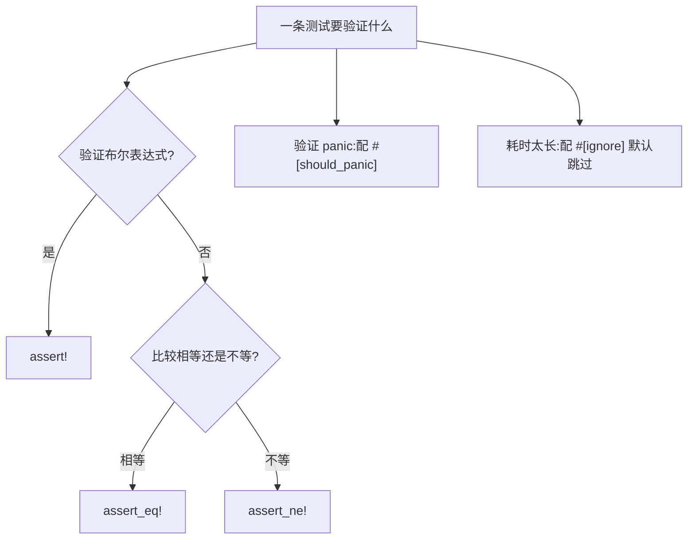

# Unit Tests(单元测试)

一句话:单元测试贴着源码写——`#[cfg(test)] mod tests` 里的 `#[test]` 函数逐个验证函数行为,断言不过即测试失败。

## 它解决什么问题

单元测试把「函数在给定输入下的行为」钉成可执行的规矩:每个用例一条断言,行为变了测试就红,失败信息直接指到函数与用例。它也是重构保护网——只改实现不动接口,跑一遍测试就能确认行为没变。

## 核心规则

测试函数就是普通函数,靠属性与断言宏定生死:

- `#[test]` 标记测试函数,`cargo test` 自动发现并运行;
- `#[cfg(test)]` 条件编译:测试模块只在跑测试时编译,不进正常构建产物;
- 断言宏分工:`assert!` 验布尔,`assert_eq!`/`assert_ne!` 验相等/不等,失败即测试失败并打印两侧值;
- `#[should_panic(expected = "...")]` 把「会 panic 且消息含该片段」变成通过条件;`#[ignore]` 让测试默认跳过,`cargo test -- --ignored` 单独运行。



## 示例

摘自 `23-testing/src/lib.rs`:

```rust
// #[cfg(test)] 表示这段代码只在 cargo test 时编译
#[cfg(test)]
mod tests {
    // use super::* 引入父模块的所有公开项
    use super::*;

    // ...should_panic 与 #[ignore] 两个测试见下表

    #[test]
    fn test_parse_positive_negative() {
        // assert_ne! 验证不相等
        assert_ne!(parse_positive("-5"), Ok(-5));
    }

    #[test]
    fn test_gcd() {
        assert_eq!(gcd(54, 24), 6);
        assert_eq!(gcd(48, 18), 6);
        assert_eq!(gcd(17, 13), 1); // 互质
        assert_eq!(gcd(0, 5), 5);
    }

    #[test]
    fn test_is_palindrome() {
        assert!(is_palindrome("Radar"));
        assert!(is_palindrome("level"));
        assert!(!is_palindrome("hello"));
        assert!(is_palindrome("")); // 空字符串算回文
    }

    #[test]
    fn test_word_count() {
        assert_eq!(word_count("hello world"), 2);
        assert_eq!(word_count(""), 0);
        assert_eq!(word_count("one"), 1);
        assert_eq!(word_count("  multiple   spaces  "), 2);
    }
}
```

## 源码解读

crate:`23-testing/src/lib.rs`,`cargo test -p testing_demo` 可运行。

| 小节 | 演示什么 | 关键行 |
|---|---|---|
| 测试模块 | `#[cfg(test)]` 条件编译,`use super::*` 从父模块拿被测函数,私有项也够得着 | `#[cfg(test)]`、`use super::*` |
| 相等断言 | 一个测试里可有多条断言,依次验证多组输入,含互质、零值等边界 | `test_gcd` |
| 布尔断言 | `assert!` 直接验证布尔结果,`!` 反转表达否定用例 | `test_is_palindrome` |
| 不等断言 | 拒绝非法输入的结果用 `assert_ne!` 表达 | `test_parse_positive_negative` |
| 空白边界 | 连续空格、空串等极端输入也要有口径 | `test_word_count` |
| panic 验证 | 被测行为是 panic 时,`expected` 匹配消息片段才算通过 | `#[should_panic(expected = "除零")]` |
| 忽略测试 | 耗时用例默认跳过,结果计为 ignored,需要时单独运行 | `#[ignore]`、`test_slow_example` |

## 实践项

| 练习 | 内容 | 对照组与评判标准 |
|---|---|---|
| [Rustlings 17_tests](https://github.com/rust-lang/rustlings/tree/main/exercises/17_tests) | tests1~tests4:补全缺失的断言,让测试转绿 | 先自己写,再对照 [官方解答](https://github.com/rust-lang/rustlings/tree/main/solutions/17_tests);标准:全绿,能说清 assert!/assert_eq!/assert_ne! 各适合什么场景 |
| [Rust By Example - Unit Testing](https://doc.rust-lang.org/stable/rust-by-example/testing/unit_testing.html) | 本地复现页面上的断言与 should_panic 示例 | 标准:`cargo test` 输出与页面描述一致,能解释 expected 匹配的是消息片段 |
| [Exercism Rust track](https://exercism.org/tracks/rust) | 任选题,先写失败测试再写实现 | 标准:实现落地前测试确实红,落地后全绿 |

## 避坑

- `assert_eq!`/`assert_ne!` 要求两侧类型实现 `PartialEq` 与 `Debug`,自定义类型不实现就编译不过。
- `#[should_panic]` 不写 `expected` 时任何 panic 都算通过,容易放过错误原因——始终写上消息片段。
- 一条断言失败即终止本测试,后面的断言不再执行——想一次定位多个问题,拆成多个测试函数。

## 参考资料

- [The Rust Book ch11.1 Writing Tests](https://doc.rust-lang.org/book/ch11-01-writing-tests.html)
- [The Rust Book ch11.2 Running Tests](https://doc.rust-lang.org/book/ch11-02-running-tests.html)
- [Rust By Example - Unit Testing](https://doc.rust-lang.org/stable/rust-by-example/testing/unit_testing.html)
