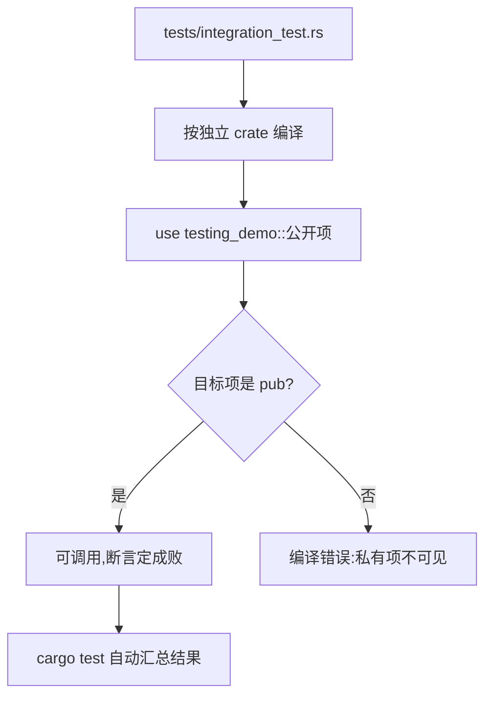

# Integration Tests(集成测试)

一句话:集成测试把整个 crate 当黑盒——`tests/` 下的独立文件通过 `use 包名::...` 只碰公开 API,模拟真实使用者的视角。

## 它解决什么问题

单元测试贴着实现写,容易顺着实现思路走,看不出使用者视角的问题。集成测试强制换位:测试文件是一个独立 crate,只能 `use` 库公开的项,API 好不好用、签名顺不顺手,一测便知。它验证的是一组函数协作起来的对外表现,而不是单个函数的内部细节。

## 核心规则

集成测试与被测库隔着一条编译边界:

- `tests/` 下每个 `.rs` 文件各自编译成一个独立测试二进制,与库代码隔离;
- 引入库用包名(本 crate 是 `testing_demo`),只够得着 `pub` 项;
- 写法与单元测试一致:`#[test]` 加断言宏,`cargo test` 自动发现;`cargo test --test integration_test` 可只跑这一个文件。



## 示例

摘自 `23-testing/tests/integration_test.rs`:

```rust
use testing_demo::{gcd, is_palindrome, parse_positive, word_count};

// ...integration_gcd 一个测试见下表

#[test]
fn integration_parse_positive() {
    assert_eq!(parse_positive("100"), Ok(100));
    assert!(parse_positive("").is_err());
    assert!(parse_positive("-1").is_err());
}

#[test]
fn integration_is_palindrome() {
    assert!(is_palindrome("noon"));
    assert!(is_palindrome("WasItACarOrACatISaw"));
    assert!(!is_palindrome("rust"));
}

#[test]
fn integration_word_count() {
    assert_eq!(word_count("the quick brown fox"), 4);
    assert_eq!(word_count(""), 0);
}
```

## 源码解读

crate:`23-testing/tests/integration_test.rs`,`cargo test -p testing_demo` 可运行。

| 小节 | 演示什么 | 关键行 |
|---|---|---|
| 引入方式 | 以包名从库里导入公开函数,一行拿齐四个被测项 | `use testing_demo::{gcd, is_palindrome, parse_positive, word_count}` |
| 成功与失败 | 同一公开 API 的合法与非法输入放一个测试里,分别断言通过与报错 | `integration_parse_positive` |
| 换组输入再验 | 与单元测试不同的输入组合,验证行为口径一致 | `integration_gcd` |
| 整体输入 | 大小写混合长串、多词句子,从外部整体验证 | `integration_is_palindrome`、`integration_word_count` |

## 实践项

| 练习 | 内容 | 对照组与评判标准 |
|---|---|---|
| [Rustlings 17_tests](https://github.com/rust-lang/rustlings/tree/main/exercises/17_tests) | 把 17_tests 复做一遍:只站在使用者视角调用函数,不窥探实现 | 先自己写,再对照 [官方解答](https://github.com/rust-lang/rustlings/tree/main/solutions/17_tests);标准:全绿,能解释为什么集成测试必须 `use 包名` |
| [Rust By Example - Integration Testing](https://doc.rust-lang.org/stable/rust-by-example/testing/integration_testing.html) | 给 testing_demo 再加一个 `tests/` 文件,只测公开 API | 标准:`cargo test -p testing_demo` 结果里新增该文件一段输出且全绿 |
| [Exercism Rust track](https://exercism.org/tracks/rust) | 任选题,把测试当第一位使用者编写,再实现公开接口 | 标准:测试不经手内部状态,全部通过公开函数完成 |

## 避坑

- `use` 后面写的是包名 `testing_demo`,不是目录名 `23-testing`——crate 名与目录名不一致时,以 Cargo.toml 里的 `name` 为准。
- 想在集成测试里调私有函数会直接编译失败——这不是 bug,是外部视角的边界在起作用,内部细节归单元测试管。
- 不要在集成测试里验证 panic:被测函数一 panic,测试直接中止,报的是崩溃而不是断言失败;要验证 panic 行为,用单元测试的 `#[should_panic]`(见 01 篇)。

## 参考资料

- [The Rust Book ch11.2 Running Tests](https://doc.rust-lang.org/book/ch11-02-running-tests.html)
- [The Rust Book ch11.3 Test Organization](https://doc.rust-lang.org/book/ch11-03-test-organization.html)
- [Rust By Example - Integration Testing](https://doc.rust-lang.org/stable/rust-by-example/testing/integration_testing.html)
