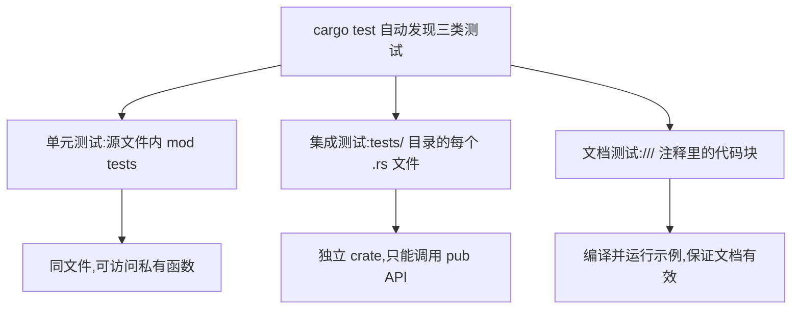

# Automated Testing(自动化测试)

一句话:Rust 把测试做进工具链——`#[test]` 标记测试函数,`cargo test` 一条命令跑完单元、集成、文档三层,文档里的示例代码也是测试。

## 它解决什么问题

代码改完,怎么知道没改坏?Rust 内置测试框架:测试就是一个个普通函数,加上 `#[test]` 属性,`cargo test` 自动发现并运行,不需要引入第三方测试工具。

光有测试还不够——文档里的示例代码最容易和实现脱节。Rust 把 `///` 注释里的代码块也当测试运行:示例一错,测试就红,文档永远不过时。

## 核心规则

三层测试各守其位,`cargo test` 一次全部运行:



- 测试代码包在 `#[cfg(test)]` 里,只在跑测试时编译,release 二进制里一点不留。
- 集成测试只够得着 `pub` API,所以 binary crate(只有 main.rs)做不了集成测试——核心逻辑放 `lib.rs`,`main.rs` 当薄壳,本 crate 就是这个结构。
- 成败由断言宏判定:`assert!` 验布尔,`assert_eq!`/`assert_ne!` 验相等/不等;`#[should_panic(expected = "...")]` 反其道而行,panic 且消息含该片段才算通过;`#[ignore]` 让慢测试默认跳过。

## 示例

摘自 `23-testing/src/lib.rs`:

```rust
/// 计算两个数的最大公约数
///
/// # 示例
///
/// ```
/// use testing_demo::gcd;
/// assert_eq!(gcd(54, 24), 6);
/// ```
pub fn gcd(mut a: u32, mut b: u32) -> u32 {
    /* ... */
}

#[cfg(test)]
mod tests {
    use super::*;

    #[test]
    fn test_parse_positive_ok() {
        assert_eq!(parse_positive("42"), Ok(42));
    }

    #[test]
    fn test_parse_positive_empty() {
        // assert! 验证布尔条件
        assert!(parse_positive("").is_err());
    }

    // ...其余测试见下表

    #[test]
    #[should_panic(expected = "除零")]
    fn test_should_panic() {
        // #[should_panic] 验证函数确实会 panic
        // expected 参数匹配 panic 信息片段
        panic!("触发除零错误");
    }

    #[test]
    #[ignore]
    fn test_slow_example() {
        // #[ignore] 标记的测试默认跳过
        // 用 cargo test -- --ignored 单独运行
        // 适用于耗时长的测试
        let result: u64 = (1..=1000).map(|x| x * x).sum();
        assert_eq!(result, 333833500);
    }
}
```

摘自 `23-testing/tests/integration_test.rs`:

```rust
use testing_demo::{gcd, is_palindrome, parse_positive, word_count};

#[test]
fn integration_gcd() {
    assert_eq!(gcd(48, 36), 12);
    assert_eq!(gcd(7, 3), 1);
}
```

## 源码解读

crate:`23-testing/src/main.rs`,`cargo run -p testing_demo` 可运行。

测试本体用 `cargo test -p testing_demo` 运行,输出依次为:lib 单元测试 8 条(1 条 ignored)、main.rs 0 条、集成测试 4 条、文档测试 3 条。

| 小节 | 演示什么 | 关键行 |
|---|---|---|
| 库函数本体 | 四个被测函数:解析正整数、最大公约数、回文判断、词数统计 | `pub fn gcd(mut a: u32, mut b: u32) -> u32` 等 4 个 `pub fn` |
| 文档测试 | `cargo test` 编译运行 3 条文档测试,示例与实现同步 | `parse_positive`/`gcd`/`is_palindrome` 的 `/// # 示例` 块 |
| 正常路径 | assert_eq! 验证相等 | `test_parse_positive_ok`、`test_gcd` |
| 错误路径 | assert! 验布尔、assert_ne! 验不等 | `test_parse_positive_empty`、`test_parse_positive_negative` |
| 边界用例 | 空串、连续空格等极端输入 | `test_is_palindrome`、`test_word_count` |
| panic 验证 | panic 且消息匹配才算通过 | `#[should_panic(expected = "除零")]` |
| 忽略测试 | 慢测试默认不跑,结果里显示 `1 ignored` | `test_slow_example` |
| 集成测试 | 4 条集成测试把 4 个函数当黑盒验证 | `use testing_demo::{gcd, is_palindrome, parse_positive, word_count}` |
| 主程序演示 | 实际调用 lib 函数展示行为 | `match parse_positive("42")` |

## 实践项

| 练习 | 内容 | 对照组与评判标准 |
|---|---|---|
| [Rustlings 17_tests](https://github.com/rust-lang/rustlings/tree/main/exercises/17_tests) | 补全缺失的断言、给会 panic 的函数补 #[should_panic] | 先自己写,再对照 [官方解答](https://github.com/rust-lang/rustlings/tree/main/solutions/17_tests);标准:全绿,能说清 assert!/assert_eq! 各适合什么场景 |
| [Rust By Example - Testing](https://doc.rust-lang.org/stable/rust-by-example/testing.html) | 给 word_count 补一条文档测试 | 标准:`cargo test -p testing_demo` 的 Doc-tests 段从 3 条变 4 条且通过 |
| [Exercism Rust track](https://exercism.org/tracks/rust) | 任选题,先写失败测试再写实现 | 标准:实现落地前测试确实红,落地后全绿 |

## 避坑

- 测试里的 `println!` 默认被捕获,失败时才显示;要看输出加 `-- --nocapture`,怀疑测试互相干扰用 `--test-threads=1` 单线程排查。
- 文档测试是独立环境:代码块里必须写全 `use testing_demo::xxx`,文件里已有的 use 帮不上忙。
- `tests/` 下每个 `.rs` 都编译成独立二进制,文件一多编译就慢;共享代码放 `tests/common/mod.rs` 并用 `mod common;` 引入,否则子目录会被误当成测试文件。

## 参考资料

- [The Rust Book ch11.1 Writing Tests](https://doc.rust-lang.org/book/ch11-01-writing-tests.html)
- [The Rust Book ch11.2 Running Tests](https://doc.rust-lang.org/book/ch11-02-running-tests.html)
- [The Rust Book ch11.3 Test Organization](https://doc.rust-lang.org/book/ch11-03-test-organization.html)
- [Rust By Example - Testing](https://doc.rust-lang.org/stable/rust-by-example/testing.html)
- 本地旧笔记:`D:\Myknows\Myknows\原理\Rust\08-测试\03-测试组织与文档测试.md`(与本文持续同步)
