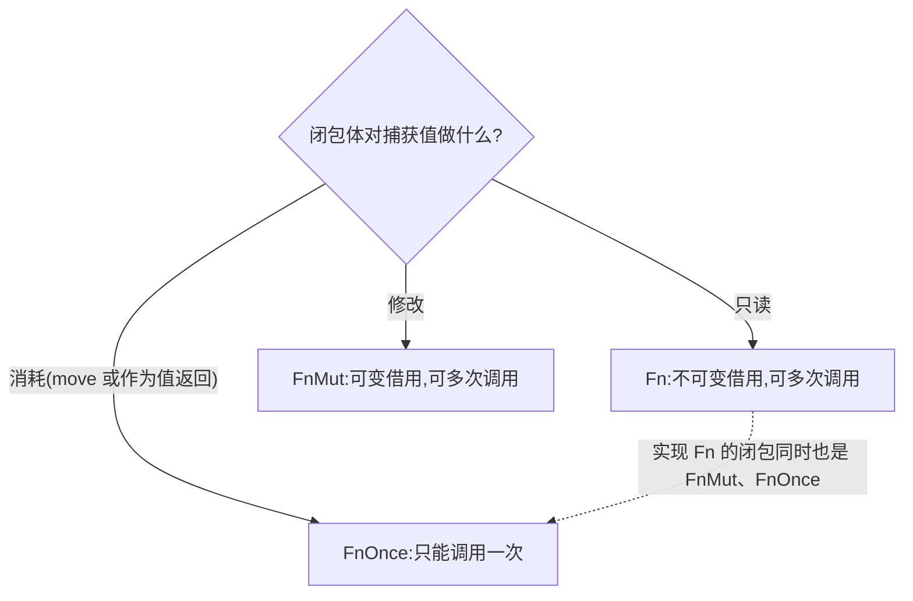

# Closures(闭包)

一句话:普通函数带不走环境,闭包是能捕获外部变量的匿名函数,编译器用 Fn/FnMut/FnOnce 三个 trait 描述它怎么使用捕获的值。

## 它解决什么问题

回调、延迟执行、给迭代器传转换逻辑,本质都是「传递一段行为」而不是「调用一个函数」。普通函数无法访问函数外的变量,数据只能一个个从参数传进去;闭包直接捕获定义处作用域里的变量,行为和数据一起打包传递。

## 核心规则

编译器看闭包体如何使用捕获的值,决定它实现三个 trait 中的哪一个:



- 捕获方式跟随用法:默认不可变借用;闭包体修改捕获变量时自动升级为可变借用;`move` 前缀强制转移所有权,用于闭包比变量活得久的场景(返回闭包、跨线程)。
- 参数写 `impl Fn` 最通用(既能接闭包也能接普通函数),`impl FnOnce` 接受面最广。
- 函数不能捕获环境,闭包可以;闭包在编译期展开为匿名结构体加调用方法,没有运行时开销。

## 示例

摘自 `24-closures/src/main.rs`:

```rust
// 闭包语法:类型推断、显式标注、多参数
let add_v1 = |x| x + 1;
let add_v2 = |x: i32| -> i32 { x + 1 };
let mul = |a: i32, b: i32| a * b;

// (a) 不可变借用捕获:默认行为
let base = 10;
let add_base = |x| x + base; // 借用 base

// (b) 可变借用捕获:闭包内部修改外部变量
let mut counter = 0;
let mut increment = || {
    counter += 1; // 可变借用 counter
};
increment();
increment();
drop(increment); // 释放借用,之后 counter 才能再被访问

// (c) move 捕获:所有权转移进闭包
let name = String::from("Rust");
let greet = move || {
    println!("hello, {}!", name); // name 被移动进闭包
};
greet();

// ...(FnOnce/FnMut 的层级说明省略,见源码)

// FnOnce:消耗捕获值,只能调用一次
let s = String::from("data");
let once = || {
    println!("consuming: {}", s);
    s // 返回 s,转移所有权给调用者
};
let result = consume_fn(once);

// FnMut:累加器,可多次调用并修改捕获变量
let mut total = 0;
let mut accumulator = |x: i32| {
    total += x;
    println!("  accumulated: total = {}", total);
};
apply_mut(accumulator, 10);

// 闭包作为参数:impl Fn 同时接受闭包与普通函数(定义见源码)
println!("apply(|x| x * 2, 21) = {}", apply(|x| x * 2, 21));
println!("apply(add_one_fn, 41) = {}", apply(add_one_fn, 41));

// 返回闭包:定义在 main 之上,Box 装箱 + move
/// 返回一个闭包:必须用 Box 包装,因为闭包大小在编译期未知
/// 这里使用 move 把捕获的 start 值移动进闭包,保证闭包生命周期独立
fn make_adder(start: i32) -> Box<dyn Fn(i32) -> i32> {
    Box::new(move |x| x + start)
}
let adder = make_adder(100);
println!("make_adder(100)(23) = {}", adder(23));

// 线程闭包必须 move:所有权转移到新线程
let data = vec![1, 2, 3];
let handle = std::thread::spawn(move || {
    println!("  in thread: {:?}", data);
});
handle.join().unwrap();
```

## 源码解读

crate:`24-closures/src/main.rs`,`cargo run -p closures_demo` 可运行。

| 小节 | 演示什么 | 关键行 |
|---|---|---|
| 1 基础语法 | 省略/标注类型、多参数;与普通函数 add_one_fn 对比 | `let add_v1 = \|x\| x + 1`、`add_one_fn(5)` |
| 2 捕获环境 | 不可变借用、可变借用、move 三种捕获;借用未释放前不能读 counter | `add_base`、`counter += 1`、`move \|\|` |
| 3 三种 trait | FnOnce 消耗捕获值只能调一次;FnMut 累加器可多次调用 | `consume_fn(once)`、`apply_mut(accumulator, 10)` |
| 4 闭包作参数 | apply 用 impl Fn 收闭包,也收同签名的普通函数 | `apply(\|x\| x * 2, 21)`、`apply(add_one_fn, 41)` |
| 5 闭包作返回值 | `Box<dyn Fn>` 装箱 + move;函数工厂批量生成加法器 | `make_adder`、`multipliers` |
| 6 线程与 move | 线程闭包必须转移所有权,否则数据可能先于线程消亡 | `std::thread::spawn(move \|\| ...)` |
| 7 闭包 vs 函数 | 调用形式相同,差异只在能否捕获环境 | `closure_eq(10)`、`func_eq(10)` |

## 实践项

| 练习 | 内容 | 对照组与评判标准 |
|---|---|---|
| [Exercism Rust track](https://exercism.org/tracks/rust) | 任意题,尝试用闭包替代一次性辅助函数 | 标准:编译通过,且能说出每个闭包是 Fn/FnMut/FnOnce 中的哪种、为什么 |
| [The Rust Book ch13.1](https://doc.rust-lang.org/book/ch13-01-closures.html) | 复现书中 sort_by_key 缓存闭包的示例 | 标准:程序运行,能解释为什么带缓存的闭包需要 FnMut 而不是 Fn |
| [Rust By Example - Closures as input parameters](https://doc.rust-lang.org/stable/rust-by-example/fn/closures/input_parameters.html) | 复现 impl Fn/FnMut/FnOnce 三种参数写法 | 标准:三种签名都能编译,能说出各自能接受哪些闭包 |

## 避坑

- 返回闭包必须 `move`:闭包可能比捕获的局部变量活得久,不 move 会报 borrowed value does not live long enough。
- 闭包还活着时,可变捕获在借用期内独占变量:上面 increment 未 drop 前读 counter 会编译失败;用完尽早 drop 或缩小作用域。
- 每个闭包类型唯一且匿名,两个代码相同的闭包类型也不同,不能互相赋值;要统一类型就装箱 `Box<dyn Fn>`。

## 参考资料

- [The Rust Book ch13.1 Closures](https://doc.rust-lang.org/book/ch13-01-closures.html)
- [Rust By Example - Closures](https://doc.rust-lang.org/stable/rust-by-example/fn/closures.html)
- [Rust By Example - Closures as input parameters](https://doc.rust-lang.org/stable/rust-by-example/fn/closures/input_parameters.html)
