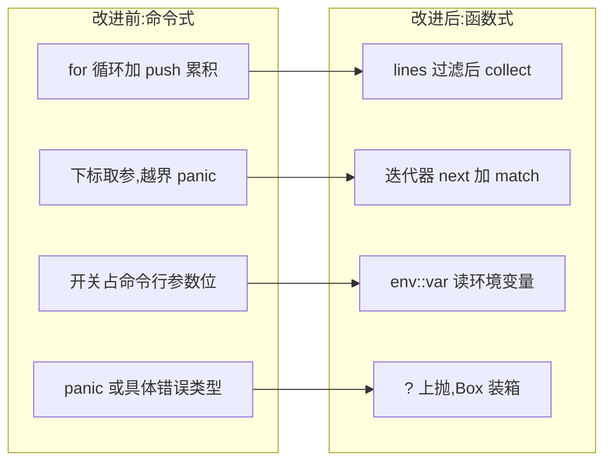

# Improving the CLI(改进 CLI 项目)

一句话:学完闭包与迭代器回头看 minigrep,同一份功能可以改得更短、更安全、更快——本篇用重构视角逐处对照改进前后的写法。

## 它解决什么问题

minigrep 的项目结构与完整流程在 [14-实战项目/01-Cli工具minigrep.md](../14-实战项目/01-Cli工具minigrep.md),本篇只谈写法。同一个能跑的程序里,三处值得动手:

- `search` 用 for 循环加 `results.push` 手工累积,过滤意图被样板淹没;
- `Config` 收 `&[String]`,用 `args[1]`、`args[2]` 下标取参,越界直接 panic,缺参没有任何报错机会;
- 大小写开关若走命令行参数,每加一个开关解析逻辑就膨胀一截;文件读取失败无处可去,只能 panic。

对应的改法各落在一件事上:迭代器链、`impl Iterator` 参数、`env::var` 读环境变量、`Box<dyn Error>` 装箱上抛。

## 核心规则

改进是逐点映射,不是推倒重写:



- 迭代器链编译后与手写循环性能相同甚至更好:编译器把整条链展开成单层循环,没有中间分配;
- 参数签名改为 `impl Iterator<Item = String>` 后,Config 不关心参数来自命令行还是测试构造的 Vec,`next()` 取不到就返回 `Err`,越界路径从签名层面消失;
- `Box<dyn Error>` 抹平具体错误类型:`run` 逐层 `?` 上抛,何时退出、怎么提示留给 main。

## 示例

摘自 `30-minigrep/src/lib.rs`:

```rust
/// 大小写敏感搜索：返回所有匹配的行
/// 生命周期标注说明：返回的引用来自 contents
pub fn search<'a>(query: &str, contents: &'a str) -> Vec<&'a str> {
    contents
        .lines()
        .filter(|line| line.contains(query))
        .collect()
}
```

命令式版本是 `let mut results` 加 for 内 if push;改后一条链,意图即字面意思:按行迭代,留下含 query 的行,收进 Vec。

```rust
/// 大小写不敏感搜索：把 query 和 line 都转小写比较
/// 注意 to_lowercase 会分配新 String，这里只在比较时做
pub fn search_case_insensitive<'a>(query: &str, contents: &'a str) -> Vec<&'a str> {
    let query_lower = query.to_lowercase();
    contents
        .lines()
        .filter(|line| line.to_lowercase().contains(&query_lower))
        .collect()
}
```

与敏感版只差两处:链外先把 query 转好小写,闭包里每行比较时各转一次。

```rust
impl Config {
    /// 从迭代器构造配置
    /// 第一个参数是程序名，跳过
    pub fn build(mut args: impl Iterator<Item = String>) -> Result<Config, &'static str> {
        args.next(); // 跳过程序名

        let query = match args.next() {
            Some(arg) => arg,
            None => return Err("未提供查询字符串"),
        };

        let file_path = match args.next() {
            Some(arg) => arg,
            None => return Err("未提供文件路径"),
        };

        // 大小写不敏感：环境变量 IGNORE_CASE=1 开启
        let ignore_case = env::var("IGNORE_CASE").is_ok();

        Ok(Config { query, file_path, ignore_case })
    }
}
```

对照点是签名:原来收 `&[String]` 用下标取参,越界即 panic;现在收 `impl Iterator`,每个参数 `next()` 一下,要么取到要么 `Err`。开关也不占参数位,改由环境变量决定。main 那半用闭包收尾:`Config::build(args.into_iter()).unwrap_or_else(|err| ...)` 打印用法并以退出码 1 结束,`run(config: &Config) -> Result<(), Box<dyn Error>>` 则把 IO 错误经 `?` 装箱上抛——报错与退出全在 main,库内没有 panic。

## 源码解读

crate:`30-minigrep/src/lib.rs`,`cargo run -p minigrep_demo` 可运行。

| 小节 | 演示什么 | 关键行 |
|---|---|---|
| search | 迭代器链替代 for+push 累积 | `contents.lines().filter(...).collect()` |
| search_case_insensitive | 闭包捕获链外转好的小写 query | `.filter(\|line\| line.to_lowercase().contains(&query_lower))` |
| Config::build | 下标取参改为 `impl Iterator` 加 `next()`,取不到返回 Err | `pub fn build(mut args: impl Iterator<Item = String>)` |
| ignore_case 开关 | 配置走环境变量,不占命令行参数位 | `let ignore_case = env::var("IGNORE_CASE").is_ok();` |
| run | IO 错误经 `?` 装箱上抛,main 的 `unwrap_or_else` 闭包接管报错 | `let contents = fs::read_to_string(&config.file_path)?;` |

## 实践项

| 练习 | 内容 | 对照组与评判标准 |
|---|---|---|
| [The Rust Book ch13.3](https://doc.rust-lang.org/book/ch13-03-improving-our-io-project.html) | 跟书把 minigrep 逐处改造成迭代器与环境变量版 | 对照组:`30-minigrep`;标准:改造前后 `cargo test` 全绿、输出一致,这是行为保持的重构 |
| [Rustlings 18_iterators](https://github.com/rust-lang/rustlings/tree/main/exercises/18_iterators) | iterators1~5:消费器、适配器、用迭代器重写循环型解法 | 先自己写,再对照 [官方解答](https://github.com/rust-lang/rustlings/tree/main/solutions/18_iterators);标准:全绿,能说出每题消费器选型理由 |
| [Exercism Rust track](https://exercism.org/tracks/rust) | 挑一道已做题,把手写循环重构为迭代器链 | 标准:两版结果一致,链版无中途 collect,错误不经 unwrap |

## 避坑

- 重构先立基线:动手前 `cargo test -p minigrep_demo` 全绿,每替换一处跑一遍;没有行为基线,「改好了」无从证明,链与循环产出不同也不易察觉。
- `impl Iterator` 参数会被消耗:`into_iter()` 之后 Vec 就空了,后面再用得重新收集;纯透传时 `env::args()` 本身就是迭代器,可直接传入——本仓库先 collect 成 Vec 只为判断参数个数。
- 不要为函数式而函数式:需要提前退出或维护跨轮状态的逻辑,命令式循环更直白;改写的判据是意图更清楚,不是行数更少。

## 参考资料

- [The Rust Book ch13.3 Improving Our I/O Project](https://doc.rust-lang.org/book/ch13-03-improving-our-io-project.html)
- [The Rust Book ch12 An I/O Project](https://doc.rust-lang.org/book/ch12-00-an-io-project.html)
- [Rust By Example - Closures](https://doc.rust-lang.org/stable/rust-by-example/fn/closures.html)
- [Rust By Example - impl Iterator](https://doc.rust-lang.org/stable/rust-by-example/trait/iter.html)
