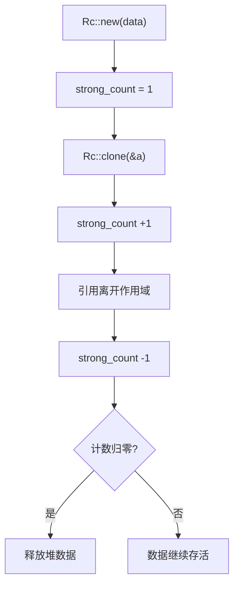

# Rc and Arc(引用计数)

一句话:一份数据可以有几个主人——Rc/Arc 用引用计数回答这个问题,数到零的那次 drop 负责清理。

## 它解决什么问题

Box 独占所有权,赋值即 move,但图节点被多条边指向、配置被多个模块共读时,数据天然需要多个所有者。Rc(单线程)与 Arc(多线程)补上这块:

- `Rc::clone(&a)` 不复制数据,只把 strong_count 加一;引用离开作用域自动减一;
- 计数归零才释放堆数据,期间所有持有者读到的是同一份;
- 两者的差别只在计数更新的方式:Rc 用普通整数,Arc 用原子操作,后者才能安全跨线程。

要修改共享到的数据,需叠加内部可变性,见 [03-RefCell内部可变性.md](./03-RefCell内部可变性.md)。

## 核心规则

计数像门禁:clone 进门 +1,drop 出门 -1,清零才拆房。



单线程默认选 Rc:普通整数计数,没有原子开销;要把值 move 进线程就必须换 Arc,因为 Rc 没实现 Send/Sync,跨线程传递直接编译失败。

## 示例

摘自 `26-smart-pointers/src/main.rs`:

```rust
// 第 2 节 Rc:clone 加一,出作用域减一
let a = Rc::new(String::from("shared data"));
println!("初始 strong_count = {}", Rc::strong_count(&a));

let b = Rc::clone(&a);
println!("clone 后 strong_count = {}", Rc::strong_count(&a));

{
    let c = Rc::clone(&a);
    println!("块内 strong_count = {}", Rc::strong_count(&a));
    println!("  b 和 c 指向同一数据: b='{}', c='{}'", b, c);
} // c 被 drop
println!("块结束后 strong_count = {}", Rc::strong_count(&a));
println!("a='{}', b='{}'（共享同一 String）", a, b);

// 第 3 节 Arc:原子计数,数据 move 进线程
let arc = Arc::new(vec![1, 2, 3]);
let arc_clone = Arc::clone(&arc);
let handle = std::thread::spawn(move || {
    println!("  线程内 Arc: {:?}", arc_clone);
});
handle.join().unwrap();
println!("主线程 Arc: {:?}", arc);
```

## 源码解读

crate:`26-smart-pointers/src/main.rs`,`cargo run -p smart_pointers_demo` 可运行。

| 小节 | 演示什么 | 关键行 |
|---|---|---|
| 2. `Rc<T>` | 单线程引用计数全程可见:clone 到 3,块结束回落到 2,b 与 c 读同一份数据 | `Rc::clone(&a)`、`Rc::strong_count(&a)` |
| 3. `Arc<T>` | `Arc::clone` 的副本 move 进线程,线程内可读,join 后主线程仍持有 | `Arc::clone(&arc)`、`thread::spawn(move ...)` |

## 实践项

| 练习 | 内容 | 对照组与评判标准 |
|---|---|---|
| [Rustlings 19_smart_pointers](https://github.com/rust-lang/rustlings/tree/main/exercises/19_smart_pointers) | smart_pointers2:八颗行星用 `Rc::clone` 共享同一个 `Rc<Sun>`,再用 drop 让计数从 9 回落到 1;smart_pointers3:八个线程各拿一份 `Arc<Vec<u32>>` 分片求和 | 先自己写,再对照 [官方解答](https://github.com/rust-lang/rustlings/tree/main/solutions/19_smart_pointers);标准:全绿,且能逐步说出 strong_count 每次变化的原因 |
| [Exercism Rust track](https://exercism.org/tracks/rust) | 任意含共享数据的题,用 Rc 让多个结构体指向同一份数据 | 标准:编译通过,且堆上只有一份数据副本 |

## 避坑

- Rc 没实现 Send/Sync,拿去跨线程直接编译错误;需要共享给线程就换 Arc,别硬凑。
- 两个 Rc 互指会让 strong_count 永不归零,内存泄漏;反向边用 Weak 持有,访问时 `Weak::upgrade` 取回临时强引用。
- 写 `Rc::clone(&a)` 而不是 `a.clone()`:行为相同,但前者一眼看出「只加计数,不复制数据」。

## 参考资料

- [The Rust Book ch15.4 Rc](https://doc.rust-lang.org/book/ch15-04-rc.html)
- [Rust By Example - Rc](https://doc.rust-lang.org/stable/rust-by-example/std/rc.html)
- [Rust By Example - Arc](https://doc.rust-lang.org/stable/rust-by-example/std/arc.html)
