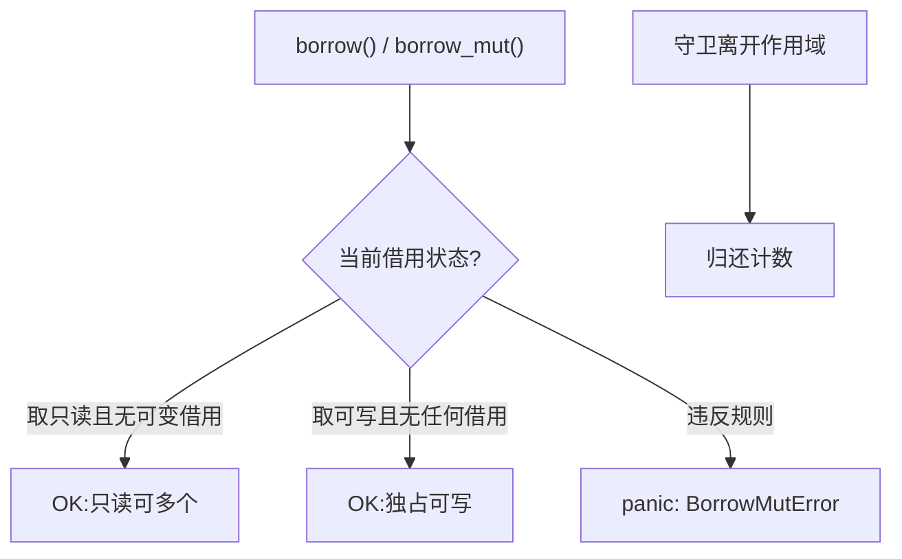

# RefCell(内部可变性)

一句话:借用规则本在编译期把守,RefCell 把执法挪到运行时——不可变外壳之下,留一道受控的修改通道。

## 它解决什么问题

有些修改在类型系统里写不出合法形式:通过 `Rc<T>` 共享的数据,持有者拿到的都是不可变引用,却要在运行时改内容;trait 方法签名只有 `&self`,却要记录调用历史。RefCell 提供「内部可变性」:

- `borrow()` 取只读借用,同一时刻可以有多个;
- `borrow_mut()` 取独占可写借用,持有期间其他任何借用都被拒;
- 违规调用立即 panic(BorrowMutError)——安全没有变少,只是从编译错误变成了运行时崩溃。

## 核心规则

规则与编译期借用检查是同一条:要么多个只读,要么一个可写;差别只在执法时机与违规后果。



## 示例

摘自 `26-smart-pointers/src/main.rs`:

```rust
// 第 4 节 RefCell:运行时借用检查
let cell = RefCell::new(vec![1, 2, 3]);

// borrow()：不可变借用
{
    let r = cell.borrow();
    println!("  borrow: {:?}", *r);
} // 必须先释放借用才能再 borrow_mut

// borrow_mut()：可变借用
{
    let mut r = cell.borrow_mut();
    r.push(4);
    r.push(5);
    println!("  borrow_mut 后: {:?}", *r);
}

// 运行时借用检查：同时多个可变借用会 panic
// let r1 = cell.borrow_mut();
// let r2 = cell.borrow_mut(); // panic!

// 第 5 节 Rc<RefCell<T>>:多所有权 + 可变
let shared = Rc::new(RefCell::new(vec![1, 2, 3]));

let owner1 = Rc::clone(&shared);
let owner2 = Rc::clone(&shared);

// owner1 修改
owner1.borrow_mut().push(4);
// owner2 修改
owner2.borrow_mut().push(5);

// 通过任一 owner 都能看到修改
println!("owner1 看到的: {:?}", *owner1.borrow());
println!("owner2 看到的: {:?}", *owner2.borrow());
println!("strong_count = {}", Rc::strong_count(&shared));
```

## 源码解读

crate:`26-smart-pointers/src/main.rs`,`cargo run -p smart_pointers_demo` 可运行。

| 小节 | 演示什么 | 关键行 |
|---|---|---|
| 4. `RefCell<T>` | borrow 只读、borrow_mut 可写,各自包在独立块里保证守卫及时释放;双 borrow_mut 注释演示 panic | `cell.borrow()`、`cell.borrow_mut()` |
| 5. `Rc<RefCell<T>>` | 两个 owner 各自 `borrow_mut` 修改,改动互见 | `Rc::clone(&shared)`、`owner1.borrow_mut().push(4)` |

## 实践项

| 练习 | 内容 | 对照组与评判标准 |
|---|---|---|
| [Rustlings 19_smart_pointers](https://github.com/rust-lang/rustlings/tree/main/exercises/19_smart_pointers) | 该套无 RefCell 专项,取 smart_pointers4 的 Cow 题:Cow 平时只读借用,需要修改才克隆,与 RefCell 同属推迟策略一族 | 先自己写,再对照 [官方解答](https://github.com/rust-lang/rustlings/tree/main/solutions/19_smart_pointers);标准:全绿,能指出四种输入里哪次发生了真正的 clone |
| [Exercism Rust track](https://exercism.org/tracks/rust) | 实现一个只有 `&self` 方法却能记录调用历史的类型,内部用 `RefCell<Vec<String>>` 存日志 | 标准:方法签名保持 `&self` 不变,测试能断言记录条数 |

## 避坑

- 守卫活得越久越危险:`borrow_mut()` 的返回值在手,后续任何借用都 panic;学 crate 把守卫包进独立块,用完即弃。
- RefCell 不是 Sync:跨线程共享要走 `Arc<Mutex<T>>`,误用会被编译器拦下。
- 拿不准借用状态时用 `try_borrow`/`try_borrow_mut`,返回 Result 而不是 panic,把「已被借用」变成可处理的分支。

## 参考资料

- [The Rust Book ch15.5 Interior Mutability](https://doc.rust-lang.org/book/ch15-05-interior-mutability.html)
