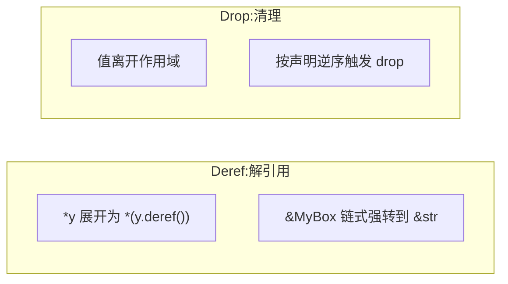

# Deref and Drop(解引用与清理)

一句话:智能指针像指针、能自动清理,靠的是 Deref 与 Drop 两个 trait——前者管「怎么用」,后者管「怎么死」。

## 它解决什么问题

Box/Rc/RefCell 本质都是包着指针的结构体,结构体默认既不能 `*` 解引用,也没有自定义的清理动作。两个 trait 补齐这两种能力:

- `Deref`:实现 `deref(&self) -> &Target` 后,`*p` 被编译器展开为 `*(p.deref())`;在函数参数等类型已知的位置,还会沿 Deref 链自动强转,`&String` 到 `&str` 就是标准库这样实现的;
- `Drop`:实现 `drop(&mut self)` 后,值离开作用域自动调用,负责释放堆内存、关闭句柄、解锁互斥量等清理。

自己写的类型实现它们,就能获得与标准库智能指针一致的手感。

## 核心规则

两个 trait 都由编译器代为触发,代码里找不到显式调用点:`*` 与强转在编译期按 Deref 展开,清理由编译器在作用域出口插入。



## 示例

摘自 `26-smart-pointers/src/main.rs`(MyBox 与 Droppy 定义在 main 上方):

```rust
impl<T> Deref for MyBox<T> {
    type Target = T;

    fn deref(&self) -> &Self::Target {
        &self.0
    }
}

impl Drop for Droppy {
    fn drop(&mut self) {
        println!("  Droppy({}) 被 drop", self.name);
    }
}

// 第 6 节 Deref 强制转换
let x = 5;
let mybox = MyBox::new(x);
// MyBox 实现了 Deref<Target=i32>，所以可当 &i32 用
println!("MyBox 解引用: {} (等价于 *mybox = {})", *mybox, *mybox);

// 标准库的 deref coercion：&String -> &str
let s = String::from("hello");
let s_ref: &str = &s; // String: Deref<Target=str>
println!("String deref 到 &str: {}", s_ref);

// 第 7 节 Drop 析构顺序
{
    let _a = Droppy { name: "A" };
    let _b = Droppy { name: "B" };
    let _c = Droppy { name: "C" };
    println!("  块结束，开始析构（逆序 C B A）：");
} // 析构顺序: C, B, A

let boxed = Box::new(Droppy { name: "boxed" });
println!("  Box<Droppy> 块结束：");
drop(boxed); // 显式 drop
```

## 源码解读

crate:`26-smart-pointers/src/main.rs`,`cargo run -p smart_pointers_demo` 可运行。

| 小节 | 演示什么 | 关键行 |
|---|---|---|
| 6. Deref 强制转换 | 自定义 MyBox 实现 Deref 后可用 `*`;`&String` 借用直接赋给 `&str` 变量触发标准库强转 | `impl Deref for MyBox<T>`、`let s_ref: &str = &s` |
| 7. Drop 析构顺序 | 三个 Droppy 按声明逆序析构;`drop()` 把值 move 走实现提前清理 | `impl Drop for Droppy`、`drop(boxed)` |

## 实践项

| 练习 | 内容 | 对照组与评判标准 |
|---|---|---|
| [Rustlings 19_smart_pointers](https://github.com/rust-lang/rustlings/tree/main/exercises/19_smart_pointers) | 该套无 Deref/Drop 专项,取 smart_pointers1 的 Box 题:Box 正是靠这两个 trait 才能直接 `*` 解引用和自动清理 | 先自己写,再对照 [官方解答](https://github.com/rust-lang/rustlings/tree/main/solutions/19_smart_pointers);标准:全绿,且能说出 `*b` 与自动清理各自来自哪个 trait |
| [Exercism Rust track](https://exercism.org/tracks/rust) | 实现一个带 Drop 的包装类型观察析构输出,再为它实现 Deref 支持解引用与强转 | 标准:析构输出为声明逆序;`*p` 与把 `&p` 传给接收 `&Target` 的函数都能编译 |

## 避坑

- 不能手写 `x.drop()`:那是编译器专用入口,显式调用等于让值析构两次;要提前清理用 `std::mem::drop(x)`,它把值 move 走,自然触发析构。
- 不要依赖精确析构顺序:局部变量按声明逆序 drop,但结构体字段、元组另有规则;资源间有依赖时显式 `drop()` 表达意图。
- deref 强转只在类型已知的位置发生:泛型函数的参数推断不会自动沿 Deref 链展开,必要时手动 `&*x` 或 `&x[..]`。

## 参考资料

- [The Rust Book ch15.2 Deref](https://doc.rust-lang.org/book/ch15-02-deref.html)
- [The Rust Book ch15.3 Drop](https://doc.rust-lang.org/book/ch15-03-drop.html)
