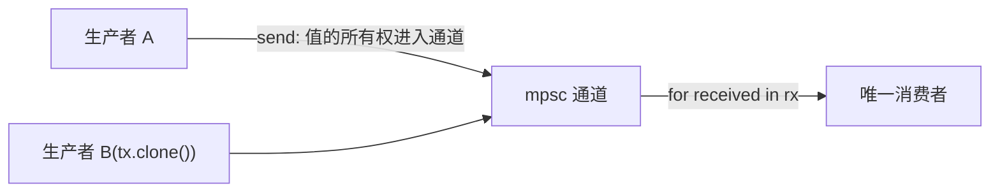

# Message Passing(消息传递)

一句话:不共享内存,改传所有权——`mpsc` 通道把值从发送端单向送进接收端,数据竞争没有立足之地。

## 它解决什么问题

多线程协作最朴素的办法是共享内存加锁,锁的正确性要靠人肉维护。另一条路反着走:Go 语言推崇的 CSP 理念——「不要通过共享内存来通信,要通过通信来共享内存」。Rust 标准库的 mpsc(multiple producer, single consumer)通道把这套理念落了地:值经 `send` 转移所有权进入通道,接收端拿到后独占,两个线程从头到尾不碰同一块内存,锁根本不需要出场。典型场景:流式数据传递、事件通知、把子线程算好的结果送回主线程。

## 核心规则



- 通道由两端组成:发送端 `Sender<T>` 可以 `clone` 出任意多个,接收端 `Receiver<T>` 全程只有一个——这正是 mpsc 名字的由来。
- `send` 即所有权交接:值 move 进通道后,发送侧再碰它就是编译错误;任一时刻「这条消息归谁」只有一个答案,这是通道免锁的根本原因。
- `rx` 自带迭代器:`for received in rx` 逐个阻塞收值;迭代结束的判定编译器替你做了——所有发送端 drop 后通道关闭,循环随之收尾,不需要手动判断「收完了没」。

## 示例

摘自 `27-concurrency/src/main.rs`:

```rust
// ===== 3. mpsc 通道 =====
// mpsc: multiple producer, single consumer
let (tx, rx) = mpsc::channel();

let handle = thread::spawn(move || {
    let msgs = vec!["hello", "from", "child"];
    for m in msgs {
        tx.send(m).unwrap();
        thread::sleep(Duration::from_millis(10));
    }
});

// 主线程接收：rx 是迭代器，每次 yield 一个收到的值
for received in rx {
    println!("  收到: {}", received);
}
handle.join().unwrap();

// ===== 4. 多生产者 =====
// clone tx 得到多个发送端
let (tx, rx) = mpsc::channel();
let tx1 = tx.clone();
let tx2 = tx;

let h1 = thread::spawn(move || {
    let vals = vec![1, 2, 3];
    for v in vals {
        tx1.send(("A", v)).unwrap();
    }
});

let h2 = thread::spawn(move || {
    let vals = vec![10, 20, 30];
    for v in vals {
        tx2.send(("B", v)).unwrap();
    }
});

// 接收所有消息（直到所有发送端关闭）
// 用 rx.try_iter 收集所有当前可用的
drop(h1.join().unwrap());
drop(h2.join().unwrap());
let collected: Vec<(&str, i32)> = rx.iter().collect();
println!("  多生产者消息: {:?}", collected);
```

## 源码解读

crate:`27-concurrency/src/main.rs`,`cargo run -p concurrency_demo` 可运行。

| 小节 | 演示什么 | 关键行 |
|---|---|---|
| 3. mpsc 通道 | 子线程逐条 send,主线程用 `rx` 迭代器阻塞接收,发完即收尾 | `mpsc::channel()`、`tx.send(m).unwrap()` |
| 4. 多生产者 | `clone` 出两个发送端分给两个线程,join 后用 `rx.iter()` 一次性收齐 | `tx.clone()`、`rx.iter().collect()` |

## 实践项

| 练习 | 内容 | 对照组与评判标准 |
|---|---|---|
| [Rustlings 20_threads](https://github.com/rust-lang/rustlings/tree/main/exercises/20_threads) | threads3:两个线程各发一半数据,`tx` 要同时活在这两个线程里 | 先自己写,再对照 [官方解答](https://github.com/rust-lang/rustlings/tree/main/solutions/20_threads);标准:全绿,且能说出 `tx` 进两个线程靠的是哪种机制 |
| [Exercism Rust track](https://exercism.org/tracks/rust) | 用 mpsc 写生产者-消费者:多线程生产,主线程消费 | 标准:消息一条不丢,且收尾条件你能解释清楚 |

## 避坑

- 提前退出丢消息:`for received in rx` 中途 `break` 或提前 drop `rx`,在途消息直接蒸发——想提前收工,先保证生产者已经结束。
- 接收端消失,`send` 跟着炸:唯一的 `Receiver` 一旦 drop,后续 `send` 全部返回 `Err`,`unwrap` 就是 panic;生产者循环里敢 unwrap,隐含的是「消费者活到最后」的假设。
- 忘了 `move`:发送闭包不加 `move` 就是借用 `tx` 和数据,而线程可能活得比借用久,编译器直接拒绝——通道两端的所有权都要搬进线程。

## 参考资料

- [The Rust Book ch16.02 Message Passing](https://doc.rust-lang.org/book/ch16-02-message-passing.html)
