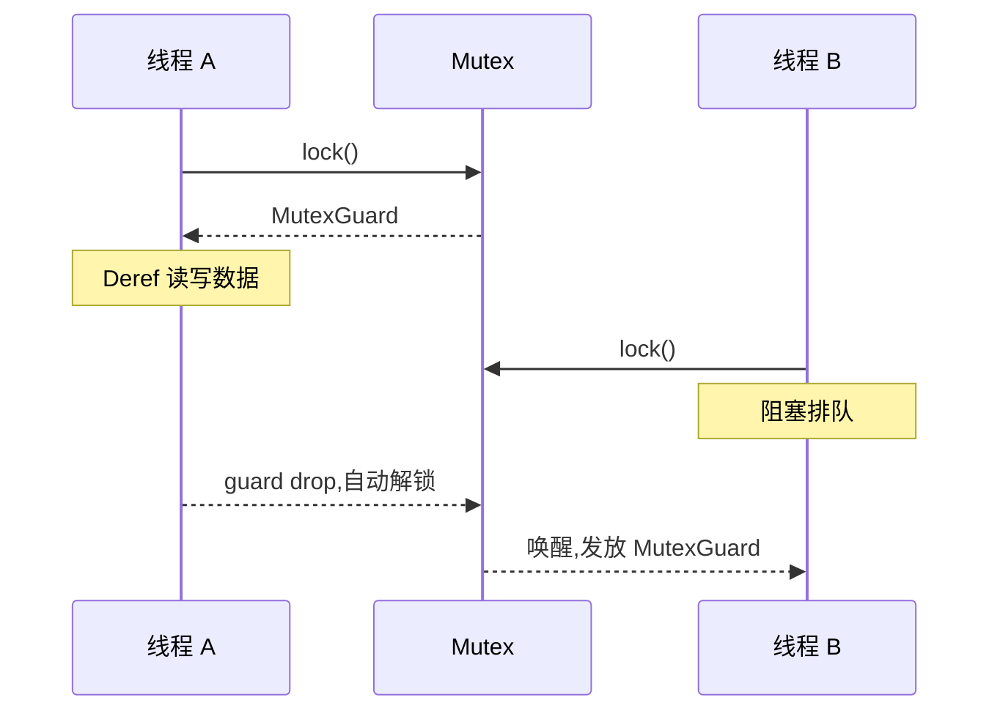

# Shared State(共享状态 Mutex)

一句话:数据被锁进 `Mutex<T>`,唯一的门是 `lock()`——拿到 `MutexGuard` 的人独占读写,guard 一 drop 自动还锁。

## 它解决什么问题

通道适合数据单向流动,但计数器、缓存这类状态需要多个线程「就地」反复读写。`Mutex<T>`(互斥锁)把数据整个包起来:不 `lock` 就拿不到内部数据的引用,「忘记加锁」在 Rust 里不是隐患,而是编译错误。同一把锁要被多个线程持有时,外面再包一层 `Arc` 提供共享所有权,得到标准组合 `Arc<Mutex<T>>`;至于裸的 `Rc<RefCell<T>>` 为什么进不了线程,由 04 篇的 Send/Sync 检查给出答案。

## 核心规则



- `lock()` 阻塞到拿锁为止,返回 `Result<MutexGuard<T>>`;guard 实现 `Deref`/`DerefMut`,解引用即读写——数据本体从不外露,不存在绕过锁的访问路径。
- 解锁即 drop:guard 离开作用域自动释放锁,临界区的大小由作用域框定,没有「忘了解锁」这回事。
- `lock()` 的返回值是 `Result`:持锁线程 panic 会「毒化」这把锁——数据可能停在改到一半的状态,之后的 `lock()` 一律返回 `Err`。

## 示例

摘自 `27-concurrency/src/main.rs`:

```rust
// ===== 5. Mutex =====
// Mutex 提供互斥访问，lock() 返回 MutexGuard
let m = Mutex::new(5);
{
    let mut num = m.lock().unwrap();
    *num += 1;
} // MutexGuard 在这里 drop，释放锁
println!("  Mutex 内值: {:?}", m);

// ===== 6. Arc<Mutex<T>> 共享可变 =====
// Arc 多线程共享所有权，Mutex 提供可变性
let counter = Arc::new(Mutex::new(0));
let mut handles = vec![];

for _ in 0..10 {
    let counter = Arc::clone(&counter);
    let handle = thread::spawn(move || {
        let mut num = counter.lock().unwrap();
        *num += 1;
    });
    handles.push(handle);
}

for h in handles {
    h.join().unwrap();
}
println!("  10 线程各 +1 后计数器 = {}", *counter.lock().unwrap());
```

## 源码解读

crate:`27-concurrency/src/main.rs`,`cargo run -p concurrency_demo` 可运行。

| 小节 | 演示什么 | 关键行 |
|---|---|---|
| 5. Mutex | 最小锁模型:进小作用域拿 guard 改值,出作用域锁自动释放 | `let mut num = m.lock().unwrap()` |
| 6. Arc\<Mutex\<T\>\> | 十线程各 +1,结果恒为 10:读-改-写全程锁内,不会被别的线程插队 | `Arc::clone(&counter)`、`*num += 1` |

## 实践项

| 练习 | 内容 | 对照组与评判标准 |
|---|---|---|
| [Rustlings 20_threads](https://github.com/rust-lang/rustlings/tree/main/exercises/20_threads) | threads2:十个线程共享 `JobStatus` 各 +1,`Arc` 单枪匹马不够,可变共享状态要补锁 | 先自己写,再对照 [官方解答](https://github.com/rust-lang/rustlings/tree/main/solutions/20_threads);标准:全绿,且能说出加锁前后编译器眼中 `Arc<JobStatus>` 发生了什么变化 |
| [Exercism Rust track](https://exercism.org/tracks/rust) | 挑一题用 `Arc<Mutex<T>>` 让多线程更新同一份统计(计数、求和) | 标准:连跑多次结果完全一致,且能解释每处 `lock()` 的作用域为什么划在那里 |

## 避坑

- 读也要过锁:「我只是读一下」照样得 `lock`——不持锁就看不到数据,而且别的线程可能正在写。读多写少想免排队,换 `RwLock`:读锁共享、写锁独占。
- 中毒不是锁坏了,是数据可疑:`PoisonError` 表示上一个持锁者 panic 了,数据可能不一致;`unwrap` 是「跟着 panic」的保守解,要抢救数据得 `into_inner()` 并自己承担一致性。
- clone 的是 `Arc`,不是锁:`Arc::clone` 复制的是指向同一把 `Mutex` 的指针;循环里若顺手 `Mutex::new` 一把新锁,各线程锁各自的,竞争原样复活。

## 参考资料

- [The Rust Book ch16.03 Shared State](https://doc.rust-lang.org/book/ch16-03-shared-state.html)
