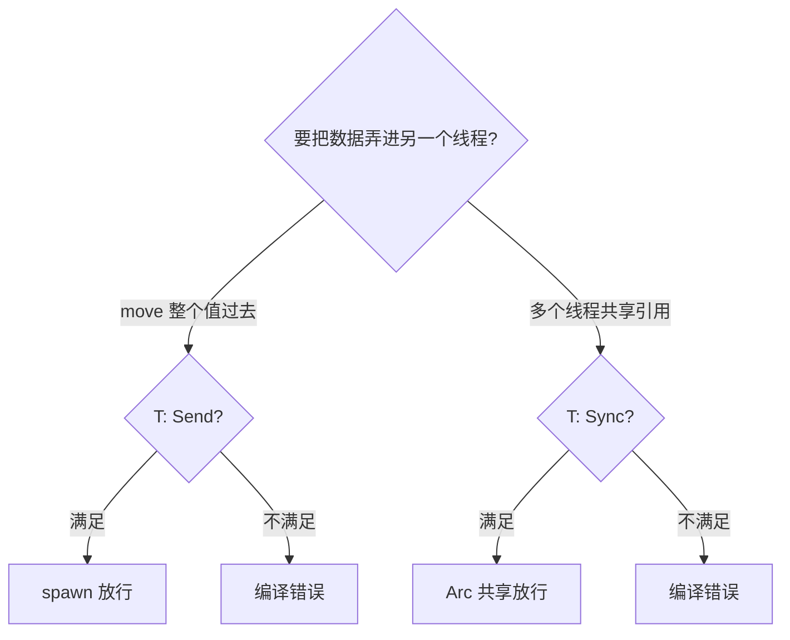

# Send and Sync(跨线程标记)

一句话:`Send` 与 `Sync` 是两个没有方法的标记 trait,`thread::spawn` 拿它们当门槛——不安全的跨线程数据访问,编译期就吃闭门羹。

## 它解决什么问题

其他语言判断线程安全靠文档和自觉,漏读一条注释就是线上数据竞争。Rust 把判断编进类型系统:`spawn` 的签名要求闭包和返回值都满足 `Send`,编译器沿类型的字段结构逐层核查,差一个字段都不放行。01 篇给过一句话定义,这一篇往下挖三层:标记如何自动推导、常见类型各自卡在哪一条、以及 `Arc<Mutex<T>>` 能过检而 `Rc<RefCell<T>>` 不能的机理。

## 核心规则



- 两个标记互为镜像:`T: Sync` 当且仅当 `&T: Send`——引用能安全搬去别的线程,等价于数据能被多线程同时盯着。
- 自动推导不需要 `derive`:struct/enum 的 Send/Sync 由字段决定,所有字段满足则整体满足,混进一个 `Rc` 就整体失格——推导沿类型树递归到底。
- 检查点在 `spawn` 签名:闭包与返回值都要 `Send + 'static`,拦下的不止是非 Send 类型,还有借用了栈上数据的闭包——`move` 与 `Send` 是两道并排的闸。

常见类型的边界(✓ 满足 / ✗ 不满足):

| 类型 | Send | Sync | 机理 |
|---|---|---|---|
| `i32` / `String` / `Vec<T>` | ✓ | ✓ | 纯数据,无共享可变性 |
| `Rc<T>` | ✗ | ✗ | 引用计数是普通加减法,两线程同时 clone/drop 会算错 |
| `Arc<T>` | ✓ | ✓ | 计数换成原子指令(要求 `T: Send + Sync`) |
| `RefCell<T>` | ✓ | ✗ | 运行时借用计数不认线程,两边能各借到一个 `&mut` |
| `Mutex<T>` | ✓ | ✓ | `lock()` 在线程间同步,独占访问补齐 Sync(只要 `T: Send`) |
| `MutexGuard<'_, T>` | ✓ | ✗ | 解锁必须发生在持锁线程,guard 不能跨线程共享 |
| `*mut T` | ✗ | ✗ | 编译器无法担保裸指针,想放行得 `unsafe impl` |

## 示例

摘自 `27-concurrency/src/main.rs`:

```rust
// ===== 7. Send / Sync 标记 trait =====
// Send：类型可安全地在线程间转移所有权（Rc 不是 Send，Arc 是）
// Sync：&T 可安全地在线程间共享（RefCell 不是 Sync，Mutex 是）
// 编译器自动推导；实现 unsafe 的 Send/Sync 需手动

// 验证 Arc 是 Send + Sync
fn assert_send_sync<T: Send + Sync>(_: &T) {}
let arc = Arc::new(5);
assert_send_sync(&arc);
println!("  Arc<i32> 满足 Send + Sync");

// Rc 不是 Send（注释演示）
// let rc = std::rc::Rc::new(5);
// thread::spawn(move || { println!("{:?}", rc); }); // 编译错误: Rc 不是 Send
```

## 源码解读

crate:`27-concurrency/src/main.rs`,`cargo run -p concurrency_demo` 可运行。

| 小节 | 演示什么 | 关键行 |
|---|---|---|
| 7. Send / Sync 标记 trait | 拿泛型约束当编译期断言,验证 `Arc<i32>` 同时满足 Send 与 Sync | `fn assert_send_sync<T: Send + Sync>` |
| 7(对照注释) | 反例以注释保留:`Rc` 塞进 `spawn` 直接编译失败 | `// thread::spawn(move \|\| ...)` |

## 实践项

| 练习 | 内容 | 对照组与评判标准 |
|---|---|---|
| [Rustlings 20_threads](https://github.com/rust-lang/rustlings/tree/main/exercises/20_threads) | threads2 换个打开方式:先把共享状态写成 `Arc<RefCell<JobStatus>>` 亲眼看编译器拒绝,再换 `Arc<Mutex<JobStatus>>` 放行 | 先自己写,再对照 [官方解答](https://github.com/rust-lang/rustlings/tree/main/solutions/20_threads);标准:全绿,且能用 Send/Sync 术语说清两种写法一拒一放的差别 |
| [Exercism Rust track](https://exercism.org/tracks/rust) | 挑一题,故意把 `Rc` 塞进 `spawn` 闭包,读懂编译错误后修复 | 标准:不看提示能说出拒绝的确切理由——哪个类型、缺哪个标记 |

## 避坑

- `Send` 是搬运许可,不是安全通行证:能整体搬进线程,不代表两个线程同时改它也安全——共享可变仍要靠 `Mutex` 把访问串行化。
- 编译报「不能跨线程」时,别盯着 `spawn` 看:错误链会指认出不满足 bound 的具体字段,顺着 `Rc`/`RefCell`/裸指针的字段链找到根源,再换 `Arc`/`Mutex` 或重构所有权。
- `unsafe impl Send/Sync` 是签生死状:含义是「编译器查不了,不变量我担保」;说不清类型不变量就别写——它把编译错误降级成未定义行为。

## 参考资料

- [The Rust Book ch16.04 Extensible Concurrency: Sync 与 Send](https://doc.rust-lang.org/book/ch16-04-extensible-concurrency-sync-and-send.html)
