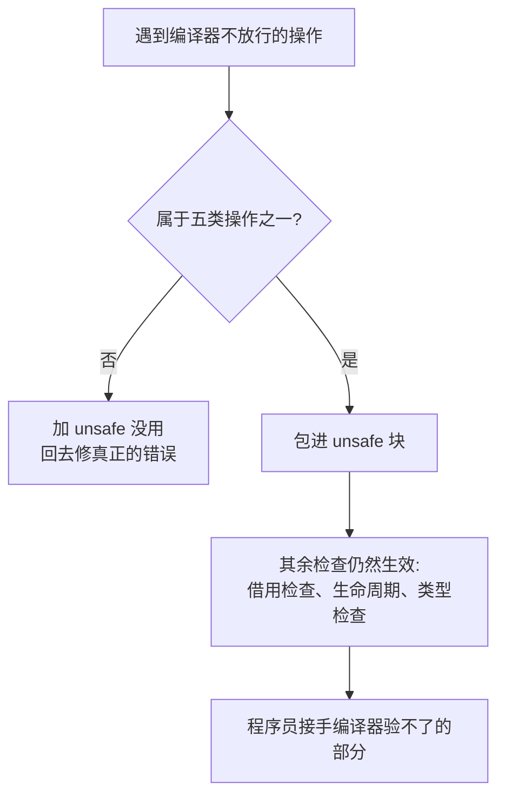

# Unsafe Rust(不安全 Rust)

一句话:unsafe 不是关掉所有检查,而是把编译器验不了的五类底层操作交给你自己保证安全。

## 它解决什么问题

Safe Rust 的检查覆盖大多数场景,但五类操作编译器无法静态验证:解引用裸指针、调用 unsafe 函数、读写可变 static、实现 unsafe trait、读取 union 字段。FFI 调 C 函数、实现底层容器、嵌入式直接读写内存,都绕不开它们。

unsafe 块的含义是「这里的安全性我接手」:指针有效、不变量成立、无数据竞争,由程序员证明,而不是编译器。

## 核心规则



- 「五类操作」的声明本身不危险:创建裸指针、定义 `unsafe fn`、声明 `unsafe trait` 都是安全的,解引用、调用、实现处才需要 unsafe。
- unsafe 块不关闭借用检查器,在 unsafe 里违反借用规则照样编译失败。
- 原则:能不用就不用;用就把 unsafe 范围缩到最小,并封装成对外安全的 API——标准库 Vec 内部操作裸内存,对外全是 safe 接口。

## 示例

摘自 `28-unsafe/src/main.rs`:

```rust
let mut num = 5;
let r1 = &num as *const i32;   // 不可变裸指针
let r2 = &mut num as *mut i32; // 可变裸指针

// 解引用必须在 unsafe 块内
unsafe {
    println!("  r1 指向: {}", *r1);
    println!("  r2 指向: {}", *r2);
}

// ...(省略:unsafe fn、static mut、unsafe trait、union 小节,见下表)
unsafe {
    COUNTER += 1;
    COUNTER += 1;
    println!("  COUNTER = {}", COUNTER);
}

// ...(省略:使用场景、借用检查小节)
fn split_at_mut(values: &mut [i32], mid: usize) -> (&mut [i32], &mut [i32]) {
    let len = values.len();
    assert!(mid <= len);
    let ptr = values.as_mut_ptr();
    // 这里的 unsafe 让编译器相信两个切片不重叠
    unsafe {
        (
            std::slice::from_raw_parts_mut(ptr, mid),
            std::slice::from_raw_parts_mut(ptr.add(mid), len - mid),
        )
    }
}

let mut data = vec![10, 20, 30, 40, 50];
let (left, right) = split_at_mut(&mut data, 2);
println!("  split_at_mut: left={:?}, right={:?}", left, right);
```

## 源码解读

crate:`28-unsafe/src/main.rs`,`cargo run -p unsafe_demo` 可运行。

| 小节 | 演示什么 | 关键行 |
|---|---|---|
| 1 解引用裸指针 | 创建裸指针安全,解引用才需 unsafe | `&num as *const i32`、`unsafe { *r1 }` |
| 2 调用 unsafe 函数 | `unsafe fn` 必须在 unsafe 块内调用 | `unsafe { dangerous() }` |
| 3 可变 static | `static mut` 读写都是 unsafe,普通 static 安全 | `COUNTER += 1`、`HELLO` |
| 4 实现 unsafe trait | 实现处要 `unsafe impl` | `unsafe impl Trusted for MyRaw` |
| 5 访问 union 字段 | 字段共享内存,读错字段得到无效值 | `IntOrFloat { i: 42 }`、`u.i`、`u.f` |
| 6 何时该用 unsafe | FFI/性能/底层/嵌入式;能不用就不用 | `- FFI:调用 C 函数` |
| 7 借用检查不关 | unsafe 块内违反借用规则仍编译失败 | 注释掉的 `v.push(4)` |
| 8 安全 API 封装 | 内部 unsafe 切出两个不重叠的可变切片 | `split_at_mut`、`from_raw_parts_mut` |
| 9 extern FFI | `extern "C"` 声明外部函数,调用需 unsafe | `unsafe { abs(-5) }` |
| 10 总结 | 五大操作回顾 + 最小化原则 | `println!("  原则:最小化 unsafe 范围...")` |

## 实践项

| 练习 | 内容 | 对照组与评判标准 |
|---|---|---|
| [Exercism Rust track](https://exercism.org/tracks/rust) | 任意题先写 safe 版;再挑一处确有必要处用 unsafe 实现一次 | 标准:能逐处说出 unsafe 里程序员要保证什么不变量 |
| [Rust By Example - Unsafe](https://doc.rust-lang.org/stable/rust-by-example/unsafe.html) | 本地复现裸指针与 FFI abs 示例 | 标准:编译运行通过,且能解释 unsafe 不关闭借用检查 |

## 避坑

- 「编译报错就加 unsafe」修不了错:借用、生命周期、类型错误 unsafe 全救不了,它只放行五类操作。
- `static mut` 是跨线程数据竞争温床:多线程场景用 `Mutex` 或原子类型替代。
- 裸指针不自动清理、可为 null、可悬垂;panic 跨 FFI 边界是未定义行为,封装时用 `catch_unwind` 兜住。

## 参考资料

- [The Rust Book ch20.1 Unsafe Rust](https://doc.rust-lang.org/book/ch20-01-unsafe-rust.html)
- [Rust By Example - Unsafe](https://doc.rust-lang.org/stable/rust-by-example/unsafe.html)
- 本地旧笔记:`D:\Myknows\Myknows\原理\Rust\13-高级特性\01-Unsafe-Rust.md`(与本文持续同步)
