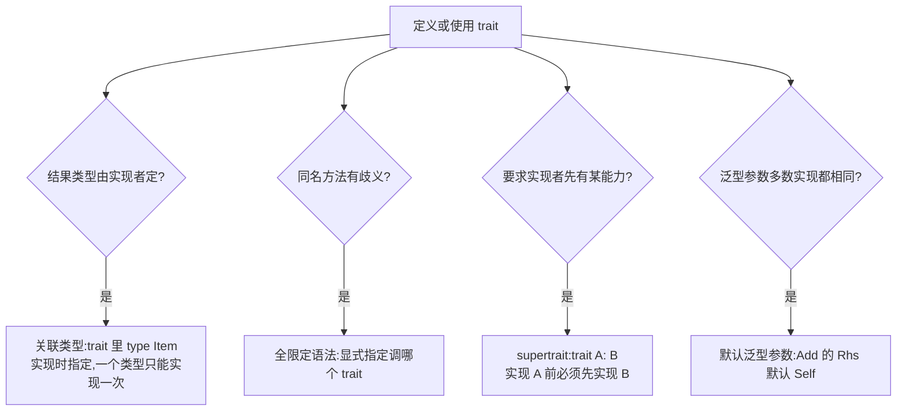

# Advanced Traits(高级 Trait)

一句话:基础 trait 只声明「有哪些行为」,关联类型、默认泛型参数、supertrait、全限定语法再往前一步,让 trait 表达更精确的类型关系——读懂标准库源码靠的就是它们。

## 它解决什么问题

把 Iterator 写成泛型 `Iterator<T>`,一个类型能以多个 `T` 各实现一份,`for x in c` 就不知道取哪份;运算符 trait 若无默认参数,每处实现都要多写一遍;两个 trait 撞了同名方法,直接调用会歧义。标准库的解法:关联类型把输出钉死为唯一,默认泛型参数吸收最常见实参,supertrait 声明实现前提,全限定语法在歧义处指名道姓。

## 核心规则



- 关联类型:trait 内 `type Item;`,实现处写 `type Item = u32;`,方法签名用 `Self::Item`。输出类型唯一用关联类型;同一操作要适配多种输入(如 `From<T>`)才用泛型参数。
- 默认泛型参数:`impl Add for T` 自动取 `Rhs = Self`;只有跨类型运算才写 `impl Add<Meters> for Millimeters`。
- supertrait:`trait OutlinePrint: Display` 之后,默认实现里能直接调 `self.to_string()`,因为 Self 必然实现了 Display。
- 全限定语法 `<Type as Trait>::method()`;无歧义时用普通调用,类型自身的固有方法永远优先。
- 孤儿规则:不能为外部类型实现外部 trait;用元组结构体包一层(newtype 模式)即可,包装零开销,内部经 `w.0` 访问,或实现 Deref 让调用直达(见下一篇)。

## 示例

关联类型——实现真正的 `std::iter::Iterator`:

```rust
struct Counter { count: u32 }

impl Iterator for Counter {          // Iterator 在预导入包里,无需 use
    type Item = u32;

    fn next(&mut self) -> Option<Self::Item> {
        if self.count < 5 {
            self.count += 1;
            Some(self.count)
        } else {
            None
        }
    }
}

// for x in (Counter { count: 0 }):逐个产出 1..=5,元素类型就是 Item = u32
```

默认泛型参数——`Add` 的 `Rhs` 默认为 Self:

```rust
use std::ops::Add;

#[derive(Debug, Clone, Copy)]
struct Millimeters(u32);
struct Meters(u32);

impl Add for Millimeters {              // Rhs 取默认值 Self
    type Output = Millimeters;

    fn add(self, rhs: Millimeters) -> Millimeters {
        Millimeters(self.0 + rhs.0)
    }
}

impl Add<Meters> for Millimeters {      // 覆盖默认:Rhs = Meters
    type Output = Millimeters;

    fn add(self, rhs: Meters) -> Millimeters {
        Millimeters(self.0 + rhs.0 * 1000)
    }
}

let same = Millimeters(50) + Millimeters(2);   // 同类型相加
let mixed = Millimeters(500) + Meters(1);      // 跨类型:500 mm + 1 m
println!("{:?}, {} mm", same, mixed.0);        // Millimeters(52), 1500 mm
```

supertrait——实现前必须先实现 Display:

```rust
use std::fmt;

trait OutlinePrint: fmt::Display {
    fn outline_print(&self) {
        let output = self.to_string();   // Display 提供 to_string
        println!("* {} *", output);
    }
}

struct Point { x: i32, y: i32 }

impl fmt::Display for Point {            // 不先实现它,下面的 impl 编译失败
    fn fmt(&self, f: &mut fmt::Formatter<'_>) -> fmt::Result {
        write!(f, "({}, {})", self.x, self.y)
    }
}

impl OutlinePrint for Point {}           // 直接复用默认实现

Point { x: 1, y: 2 }.outline_print();    // 输出 * (1, 2) *
```

全限定语法——同名方法各归各:

```rust
trait Pilot {
    fn name() -> &'static str;
}

trait Wizard {
    fn name() -> &'static str;
}

struct Human;

impl Pilot for Human { fn name() -> &'static str { "机长" } }
impl Wizard for Human { fn name() -> &'static str { "巫师" } }

impl Human {
    fn name() -> &'static str { "人类" }   // 固有方法
}

Human::name();                  // 人类:固有方法优先
<Human as Pilot>::name();       // 机长
<Human as Wizard>::name();      // 巫师
```

## 实践项

| 练习 | 内容 | 对照组与评判标准 |
|---|---|---|
| [Exercism Rust track](https://exercism.org/tracks/rust) | 任选一题,给自定义类型实现 `std::iter::Iterator` 并指定关联类型,让 `for` 循环直接遍历 | 标准:循环里不出现显式 `next` 调用,能说清为何用关联类型而非泛型参数 |
| [Exercism Rust track](https://exercism.org/tracks/rust) | 重载 `std::ops::Add`,其中一处覆盖默认 `Rhs` 做跨类型运算 | 标准:同类型与跨类型的 `+` 都编译通过,且能写出其中一处对应的全限定调用 |

## 避坑

- 一个类型对带关联类型的 trait 只能实现一次:`Counter` 不可能既是迭代 `u32` 又是迭代 `String` 的 Iterator;真需要多份实现(如 `From<i32>`、`From<f32>`)就改用泛型参数。
- 多个 trait 同名方法且类型自身没有同名固有方法时,`obj.method()` 直接报歧义错误;先看固有方法(永远优先),再上全限定语法。
- 全限定语法只解决「调哪个」,不解决 trait bound 缺失:supertrait 没实现时报的是 `Point: Display` 不满足,补实现而不是换调用写法。

## 参考资料

- [The Rust Book ch20.2 Advanced Traits](https://doc.rust-lang.org/book/ch20-02-advanced-traits.html)
