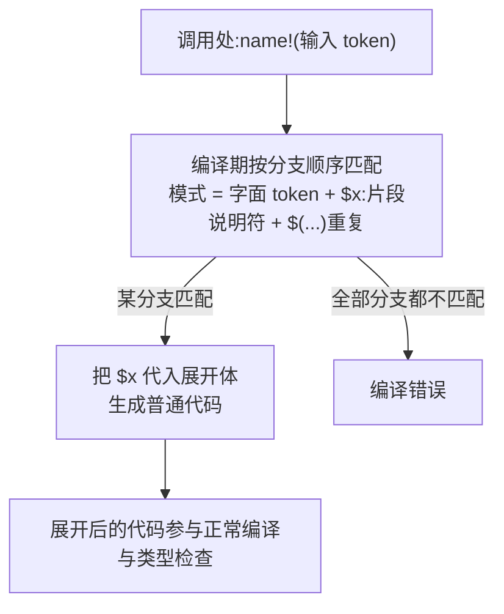

# Macros(宏)

一句话:宏在编译期按模式匹配展开成代码,做到函数做不到的事——可变参数、自定义语法、生成代码。

## 它解决什么问题

函数的参数数量和类型都是固定的,而 `println!` 要接任意个参数、`vec![1, 2, 3]` 要按字面量直接构造 Vec——这些函数都写不出来。声明宏(`macro_rules!`)在编译期把调用处的 token 按分支匹配,展开成普通代码后再参与编译,可变参数和代码生成都成为可能。

## 核心规则



- 宏不是函数:函数运行时调用、签名固定;宏编译时展开、参数可变、还能生成结构体定义(简化版 derive)。
- 片段说明符决定匹配什么:`$x:expr`(表达式)、`ident`、`ty`、`pat`、`literal`、`tt` 等;`$(...),*` / `$(...)+` 匹配逗号分隔的重复,`$(,)?` 容忍尾逗号。
- 递归宏 = 终止分支 + 自调用,每次消耗一个参数,直到命中终止分支。
- `#[macro_export]` 让宏可被其他 crate 使用;能用函数就用函数,宏留给函数做不到的场景。

## 示例

摘自 `29-macros/src/main.rs`:

```rust
macro_rules! my_vec {
    ( $( $x:expr ),* $(,)? ) => {
        {
            let mut v = Vec::new();
            $(
                v.push($x);
            )*
            v
        }
    };
}

macro_rules! my_sum {
    // 单个值：递归终止
    ($single:expr) => {
        $single
    };
    // 多个值：第一个 + 剩余的递归求和
    ($first:expr, $($rest:expr),*) => {
        $first + my_sum!($($rest),*)
    };
}

// ...(省略:print_value、my_println、math、measure_time、assert_non_empty,见下表)
let v1 = my_vec![1, 2, 3, 4, 5];
println!("  my_vec!: {:?}", v1);
let s3 = my_sum!(1, 2, 3, 4, 5);
println!("  my_sum!(1,2,3,4,5) = {}", s3);
```

## 源码解读

crate:`29-macros/src/main.rs`,`cargo run -p macros_demo` 可运行。

| 小节 | 演示什么 | 关键行 |
|---|---|---|
| 1 最简单的宏 | 无参宏的定义与调用 | `macro_rules! say_hello` |
| 2 带参数的宏 | `$x:expr` 匹配表达式,`stringify!` 回显源码文本 | `print_value!(x + 1)` |
| 3 重复 | `$(...),*` 加可选尾逗号 `$(,)?` 构造 Vec | `my_vec![1, 2, 3, 4, 5]`、`my_vec![]` |
| 4 递归宏 | 终止分支 + 自调用逐个消耗参数 | `my_sum!(1, 2, 3, 4, 5)` |
| 5 自定义 println | 按 literal / literal+args 两个分支转发 | `my_println!("带参数: x={}, s={}", x, "hello")` |
| 6 条件分支宏 | 分支开头的字面 token(add/mul/max)分流 | `math!(add 3, 4)` |
| 7 块参数宏 | `$body:block` 匹配整块代码并计时、返回其值 | `measure_time!("空循环1e6", { ... })` |
| 8 导出宏 | `#[macro_export]` 使宏可跨 crate 使用 | `assert_non_empty!(s)` |
| 9 宏 vs 函数 | 函数签名固定,宏接受可变参数 | `my_sum!(2, 3, 4)` |
| 10 生成结构体 | `$name:ident`/`$ty:ty` 在宏里生成 struct 定义 | `make_struct!(Point { x: f64, y: f64 })` |
| 片段说明符速查 | 注释区列出 expr/ident/ty/pat/tt 等全部说明符 | `// expr : 表达式,如 1+2、foo()` |

## 实践项

| 练习 | 内容 | 对照组与评判标准 |
|---|---|---|
| [Rustlings 21_macros](https://github.com/rust-lang/rustlings/tree/main/exercises/21_macros) | macros1~4:补宏调用语法、写带参与分支宏 | 先自己写,再对照 [官方解答](https://github.com/rust-lang/rustlings/tree/main/solutions/21_macros);标准:全绿,能说出每个调用命中哪个分支 |
| [Rust By Example - Macros](https://doc.rust-lang.org/stable/rust-by-example/macros.html) | 复现 my_vec,再写一个 `hashmap!("a" => 1, "b" => 2)` 宏 | 标准:空、单元素、尾逗号都能用,`hashmap!` 编译运行通过 |
| [Rust By Example - designators](https://doc.rust-lang.org/stable/rust-by-example/macros/designators.html) | 逐个试 expr/ident/ty/pat 等说明符 | 标准:能说出 `expr` 与 `tt` 匹配范围的差别 |

## 避坑

- 递归宏有深度上限,参数太多会编译错误;能用 `$(...)*` 循环展开就别用递归。
- 宏有卫生性(hygiene):宏内部生成的变量不会泄漏到调用方作用域,别指望宏里的 `let` 在外面可见。
- 宏展开后的报错难读:能用函数就用函数;需要看展开结果时用 `cargo expand`。

## 参考资料

- [The Rust Book ch20.5 Macros](https://doc.rust-lang.org/book/ch20-05-macros.html)
- [Rust By Example - Macros](https://doc.rust-lang.org/stable/rust-by-example/macros.html)
