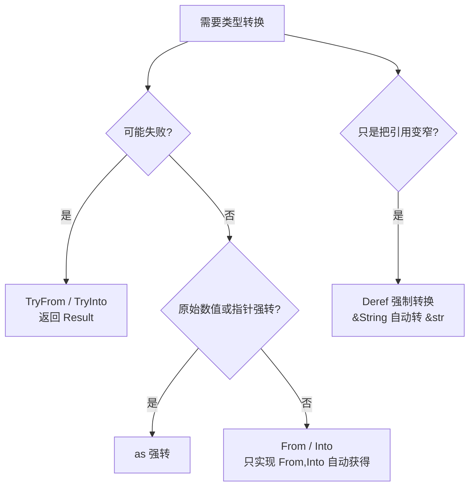

# Type Conversions(类型转换)

一句话:Rust 不做隐式数值转换,类型之间的桥由 trait 搭——From/Into 显式转换、as 强转兜底、Deref 让引用自动变窄。

## 它解决什么问题

`i32` 不能直接当 `u64` 用,`&String` 不能直接传给要 `&str` 的参数;若每个类型各造一套转换 API,调用方要背一堆方法名。标准库把转换收敛成几个 trait:实现一次 `From<T> for U`,`U::from(t)` 与 `t.into()` 同时可用;实现 `Deref` 后,凡需要 `&Target` 的地方编译器自动把 `&T` 转过去,调用方零代码。

## 核心规则



- From 是源头:实现 `impl From<T> for U` 后,标准库的 blanket impl 自动提供 `Into<U> for T`;自定义转换只写 From,不写 Into。
- 约定:From/Into 转换永不失败;可能失败的(如 `i32` 转 `u8` 越界)用 `TryFrom`/`TryInto`,错误类型实现 `std::error::Error` 后可统一汇入 `Box<dyn Error>`。
- as 是编译器内置强转,只用于原始数值与指针之间,不经过任何 trait。
- Deref:`impl Deref for T` 声明 `type Target`,凡需要 `&Target` 的地方编译器自动把 `&T` 转过去,可链式多层——`&Box<String>` → `&String` → `&str`;`String`、`Vec<T>`、`Box<T>` 全靠它。
- AsRef 用在泛型参数上:`fn take(s: impl AsRef<str>)` 同时接受 `&str`、`&String`、`String`。

## 示例

From / Into——只写 From,Into 免费获得:

```rust
struct Millimeters(u32);
struct Meters(u32);

impl From<Meters> for Millimeters {      // 只写 From
    fn from(m: Meters) -> Self {
        Millimeters(m.0 * 1000)
    }
}

let a = Millimeters::from(Meters(3));    // 显式 From
let b: Millimeters = Meters(3).into();   // Into 自动可用,需标注目标类型

// 标准库最常用的几个 From
let s = String::from("hello");           // &str → String
let boxed: Box<[i32]> = vec![1, 2, 3].into();   // Vec<i32> → Box<[i32]>
```

AsRef——一个参数同时收多种字符串类型:

```rust
fn print_len(s: impl AsRef<str>) {
    println!("{}", s.as_ref().len());
}

print_len("hello");               // &str
print_len(String::from("hi"));    // String
print_len(&String::from("hi"));   // &String 也行
```

Deref——自定义智能指针的解引用:

```rust
use std::ops::Deref;

struct MyBox<T>(T);

impl<T> Deref for MyBox<T> {
    type Target = T;

    fn deref(&self) -> &Self::Target {
        &self.0
    }
}

fn hello(name: &str) {
    println!("Hello, {}!", name);
}

let m = MyBox(String::from("Rust"));
hello(&m);   // &MyBox<String> → &String → &str,编译器链式 deref

let s = String::from("hi");
let r: &str = &s;   // String 实现 Deref<Target = str>,同一规则处处生效
```

## 源码解读

crate:`26-smart-pointers/src/main.rs`,`cargo run -p smart_pointers_demo` 可运行。

| 小节 | 演示什么 | 关键行 |
|---|---|---|
| MyBox 定义(文件头部) | 泛型元组结构体实现 `Deref`,`type Target = T`,返回 `&self.0` | `impl<T> Deref for MyBox<T>` |
| 6 Deref 强制转换 | 显式 `*mybox` 解引用取值;`&String` 自动转 `&str` | `let mybox = MyBox::new(x)`、`let s_ref: &str = &s` |

## 实践项

| 练习 | 内容 | 对照组与评判标准 |
|---|---|---|
| [Exercism Rust track](https://exercism.org/tracks/rust) | 任选一题,给自定义类型实现 `From`,再用 `.into()` 反向调用 | 标准:不手写 Into,`into()` 调用处类型可推断或有明确标注 |
| [Rust By Example - From and Into](https://doc.rust-lang.org/stable/rust-by-example/conversion/from_into.html) | 复现示例,再写一个可能失败的 `TryFrom`(越界返回 Err) | 标准:合法路径 Ok、越界路径 Err,两条路径都亲手验证过 |

## 避坑

- `as` 静默截断:`300 as u8` 得 44,不报错;可能越界就用 `u8::try_from(300)`,失败变成 `Err` 而不是错值。
- 只实现 From,别手写 Into:From 已存在时标准库的 blanket impl 已提供 Into,再手写会因实现重叠直接编译失败。
- Deref 只该用在「包装/变窄」语义上(智能指针、`String`→`str`);给无关类型互实现 Deref 会让方法解析出乎意料——编译器会先沿解引用链找方法,同名方法可能命中内层类型。

## 参考资料

- [The Rust Book ch15.2 Deref](https://doc.rust-lang.org/book/ch15-02-deref.html)
- [Rust By Example - From and Into](https://doc.rust-lang.org/stable/rust-by-example/conversion/from_into.html)
- [std::convert::From](https://doc.rust-lang.org/std/convert/trait.From.html)
- [std::error::Error](https://doc.rust-lang.org/std/error/trait.Error.html)
