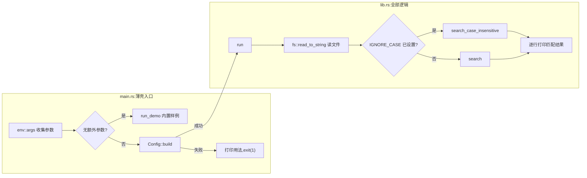

# MiniGrep CLI(CLI 工具 minigrep)

一句话:用纯标准库写一个简化版 grep——把命令行参数、文件 I/O、错误处理、生命周期、迭代器全部落地,并把逻辑拆进 lib、入口压成薄壳。

## 它解决什么问题

前面的知识点各管一段:参数怎么拿、文件怎么读、错误怎么传、借用怎么标。minigrep 把它们拼成一个真实程序——输入单词和文件路径,打印所有包含该单词的行,还能用环境变量切换大小写不敏感。

它同时演示工程划分:核心逻辑(Config、search、run)全放 lib.rs,可直接测试;main.rs 只做参数收集与错误兜底。这是 The Rust Book 第 12 章的项目。

## 核心规则



- lib 与 main 分离的收益:核心函数能被单元测试与集成测试直接调用,`cargo test -p minigrep_demo` 不必启动进程;
- 参数解析返回 `Result<Config, &'static str>` 而不是 panic,何时退出、以什么码退出由 main 决定;文件读取的 IO 错误经 `?` 装进 `Box<dyn Error>` 向上传播;
- `search<'a>` 的返回值借用 contents:结果直接指向输入文本,零复制。

## 示例

摘自 `30-minigrep/src/lib.rs`:

```rust
/// 配置：从命令行参数构造
/// 字段都为 owned 数据，避免持有引用带来的生命周期复杂度
pub struct Config {
    pub query: String,
    pub file_path: String,
    pub ignore_case: bool,
}

impl Config {
    /// 从迭代器构造配置
    /// 第一个参数是程序名，跳过
    pub fn build(mut args: impl Iterator<Item = String>) -> Result<Config, &'static str> {
        args.next(); // 跳过程序名

        let query = match args.next() {
            Some(arg) => arg,
            None => return Err("未提供查询字符串"),
        };

        let file_path = match args.next() {
            Some(arg) => arg,
            None => return Err("未提供文件路径"),
        };

        // 大小写不敏感：环境变量 IGNORE_CASE=1 开启
        let ignore_case = env::var("IGNORE_CASE").is_ok();

        Ok(Config { query, file_path, ignore_case })
    }
}

/// 大小写敏感搜索：返回所有匹配的行
/// 生命周期标注说明：返回的引用来自 contents
pub fn search<'a>(query: &str, contents: &'a str) -> Vec<&'a str> {
    contents
        .lines()
        .filter(|line| line.contains(query))
        .collect()
}
// ...(run、search_case_insensitive、run_demo 及单元测试略,见源码)...
```

## 源码解读

crate:`30-minigrep/src/lib.rs` 与 `30-minigrep/src/main.rs`,`cargo run -p minigrep_demo` 可运行。

| 小节 | 演示什么 | 关键行 |
|---|---|---|
| Config::build(lib.rs) | 用迭代器逐个取参数,缺参返回 Err 而非 panic | `None => return Err("未提供查询字符串"),` |
| ignore_case 开关 | 环境变量「存在即开启」,不解析取值 | `let ignore_case = env::var("IGNORE_CASE").is_ok();` |
| run(lib.rs) | 读文件失败经 `?` 传播,按开关二选一搜索后逐行打印 | `let contents = fs::read_to_string(&config.file_path)?;` |
| search 与 search_case_insensitive(lib.rs) | 迭代器链筛匹配行;不敏感版双方转小写再比较,各有一次分配 | `let query_lower = query.to_lowercase();` |
| run_demo(lib.rs) | 无参数时的内置样例,顺带演示 Config 缺参报错 | `Err(e) => println!("  预期错误: {}", e),` |
| main(main.rs) | 薄壳:参数错误打印用法并以退出码 1 结束,运行错误同样处理 | `process::exit(1);` |
| 单元测试(lib.rs) | 敏感、不敏感、无匹配、缺参各一条 | `assert_eq!(vec!["safe, fast, productive."], search(query, contents));` |

集成测试在 `30-minigrep/tests/integration_test.rs`,直接调用 lib 的公开 API。

## 实践项

| 练习 | 内容 | 对照组与评判标准 |
|---|---|---|
| [The Rust Book ch12 An I/O Project](https://doc.rust-lang.org/book/ch12-00-an-io-project.html) | 跟书从零实现一遍 minigrep,再与仓库版对比 | 对照组:`30-minigrep`;标准:缺参打印用法且退出码 1,IGNORE_CASE 切换生效,`cargo test -p minigrep_demo` 全绿 |
| [Rustlings 22_clippy](https://github.com/rust-lang/rustlings/tree/main/exercises/22_clippy) | clippy 补充练习:按 lint 提示改写代码 | 先自己写,再对照 [官方解答](https://github.com/rust-lang/rustlings/tree/main/solutions/22_clippy);标准:全绿,能说出每条 lint 在挑什么坏味道 |
| [Exercism Rust track](https://exercism.org/tracks/rust) | 挑一道文本处理题,用迭代器链加 Result 完成 | 标准:核心逻辑一条 `lines().filter().collect()` 链,无 unwrap,测试通过 |

## 避坑

- `'a` 只标在 contents 上是刻意的:返回的行借用自文件内容,query 只参与比较;若给 query 也加 `'a`,借用范围无谓扩大,编译器反而更容易拒绝。
- Config 字段存 owned String 而非 `&str`:省掉整个生命周期参数,几个字符串的复制成本可忽略;别为省一次 clone 换来一堆 `'a`。
- `IGNORE_CASE=0` 也会开启不敏感——`is_ok()` 只看变量存在与否。环境变量当布尔开关时,「存在即开启」的约定要写进提示并前后一致。

## 参考资料

- [Rust By Example - Result](https://doc.rust-lang.org/stable/rust-by-example/error/result.html)
- 本地旧笔记:`D:\Myknows\Myknows\原理\Rust\14-实战项目\01-Cli工具minigrep.md`(与本文持续同步)
