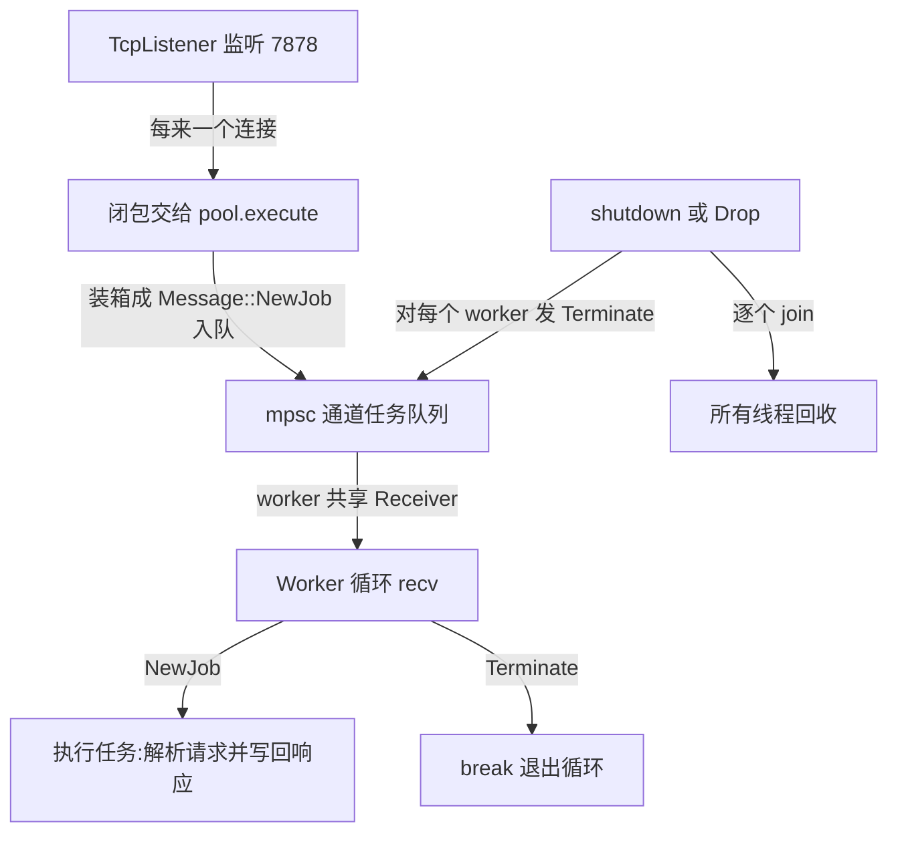

# Multithreaded Web Server(多线程 Web 服务器)

一句话:用纯标准库把 TcpListener 和自建线程池拼成一个能并发响应 HTTP 的服务器——channel、Arc/Mutex、trait 对象、Drop 在同一个程序里全部用上。

## 它解决什么问题

每来一个连接就 spawn 一个线程,程序能跑,但并发度随请求无上限增长,请求洪峰一来线程数先爆炸。线程池把并发度变成常量:预先建好固定数量的常驻 worker,每个连接的处理闭包排队入队,worker 轮流取用。

这是 The Rust Book 的压轴章:单线程版先看清局限,再改造成线程池版,前面学到的 channel、Mutex、Arc、Send 在这里从练习变成生产形态。

## 核心规则



- Job 是 `Box<dyn FnOnce() + Send + 'static>`:Box 抹平闭包类型差异才能装进同一条队列,Send 允许跨线程转移,'static 保证闭包不借用任何短命数据;
- Receiver 不能 clone,共享靠 `Arc<Mutex<Receiver>>`:Arc 让 4 个 worker 指向同一接收端,Mutex 保证一次只有一个 worker 取到任务;
- 优雅关闭不杀线程:发 Terminate 让 worker 自己退出循环再逐个 join,正在执行的任务能跑完。

## 示例

摘自 `31-web-server/src/lib.rs`:

```rust
/// 任务类型：一个可在线程中执行、可 Send 的闭包
type Job = Box<dyn FnOnce() + Send + 'static>;

/// 消息：要么是执行任务，要么是要求 worker 停止
enum Message {
    NewJob(Job),
    Terminate,
}

/// 线程池：固定数量的 worker 共享一个任务队列
pub struct ThreadPool {
    workers: Vec<Worker>,
    sender: Option<mpsc::Sender<Message>>,
}

impl ThreadPool {
    /// 创建线程池：必须 size > 0
    pub fn new(size: usize) -> ThreadPool {
        assert!(size > 0, "线程池大小必须 > 0");

        let (sender, receiver) = mpsc::channel();
        let receiver = Arc::new(Mutex::new(receiver));

        let mut workers = Vec::with_capacity(size);
        for id in 0..size {
            workers.push(Worker::new(id, Arc::clone(&receiver)));
        }

        ThreadPool {
            workers,
            sender: Some(sender),
        }
    }

    /// 提交一个任务到线程池
    pub fn execute<F>(&self, f: F)
    where
        F: FnOnce() + Send + 'static,
    {
        let job = Box::new(f);
        if let Some(ref sender) = self.sender {
            sender.send(Message::NewJob(job)).unwrap();
        }
    }

    /// 优雅关闭：发送 Terminate 给所有 worker，再 join
    pub fn shutdown(&mut self) {
        if let Some(sender) = self.sender.take() {
            for _ in &self.workers {
                sender.send(Message::Terminate).unwrap();
            }
        }
        for worker in &mut self.workers {
            if let Some(handle) = worker.thread.take() {
                if let Err(e) = handle.join() {
                    eprintln!("  worker {} join 失败: {:?}", worker.id, e);
                }
            }
        }
    }
}
// ...(impl Drop、Worker 与单元测试略,见源码)...
```

## 源码解读

crate:`31-web-server/src/lib.rs` 与 `31-web-server/src/main.rs`,`cargo run -p web_server_demo` 可运行。另开终端执行 `curl http://127.0.0.1:7878`(或浏览器访问)即可看到响应。

| 小节 | 演示什么 | 关键行 |
|---|---|---|
| Job 与 Message(lib.rs) | 任务=可跨线程执行的闭包;终止信号与任务走同一条通道 | `type Job = Box<dyn FnOnce() + Send + 'static>;` |
| ThreadPool::new(lib.rs) | 建通道、包 Arc/Mutex、逐个启动 worker;size=0 用 assert 拦截 | `let receiver = Arc::new(Mutex::new(receiver));` |
| execute(lib.rs) | 闭包装箱入队,跨线程要求写进签名的 trait bound | `sender.send(Message::NewJob(job)).unwrap();` |
| Worker::new(lib.rs) | 常驻线程循环取任务;锁的作用域只包住 recv | `let lock = receiver.lock().unwrap();` |
| shutdown 与 Drop(lib.rs) | 发 Terminate 后逐个 join;忘调 shutdown 时 Drop 兜底 | `sender.send(Message::Terminate).unwrap();` |
| main(main.rs) | bind 失败打印原因后退出;incoming 循环里每个连接丢进线程池 | `pool.execute(\|\| {` |
| handle_connection(main.rs) | BufReader 读请求首行,按路由取状态行与正文后写回;/sleep 睡 2 秒演示并发 | `std::thread::sleep(Duration::from_secs(2));` |
| parse_request(main.rs) | 拆请求行校验方法与路径,未知路径归 404 | `"/sleep" => Route::Sleep,` |
| 单元测试(lib.rs) | worker 数量、任务全执行、shutdown 后全部 join | `assert_eq!(pool.workers.len(), 4);` |

集成测试在 `31-web-server/tests/thread_pool_test.rs`,验证 100 个任务全部完成与 drop 时的优雅关闭。

## 实践项

| 练习 | 内容 | 对照组与评判标准 |
|---|---|---|
| [The Rust Book ch21.1 A Single-Threaded Web Server](https://doc.rust-lang.org/book/ch21-01-single-threaded.html) | 先跟书实现单线程版 | 标准:curl / 返回首页;连发第二个请求必须等第一个完成——亲眼看单线程的局限 |
| [The Rust Book ch21.2 Turning Our Single-Threaded Server into a Multithreaded Server](https://doc.rust-lang.org/book/ch21-02-multithreaded.html) | 自建 ThreadPool 替代每连接一线程 | 对照组:`31-web-server`;标准:`/sleep` 睡 2 秒期间 `/` 立即返回,`cargo test -p web_server_demo` 全绿 |
| [Exercism Rust track](https://exercism.org/tracks/rust) | 挑一道共享状态题,用 Arc 加 Mutex 加 mpsc 完成 | 标准:不靠 sleep 等待结果,测试反复运行稳定通过 |

## 避坑

- 锁只到取任务为止:Worker 里 `lock.recv()` 放在 `{}` 块内,锁在块尾释放;若把 guard 留到任务执行期间,其他 worker 全被堵住,线程池退化成单线程。
- 闭包 bound 是 `FnOnce + Send + 'static`:move 进来的 TcpStream 是 owned 数据没问题;捕获栈上借用会被编译器拒绝——这不是碍事,是在替你挡悬垂。
- 端口被占用时 bind 返回 Err:源码用 unwrap_or_else 打印原因再 exit(1);若换成 unwrap,「Address already in use」会变成一屏 panic 回溯。

## 参考资料

- [The Rust Book ch21 Final Project: A Web Server](https://doc.rust-lang.org/book/ch21-00-final-project-a-web-server.html)
- [Rust By Example - Box](https://doc.rust-lang.org/stable/rust-by-example/std/box.html)
