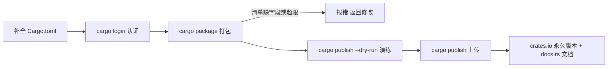

# Publishing to crates.io(发布到 Crates.io)

一句话:把 crate 按规矩补全清单、打包演练、上传官方注册中心,让任何人 `cargo add` 就能用。

## 它解决什么问题

minigrep 和 web server 都活在本地仓库里,别人想复用只能拷代码。crates.io 是 Rust 的官方包注册中心,发布之后你的 crate 有了三样东西:全站唯一的名字、不可变的版本号、由 docs.rs 自动生成的文档页面。发布全程不写业务代码,只跟清单字段和 cargo 命令打交道,但每一步都是硬检查——漏一个必填字段,上传直接被拒。

## 核心规则

发布是一条单向流水线:检查不过不打包,演练不过不上传,上传之后版本永久占用。



上传前 cargo 校验清单四项必填:`name` 全站唯一、`version` 遵循 semver、`description` 一句话简介、`license` 用 SPDX 标识符;缺任何一项 `cargo publish` 直接拒绝,其余字段(repository、readme、keywords)只影响展示效果。

## 示例

Cargo.toml 的 `[package]` 段,发布所需的关键字段:

```toml
[package]
name = "my_grep"                    # 全站唯一,先到先得
version = "0.1.0"                   # semver,发布后该号永久占用
edition = "2021"
description = "A minimal line-search library"   # 必填
license = "MIT"                     # 必填,SPDX 标识符
repository = "https://github.com/you/my_grep"
readme = "README.md"
keywords = ["search", "cli"]        # 最多 5 个,每个不超过 20 字符
```

发布全流程命令:

```bash
# 1. 认证:token 在 crates.io 账户设置页生成,粘贴进交互提示即可,
#    不要写进命令参数——会留在 shell 历史
cargo login

# 2. 演练:校验清单字段,产出 target/package/*.crate,不上传
cargo publish --dry-run
cargo package --list              # 列出将打包的文件,防止误带本地内容

# 3. 正式发布
cargo publish

# 4. 作废已发布版本:yank 后新项目解析不到它,已依赖者不受影响
cargo yank --vers 0.1.0
cargo yank --vers 0.1.0 --undo    # 撤销 yank
```

## 实践项

| 练习 | 内容 | 对照组与评判标准 |
|---|---|---|
| [Cargo Book - Publishing](https://doc.rust-lang.org/cargo/reference/publishing.html) | 对照官方发布文档逐节核对,给任一本地 crate 补全 `[package]` 必填字段,完整走一遍 dry-run | 标准:`cargo publish --dry-run` 无警告通过,target/package 下出现 .crate 产物,`cargo package --list` 里没有密钥与本地敏感文件 |
| [Exercism Rust track](https://exercism.org/tracks/rust) | 把一道已完成的题整理成可发布的小库:补全清单、写 README、做 dry-run | 标准:四项必填字段齐全,dry-run 通过;被问「发布后想作废怎么办」能答出 yank 的语义与局限 |

## 避坑

- 版本不可覆盖:上传成功后同号永久占用,发现 bug 不能重发,只能升号再发;要作废某版本用 `cargo yank`,它既不删除也不影响已依赖者,只是让新项目解析不到。
- `license` 必须是 SPDX 标识符:写 `MIT` 能过,写 `MIT License` 或自由文本会被拒;双协议用 `MIT OR Apache-2.0` 表达。
- 发布即公开:.crate 包对所有人可见且会被镜像同步,打包前用 `cargo package --list` 确认没有密钥、凭据文件混进去;`cargo login` 存下的 token 在本地凭据文件里,别提交进仓库。

## 参考资料

- [Cargo Book - Publishing](https://doc.rust-lang.org/cargo/reference/publishing.html)
- [The Rust Book ch1.3 Hello, Cargo!](https://doc.rust-lang.org/book/ch01-03-hello-cargo.html)
